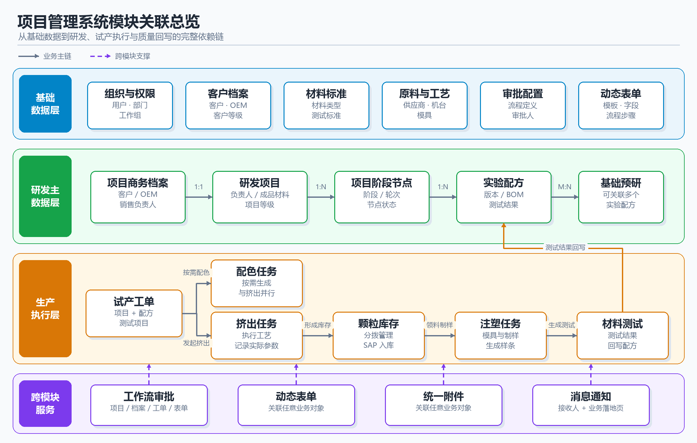
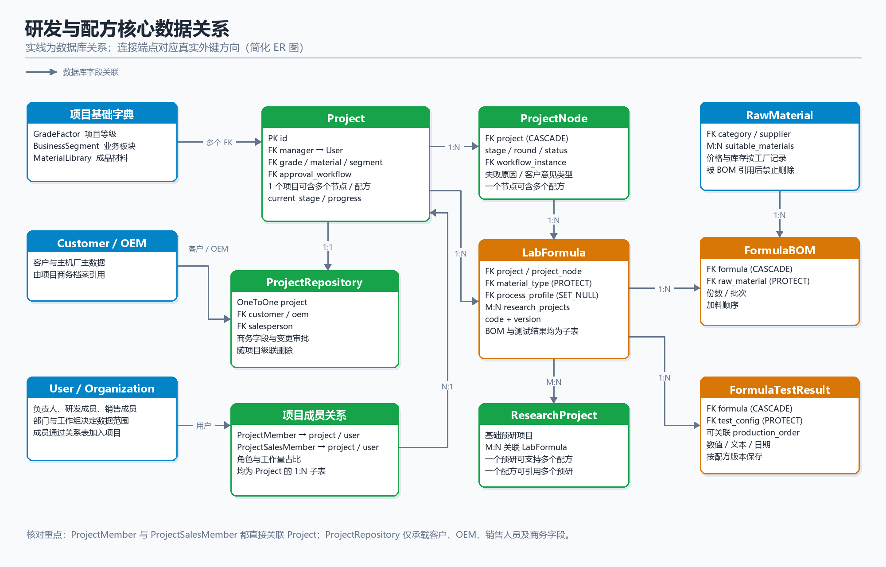
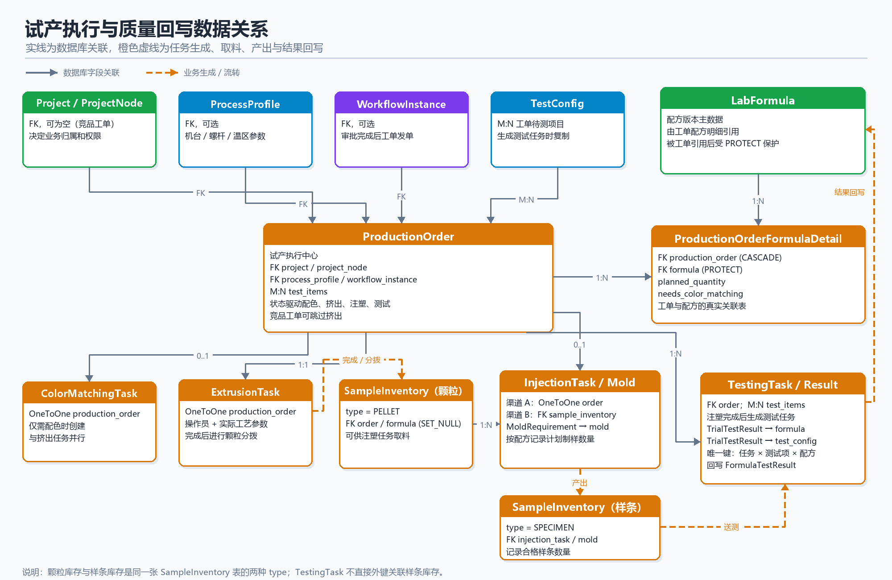
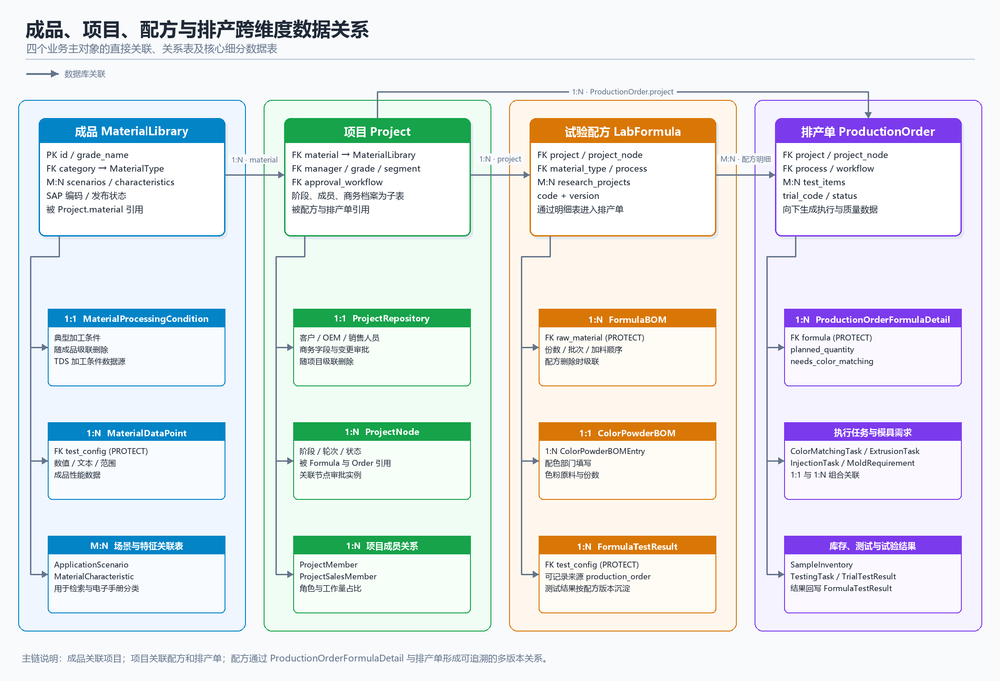

# 项目管理系统用户操作手册

> 文档版本：2.0
>
> 适用系统：Django_manage 项目管理系统
>
> 更新日期：2026-11-18
>
> 适用对象：研发、销售、工艺、试产、配色、注塑、测试、审批及系统管理人员

## 目录

- [1. 手册说明](#1-手册说明)
- [2. 模块关联与数据准备](#2-模块关联与数据准备)
- [3. 快速开始](#3-快速开始)
- [4. 界面与通用操作](#4-界面与通用操作)
- [5. 权限与数据范围](#5-权限与数据范围)
- [6. 推荐业务流程](#6-推荐业务流程)
- [7. 看板工作台](#7-看板工作台)
- [8. 项目管理中心](#8-项目管理中心)
- [9. 客户档案中心](#9-客户档案中心)
- [10. 基础预研中心](#10-基础预研中心)
- [11. 材料成品库](#11-材料成品库)
- [12. 实验配方库](#12-实验配方库)
- [13. 试验排产中心](#13-试验排产中心)
- [14. 挤出排产中心](#14-挤出排产中心)
- [15. 材料配色中心](#15-材料配色中心)
- [16. 模具注塑中心](#16-模具注塑中心)
- [17. 材料测试中心](#17-材料测试中心)
- [18. 生产工艺库](#18-生产工艺库)
- [19. 原材料与供应商](#19-原材料与供应商)
- [20. 表单管理中心](#20-表单管理中心)
- [21. 流程审批中心](#21-流程审批中心)
- [22. 官网产品目录](#22-官网产品目录)
- [23. 通知与个人中心](#23-通知与个人中心)
- [24. 系统管理](#24-系统管理)
- [25. 状态速查](#25-状态速查)
- [26. 常见问题](#26-常见问题)
- [27. 操作检查清单](#27-操作检查清单)
- [附录 A 操作入口速查](#附录-a-操作入口速查)

---

## 1. 手册说明

本手册适用于研发、销售、工艺、试产、配色、注塑、测试、审批人员及系统管理员，说明从基础资料准备、项目与配方研发，到试产执行、结果回写、成品发布的日常操作。文档版本 2.0，更新日期为 2026-11-18。

所有业务操作均从页面可见的菜单、按钮、链接或拖拽区域进入。每项操作先说明入口，再说明所需条件、填写内容和完成后的检查方式。图标按钮以悬停提示或弹窗标题辨认。菜单按账号权限和后台启用状态显示，实际显示顺序也可由管理员调整。

### 1.1 使用约定

- **加粗文字**表示页面上的菜单、按钮、页签或字段。步骤中的“→”表示逐级点击。
- 操作前核对项目、阶段、轮次、实验单号及版本。配方版本、BOM 替代组和生产批次分别标识不同信息，不能混用。
- **保存草稿**、**保存修改**、**提交审批**和 BOM **发布**的结果不同。保存业务数据不代表审批通过，也不代表已写入 SAP 或已对外发布。
- 页面按钮由业务状态、模块权限和对象归属共同决定。先确认正在正确页面，再检查状态和权限。
- 查看页面提示和字段错误后再提交。保存成功应重新核对详情页；遇到外部服务超时，先查询实际结果，避免重复写入。
- 本手册供日常使用；练习及验收任务见配套的[用户系统操作任务](用户系统操作任务.md)。业务入口及新功能以本手册对应章节为准。

### 1.2 按职责阅读

| 使用人员 | 建议先读 | 常用后续章节 |
|---|---|---|
| 首次使用者 | 3 快速开始、4 界面与通用操作、5 权限与数据范围 | 附录 A 操作入口速查 |
| 研发及项目负责人 | 2 数据准备、8 项目、12 配方 | 13 工单、17 测试、11 材料发布 |
| 销售与客户档案人员 | 9 客户档案、8 项目协作 | 7 看板、22 官网目录、23 通知 |
| 工艺及挤出人员 | 18 生产工艺、13 工单、14 挤出 | 19 原材料、13 库存 |
| 配色人员 | 15 配色、12 配方及 BOM | 14 挤出、11 SAP BOM 发布 |
| 注塑及测试人员 | 16 注塑、17 测试 | 13 工单、25 状态速查 |
| 审批及管理人员 | 20 表单、21 审批 | 7 看板、8 绩效 |
| 系统管理员 | 5 权限、24 系统管理 | 22 接口对接、各章操作前置条件 |

### 1.3 先定位页面再操作

新建试产的完整链路是：**项目管理中心 → 项目列表 → 项目详情 → 查看配方 → 配方过程 → 试验排产 → 创建工单**。**排产总览**用于查找工单，不提供“新建工单”按钮。客户竞品使用配方过程页的**新增客样**。详情步骤见第 13 章。

**首页**与**个人工作台**是不同页面；**排产日历**与**排产工作台**也有不同操作范围。项目档案在项目详情页维护，等级因子从**系统管理设置 → 项目等级因子设置**维护。更多入口见附录 A。

---

## 2. 模块关联与数据准备

本章用于回答“创建这条数据之前，系统中必须先有什么”。系统中的项目、配方、工单、任务和测试结果不是相互独立的数据；上游主数据缺失时，下游页面可能没有可选项，或者无法提交、审批和生成后续任务。

### 2.1 关系符号与使用原则

| 符号/规则 | 含义 | 业务示例 |
|---|---|---|
| `1:1` | 一条数据只对应另一条数据 | 一个研发项目对应一个项目商务档案 |
| `1:N` | 一条主数据可以对应多条明细 | 一个项目可以包含多个阶段节点和多个配方 |
| `M:N` | 两边都可以关联多条数据 | 多个配方可以关联多个基础预研项目 |
| 必须前置 | 页面保存或提交时必须存在 | 配方 BOM 使用的原材料、工单使用的配方版本 |
| 建议前置 | 系统允许暂时不选，但会影响后续处理 | 工艺方案、模具、完整的组织信息 |
| 自动生成 | 完成上一步后由系统产生 | 按发单、开始挤出、分拨及注塑完成等节点生成相应任务 |

数据库关系中的删除规则会直接影响页面操作：

- `PROTECT`：数据已经被业务记录引用，系统禁止直接删除，以保护历史数据。
- `SET_NULL`：删除被关联的数据后，历史记录仍保留，但对应关联会显示为空。
- `CASCADE`：删除主记录时，其专属明细同步删除，操作前必须确认影响范围。

用户不需要记忆数据库字段名。遇到下拉框无数据或删除失败时，可根据本章先检查上游数据是否已创建、启用并在当前账号的数据范围内。

### 2.2 模块依赖总览

系统数据按四层关系组织：

1. **基础数据层**：组织权限、客户/OEM、材料标准、原材料、设备工艺、审批流程和表单模板，为后续业务提供可选项。
2. **研发主数据层**：项目商务档案、研发项目、阶段节点、实验配方和基础预研构成研发过程主链。
3. **生产执行层**：试产工单根据项目和配方生成配色、挤出、注塑与材料测试任务，并形成颗粒、样条和测试结果。
4. **跨模块服务**：工作流、动态表单、附件和通知可关联多个业务模块，不独立替代业务主数据。

> 建议先完善基础数据，再创建项目和配方，最后发起试产。不要为解决“下拉框没有选项”而重复新建同名数据，应先检查权限、启用状态和数据归属。

### 2.3 研发与配方数据关系

| 主数据 | 关联数据 | 关系 | 对用户操作的影响 |
|---|---|---|---|
| 研发项目 `Project` | 项目商务档案 `ProjectRepository` | `1:1` | 客户、OEM、销售人员和商务信息通过项目档案维护 |
| 研发项目 `Project` | 项目阶段 `ProjectNode` | `1:N` | 项目推进时按阶段和轮次创建节点，配方和工单可归属具体节点 |
| 研发项目 `Project` | 项目成员 `ProjectMember` | `1:N` | 负责人、研发成员和工作量分配影响数据权限与绩效统计 |
| 研发项目 `Project` | 实验配方 `LabFormula` | `1:N` | 项目可有多个实验单号及多个配方版本 |
| 项目阶段 `ProjectNode` | 实验配方 `LabFormula` | `1:N` | 在项目阶段内创建的配方自动带入项目和节点归属 |
| 实验配方 `LabFormula` | 配方 BOM `FormulaBOM` | `1:N` | 每个配方版本分别维护原材料、份数、批次和加料顺序 |
| 原材料 `RawMaterial` | 配方 BOM `FormulaBOM` | `1:N` | 原材料被 BOM 引用后不可直接删除 |
| 实验配方 `LabFormula` | 配方测试结果 `FormulaTestResult` | `1:N` | 测试任务完成或手动回写后，结果沉淀到对应配方版本 |
| 实验配方 `LabFormula` | 基础预研 `ResearchProject` | `M:N` | 一个配方可引用多个预研成果，一个预研项目也可支持多个配方 |

新建配方主记录必须有基材类型，填写实际 BOM 前还需准备原材料；从项目节点新增时，应先有项目、阶段节点及选用成品材料，成员按需维护。需要核算成本时，原材料还应具备相应工厂和期间的价格记录。

### 2.4 试产执行与质量回写关系

试产工单 `ProductionOrder` 是执行链中心：

1. 工单关联项目、项目阶段、一个或多个配方版本、工艺方案、测试项目和审批流程。
2. 每个选中配方形成一条工单配方明细，记录计划产量及是否需要配色。
3. 普通工单发单后生成挤出任务；从工单详情开始挤出时联动生成所需配色任务。完成挤出后，还需办理颗粒分拨，才能登记对应库存。
4. 普通工单完成颗粒分拨后，按已填模具需求生成注塑任务；客样工单则在审批发单后进入注塑。完成注塑时结合模具和各版本数量登记样条。当前库存页没有独立新建注塑任务入口。
5. 需要测试时，系统根据工单测试项目生成测试任务；结果按“配方版本 × 测试标准”记录，并回写配方测试结果。

工单一旦进入投产，配方版本结构和关键关联会受到限制。修改工单前应先确认当前审批、任务、库存和测试状态，避免出现执行记录与计划不一致。

### 2.5 成品、项目、配方与排产跨维度关系

这四个业务维度通过以下关系贯通：

- 成品材料 `MaterialLibrary` 被项目的 `material` 字段引用；同一成品可用于多个项目。
- 项目 `Project` 向下包含商务档案、阶段节点和成员关系；配方与排产单都可以归属项目及具体阶段节点。
- 试验配方 `LabFormula` 通过 `ProductionOrderFormulaDetail` 与排产单形成多对多业务关系，同一排产单可以选择多个配方版本，同一配方版本也可以被多个排产单引用。
- 排产单 `ProductionOrder` 除配方明细外，还向下关联配色、挤出、注塑、库存、测试任务和试验结果。

图中每个主维度下方列出了最重要的细分数据表。创建下游数据时，应沿主链向左检查成品、项目、节点和配方版本是否已存在且状态可用。

### 2.6 推荐建数顺序

首次启用系统或开展一类新业务时，建议按以下顺序准备数据：

1. **组织与权限**：子公司/基地 → 部门 → 工作组 → 用户 → 角色/权限组 → 组织角色和评审组。
2. **审批与通用配置**：流程定义 → 审批人/候选组 → 表单模板 → 通知配置。
3. **标准与分类**：材料类型 → 应用场景/特性 → 指标类别 → 测试标准 → 项目等级/业务板块。
4. **客户主数据**：客户 → OEM → 销售人员归属及项目商务字段。
5. **原材料主数据**：原材料类型 → 原材料，并按需关联供应商 → 工厂价格/库存记录。
6. **生产资源**：机台型号 → 螺杆组合 → 工艺方案 → 模具台账。
7. **成品材料**：材料牌号 → 加工条件 → 性能数据点 → 发布资料与附件。
8. **研发业务**：研发项目 → 项目成员及商务档案 → 阶段节点；独立探索可先建基础预研。
9. **配方业务**：实验单号与版本 → 原材料 BOM → 色粉 BOM → 初始测试结果。
10. **试产执行**：试产工单 → 审批发单 → 配色/挤出 → 颗粒分拨 → 注塑 → 测试 → 结果回写。

### 2.7 各模块前置数据矩阵

| 模块 | 准备/创建对象 | 必须先有 | 建议先有 | 后续关联或自动数据 |
|---|---|---|---|---|
| 看板工作台 | 统计和待办视图 | 用户账号及模块权限 | 完整部门、工作组和业务归属 | 汇总项目、工单、流程、通知等数据 |
| 项目管理中心 | 研发项目 | 内部账号、项目名称；负责人由系统记录 | 项目等级、成品材料、业务板块、审批流程、客户/OEM、项目成员 | 项目档案、阶段节点、配方、工单、绩效 |
| 客户档案中心 | 客户、OEM、项目档案 | 有权限的销售/管理账号 | 客户等级、销售负责人、审批流程 | 被项目、竞品工单和商务分析引用 |
| 基础预研中心 | 预研项目 | 内部账号、项目名称；负责人自动记录 | 项目背景、阶段标准和实验资料 | 可与多个实验配方关联 |
| 材料成品库 | 成品材料 | 材料牌号、唯一 SAP 物料号、材料类型 | 应用场景、特性、测试标准、加工条件 | 项目选材、性能数据、TDS、对外发布 |
| 实验配方库 | 配方版本和 BOM | 配方名称、基材类型；实际录入 BOM 时需要原材料 | 项目/节点、工艺方案、预研项目、原料价格 | 工单配方明细、色粉 BOM、成本与测试结果 |
| 试验排产中心 | 试产工单 | 项目、阶段节点、配方版本 | 工艺方案、测试标准、模具、审批流程 | 配色/挤出/注塑/测试任务及库存 |
| 挤出排产中心 | 挤出执行记录 | 已发单的试产工单 | 操作员、机台、螺杆、工艺参数 | 颗粒库存、分拨记录和后续注塑取料 |
| 材料配色中心 | 配色任务/色粉 BOM | 已存在的项目配方；工单任务还需标记需要配色并开始挤出 | 色粉原材料和配色人员 | 配色完成状态与配方色粉 BOM |
| 模具注塑中心 | 注塑任务 | 已分拨且有模具需求的普通工单，或已发单的客样工单 | 模具、各配方制样数量、注塑参数 | 样条库存和材料测试任务 |
| 材料测试中心 | 测试任务与结果 | 工单、配方、测试标准 | 合格样条、测试负责人、测试日期 | 试验结果并回写配方测试结果 |
| 生产工艺库 | 工艺方案 | 方案名称、工艺类型及表单必填参数 | 机台、螺杆组合、适用材料类型、温区和速度参数 | 被配方和试产工单引用 |
| 原材料/供应商 | 原材料 | 原材料名称、所属类型 | 供应商、内部编码、适用材料类型、工厂、价格和库存 | 配方 BOM、成本计算和 SAP 数据 |
| 表单管理中心 | 表单提交 | 已启用的表单模板及字段 | 分步配置、审批流程、业务对象 | 草稿、提交记录、审批实例和附件 |
| 流程审批中心 | 流程实例/任务 | 已启用的流程定义 | 审批人、候选组、组织角色 | 待办、已办、状态回写和通知 |
| 官网产品目录 | 已发布的成品材料 | CRM 调用方、有效目录服务密钥、已发布材料 | 牌号、分类、物性、TDS/MSDS/RoHS | 由 CRM 调用 /api/catalog/v1/ 渲染官网页面 |
| 通知与个人中心 | 通知和个人资料 | 用户账号 | 正确邮箱、组织及角色信息 | 接收审批、任务和业务变更提醒 |
| 系统管理 | 权限与基础配置 | 超级管理员或相应管理权限 | 变更方案和影响范围确认 | 影响菜单、数据范围、审批和全模块选项 |

### 2.8 常用场景前置检查

**新建研发项目**

- [ ] 项目负责人账号已启用，且所属子公司、部门和工作组正确
- [ ] 业务需要的项目等级、业务板块和目标成品材料已维护，非必填项可后补
- [ ] 客户和 OEM 已存在，销售负责人可选
- [ ] 项目审批流程已启用并配置审批人
- [ ] 计划加入的研发/销售成员已获得相应数据权限

**新建实验配方**

- [ ] 材料类型已维护
- [ ] 所需原材料、类别和供应商已维护
- [ ] 需要归属正式研发时，项目及当前阶段节点已创建
- [ ] 需要引用工艺时，机台、螺杆和工艺方案已维护
- [ ] 需要显示成本时，原材料价格、工厂和有效期间已维护

**新建试产工单**

- [ ] 项目、节点、实验单号和配方版本状态可用
- [ ] 各配方版本计划产量及配色需求已确认
- [ ] 工艺方案和操作员可选
- [ ] 所需模具存在且状态可用，制样数量已确认
- [ ] 测试标准已维护并完成选择
- [ ] 工单审批流程和审批人配置有效

**完成测试并发布材料**

- [ ] 注塑已形成可用样条，或已确认测试样品来源
- [ ] 测试任务中的配方版本和测试项目正确
- [ ] 测试值、单位、日期及备注已复核并回写
- [ ] 成品材料已关联正确的性能数据点和加工条件
- [ ] TDS/SDS 等附件及中英文发布信息完整

### 2.9 删除与变更影响

| 操作对象 | 可能影响 | 建议处理方式 |
|---|---|---|
| 原材料 | 已被配方 BOM 引用时受 `PROTECT` 保护，不能直接删除 | 保留被引用的历史原料；新配方按规则改用替代原料，资料调整请联系维护人员 |
| 配方版本 | 已被工单配方明细引用时受保护，投产后还可能被业务锁定 | 保留历史版本，新建版本进行调整 |
| 测试标准 | 已形成配方测试结果时受保护 | 保留已引用的标准，新增标准前先核对，不覆盖历史定义 |
| 项目/节点 | 关联配方、工单、成员、审批和绩效数据 | 优先终止或关闭，不直接删除正式项目 |
| 客户/OEM/负责人等可选关联 | 部分关系允许置空，历史记录仍保留 | 变更前先确认报表和责任归属是否受影响 |
| 项目专属明细 | 部分明细随主记录级联删除 | 删除草稿主记录前查看明细、附件和审批状态 |
| 流程定义、表单模板 | 新业务可能无法提交，历史实例仍需保留 | 已使用配置应停用并新建版本，避免直接删除 |

正式业务数据通常应通过“停用、下架、终止、作废或新建版本”处理。只有确认数据未被引用且属于测试/草稿时，才执行删除；页面提示存在关联时，应停止操作并联系管理员核对。

---

### 2.10 版本、组合物料与替代原料

| 名称 | 使用位置 | 核对重点 |
|---|---|---|
| 实验单号 | 项目配方过程、配方编辑、工单 | 同一次实验的多个版本按实验单归组 |
| 版本 | 配方编辑列、工单配方明细、测试结果列 | v1、v2 等分别保留配方与试产数据 |
| 替代组 | 组合物料的 BOM 原材料行 | 按用途可能性分摊，或在本地按优先级 1 原料计算；总份数只计一组 |
| 组合物料 | 新建配方的编辑模式 | 每次编辑一个版本，允许设置替代组；保存后不能与普通模式互相切换 |
| 批次 | 工单与样品库存 | 区分同一配方在不同工单中的生产记录 |

原有四张关系图展示主链关系；组合料、替代组和 SAP BOM 发布的详细操作见第 11、12、15 章。官网目录现由 CRM 读取已发布材料，图中“电子手册”表示对外资料用途，不代表本系统还有独立浏览站点。

---

## 3. 快速开始

### 3.1 登录系统

操作入口：打开管理员提供的管理系统地址，进入登录页。

1. 如果先出现浏览器安全验证页，按提示完成滑块操作，点击**确认并跳转**。
2. 在登录页输入管理员登记的**工号**和密码。工号按登记内容填写，包含字母时注意大小写。
3. 输入图形验证码；看不清时点击验证码图片刷新，再输入新图片中的字符。
4. 按需勾选**在此设备上保持登录**。未勾选时，关闭浏览器后会话按系统设置结束；勾选后的有效时长仍受系统会话配置限制。
5. 点击**登录**，成功后进入首页。

管理系统使用工号登录。用户名用于账号资料和部分业务显示，邮箱用于注册和找回密码，均不能替代登录页的工号。普通账号必须启用，并具有启用的内部业务角色；注册成功本身不等于已经获得登录和业务访问资格。客户、主机厂不通过本系统的会员页面登录官网目录。

连续失败可能触发临时锁定。出现锁定提示时，按页面提示等待后重试；工号、密码或内部角色不明确时联系管理员。

### 3.2 注册账号

操作入口：登录页 → **立即注册**。

1. 按提示完成浏览器安全验证。
2. 输入管理员提供的邀请码、用户名和邮箱。
3. 输入图形验证码，点击**发送验证码**，到所填邮箱查收邮件。
4. 输入邮箱验证码，设置密码并再次确认。
5. 点击**创建账户**，以注册结果页或错误提示为准。
6. 注册成功后，请管理员补齐工号、内部业务角色、部门、工作组、用户等级及业务权限，再返回登录页使用工号登录。

未配置邀请码时会提示系统暂未开放注册，此时由管理员创建账号或开放注册。注册页不提供工号和业务权限的自行申请或分配。发送邮箱验证码后，应使用同一浏览器会话完成注册，并保持邮箱与发送时一致；建议统一使用小写且不带首尾空格的邮箱。

### 3.3 忘记密码

操作入口：登录页 → 密码栏旁的**忘记密码？**。

1. 输入账号登记的邮箱和图形验证码。
2. 点击**发送验证码**，查收邮件；同一邮箱或同一 IP 的发送间隔至少为 60 秒。
3. 在当前浏览器会话输入邮箱验证码、新密码和确认密码。
4. 点击**重置密码**。成功后返回登录页，用原工号和新密码登录。

发送提示不会用于确认某个邮箱是否已注册。未收到邮件时，核对邮箱、垃圾邮件及发送间隔；仍无结果时联系管理员。新密码须满足页面校验要求。邮箱遗失、工号未登记或账号被停用，需要管理员处理，重置密码不会自动补齐这些条件。

### 3.4 首次登录检查

1. 点击右上角头像或用户名 → **个人中心**，核对工号、姓名、邮箱、部门、子公司/基地、角色和工作组。
2. 有相应菜单时，进入**看板工作台 → 个人工作台**，查看本人待办、草稿、提交记录和发起的流程。
3. 点击右上角通知铃铛，查看未读消息；从消息跳转后仍须完成对应业务操作。
4. 检查实际需要的菜单和按钮。资料错误、菜单缺失或数据范围异常时，将工号、页面地址、业务编号和期望操作交给管理员核对。

个人中心以资料展示为主，不提供自行修改部门、角色、工作组和业务权限的入口。

---

## 4. 界面与通用操作

### 4.1 左侧导航

左侧导航由启用的菜单配置、角色准入和各子项权限共同决定。不同账号看到的模块与子菜单可能不同；某模块没有任何可见子项时，整个模块可能不显示。以下为标准菜单清单，实际以管理员配置后的页面为准。

| 一级菜单 | 子菜单 |
|---|---|
| 首页 | 返回系统首页 |
| 看板工作台 | 个人工作台、系统总览、项目全景看板、项目统计看板、客户行为分析 |
| 项目管理中心 | 项目列表、成员绩效看板、项目评分规则、业务板块类型、不合格原因类型、客户意见类型 |
| 客户档案中心 | 客户资料库、客户评分排行、主机厂(OEM)库 |
| 基础预研中心 | 预研项目管理 |
| 材料成品库 | 成品材料列表、材料类型分类、材料特性分类、应用场景分类、测试标准配置、测试分类 |
| 实验配方库 | 实验配方列表 |
| 试验排产中心 | 排产总览、成品颗粒库存、排产日历 |
| 挤出排产中心 | 排产工作台、挤出任务 |
| 材料配色中心 | 配色任务、产品项目 |
| 模具注塑中心 | 注塑任务、样品库存、模具台账 |
| 材料测试中心 | 测试任务、样条库存 |
| 生产工艺库 | 工艺方案列表、机台型号管理、螺杆组合管理 |
| 原材料/供应商 | 原材料列表、原材料类型分类、供应商资料库 |
| 表单管理中心 | 创建表单、我的表单草稿、我的表单提交、表单模板管理 |
| 流程审批中心 | 我的待办任务、我的已办任务、我发起的流程、流程定义管理 |
| 系统管理设置 | 项目全局配置、排产配置、项目等级因子设置、进入底层管理 |

**系统管理设置**的默认侧栏仅对超级管理员显示。获授权进入底层管理的其他管理员，可能需要使用管理员提供的后台地址，不一定看到该侧栏。

客户档案中心没有独立的“项目档案”子菜单，项目档案应从相应项目业务页面进入。

### 4.2 顶部工具和辅助入口

| 入口 | 操作与结果 |
|---|---|
| 工艺系统 | 点击**工艺系统**，在新标签页打开外部工艺系统；后续登录和操作由该系统决定 |
| 配方对比清单 | 具备对应角色条件时显示，点击进入配方对比相关页面 |
| 明暗模式图标 | 点击切换界面明暗显示 |
| 通知铃铛 | 查看未读消息，具体见第 23 章 |
| 头像或用户名 | 展开用户菜单，进入**个人中心**或点击**退出登录** |
| 辅助工具中的 AI 智能助手 | 当前是占位链接，点击不能进入可用的聊天页面 |

顶部搜索框当前不能完成有效的关键词搜索。查找业务记录请进入对应模块的列表页，使用该列表提供的搜索或筛选条件。

外部 MCP 客户端的 AI 数据查询与左侧**AI 智能助手**占位入口不同，连接方法见 23.5。

### 4.3 列表页检索和分页

1. 从左侧菜单进入目标列表。
2. 使用该页提供的关键词、模板、状态、分类、日期等条件。各页可搜索字段不同，不能默认所有列表均支持工号、业务编码或附件名搜索。
3. 点击页面实际提供的**搜索**或**筛选**；需要清空时点击**重置**。
4. 使用底部分页查看其他记录。筛选后无结果时，先清空条件，再核对账号权限和记录状态。
5. 点击记录名称、**查看详情**或相应图标进入详情。鼠标停在图标上可查看操作提示；仅在显示对应功能时进行编辑、删除等操作。

列表中有记录，不代表一定具有编辑、附件修改或审批权限。审批、提交、回写等操作完成后，刷新列表确认最新状态，避免重复提交。

### 4.4 填写字段和选择人员

- 搜索型下拉框应先输入关键词，再点击候选结果完成选择。仅输入文本通常没有保存关联对象。
- 多选字段可选择多个标签，移除标签后按该页要求保存。
- 日期、数值、文本和选项按字段提示录入，提交失败时查看顶部消息和字段校验提示。
- 有明细行的页面，按页面提供的新增、移除控件操作，再保存整张业务表单；附件可能独立即时保存，不能一概视为整表提交后才生效。
- 人员树仅在业务页面调用时出现。展开组织节点或按姓名、用户名检索，选择人员后点击**确认**。能搜到某人不代表该人具备接收任务、查看表单或执行审批的权限。

### 4.5 附件

在业务详情的附件区域或动态表单的上传字段操作，具体控件以所在页面为准。

1. 点击上传控件；页面支持拖拽时，也可将文件拖入指定区域。
2. 等待上传结果，确认附件已出现在列表或字段中。失败时先检查页面提示、格式、大小、网络和当前对象的修改条件。
3. 点击文件名或下载控件获取文件；只有页面明确提供预览时才使用预览。
4. 删除前确认附件、业务对象和字段无误，再使用删除控件并确认结果。

动态表单附件上传成功后会立即关联到当前记录，无需等待点击**保存草稿**或**提交**。离开页面或取消填写不会自动撤销已成功的上传。动态表单附件删除会实际删除附件，不能按“暂存到回收站”处理。

草稿和退回发起人修订阶段，附件由表单提交者修改；已提交的多步表单，仅当前节点负责人可修改其负责步骤的附件。已提交的单步表单不能据此继续增删附件。查看权限与修改权限应分别判断。

---

## 5. 权限与数据范围

### 5.1 权限如何影响操作

系统按模块和业务对象组合判断访问条件。下表说明各层含义，各模块还可能有自己的负责人、成员、审批人及状态限制。

| 条件 | 含义及常见表现 |
|---|---|
| L1 角色准入 | 内部业务角色须启用，并被该模块允许的角色分组包含；模块未配置、停用或准入为空时，普通用户不能进入 |
| L2 等级准入 | 用户等级须达到模块或菜单子项要求；有菜单不代表能够通过所有页面的等级检查 |
| L3 操作权限 | 查看、新增、修改、删除是不同权限；通常由权限角色组分配，也可由管理员单独授权 |
| L4 部门隔离 | 启用时限制数据范围；拥有者、本人及模块特殊规则会参与判断，不能简单理解为同部门所有数据均可编辑 |
| L5 工作组隔离 | 启用时根据本人、工作组成员及模块规则限制数据；部分模块配置了达到指定等级后跳过隔离 |
| 对象与状态条件 | 是否为负责人、协同成员、提交者、当前审批人，以及对象是否已提交、已结束或锁定 |

超级管理员在通用业务准入中有豁免，但部分业务操作仍有当前负责人、提交者、对象状态等专门条件。不要将超级管理员等同于任何页面上的所有操作均可成功。

### 5.2 区分角色、分组和审批职责

| 配置 | 用途 | 不能替代的条件 |
|---|---|---|
| 用户角色 | 研发、销售等业务身份及内部成员标记 | 不自动赋予全部增删改查权限 |
| 角色分组 | 将多个业务角色组成模块准入范围 | 不等于 Django 权限组 |
| 权限角色组（Django 用户组） | 汇总查看、新增、修改、删除等具体权限 | 不自动解决部门、工作组或对象权限 |
| 工作组 | 协作组织与 L5 数据范围，也可参与审批人解析 | 不等于审核组 |
| 审核组 | 提供候选审批人，可能形成待签收任务 | 不自动获得业务模块和表单查看权限 |
| 组织角色及组织角色指派 | 在工作组、部门、子公司/基地内指定组长、经理等审批职责 | 不等于用户的 L1 业务角色 |

子公司/基地不直接作为通用 L4 部门隔离条件，但会参与按组织职责解析审批人。调整组织归属前，应同时核对审批职责。

### 5.3 表单与流程的查看、处理条件

表单详情供提交者、已分配过该表单流程任务的人员及超级管理员访问，同时仍需满足表单模块准入和查看权限。候选人尚未签收时，可能看得到待办，却不能打开业务表单；应先在待办列表**签收**。

查看流程与处理当前任务是不同操作。审批人应同时具有流程模块、相关业务模块和必要操作权限。加入候选审核组不等于自动具有表单查看、签收或退回权限。

默认列表和详情的权限范围可能存在业务差异。选择框有选项、通知有链接或菜单可见，都不能作为已经获得业务授权的依据。

### 5.4 权限不足时的处理

1. 确认正在使用自己的工号账号，并打开右上角用户菜单 → **个人中心**检查组织和角色。
2. 确认该业务记录的负责人、成员、提交者或当前审批人是否符合预期。
3. 将完整页面地址、业务编号、操作时间、错误提示和需要执行的动作交给管理员。
4. 管理员核对账号启用状态、内部角色、模块准入、等级、具体权限、部门/工作组及对象状态后，再用普通业务账号验证。

权限配置变更后可能需要等待短暂缓存同步并刷新页面。不能通过借用他人账号、修改地址或重复提交解决权限不足。

---

## 6. 推荐业务流程

### 6.1 新产品研发主流程

1. 准备客户/OEM、材料分类、原材料、工艺、模具、测试标准及审批配置，检查方法见第 2 章。
2. 在**项目管理中心 → 项目列表 → 新建**建立项目；创建后核对负责人、成员和商务档案。
3. 在项目详情的节点行点击**新增配方**；在配方编辑页录入版本、BOM 和测试项后点击**保存配方**。需要替代原料时，按第 12 章选择组合物料模式并设置替代组。
4. 返回项目详情点击**查看配方**，在正确阶段、轮次和实验单的**关联排产工单**区域点击**试验排产**；进入**创建生产工单**页核对版本、计划产量、工艺、配色、模具和测试项目，点击**创建工单**。
5. 在工单详情点击**提交审批**，在**流程审批中心 → 我发起的流程**查看进度；发单后进入生产链路。
6. 在**挤出排产中心 → 排产工作台**给待排工单安排时间，按第 14 章开始挤出、记录参数并完成挤出。
7. 配色与挤出并行处理。需要配色时，从**材料配色中心 → 配色任务 → 填写配色**录入对应版本的色粉配比，按第 15 章确认保存范围。
8. 在工单详情点击**颗粒分拨**，登记**颗粒成品**和**待打样颗粒**。进入注塑任务后，核对来源颗粒、模具和制样数量，点击**开始注塑**及**完成注塑**。
9. 在**材料测试中心 → 测试任务**打开详情，点击**填写结果**，保存并复核后点击**回写配方**。回写后核对工单状态、样条库存及配方中带来源工单的结果。
10. 项目负责人进入**查看配方 → 配方过程 → 测试结果**复核各次试产结果；需要汇总为配方正式指标时点击**均值回写**，核对后**确认保存**。有误数据按第 8 章的**测试退回**处理。
11. 更新当前项目节点，审批通过或直接生效后继续下一阶段。成品物性及资料确认后，分别按第 11 章从**BOM 发布**入口办理 SAP BOM，以及网站**对外发布**。

普通工单会带入同一实验单号的所有版本，创建前逐项核对产量，不要只检查点击发起的版本。SAP BOM 发布、本地样品 SAP 入库登记、官网目录发布是三个独立操作；样品登记状态还应与 SAP 实际库存另行核对。

### 6.2 客户竞品流程

1. 打开项目详情，在项目档案卡点击**客户竞品**，进入配方过程的客户竞品视图。
2. 点击**新增客样**，在竞品创建页面填写公司、品牌、型号、客户以及模具、制样和测试需求。
3. 点击**创建竞品工单**生成草稿，再打开工单详情点击**提交审批**；审批通过后才进入后续生产任务。
4. 竞品工单跳过挤出；在注塑任务中完成制样，再进入材料测试并回写相应竞品配方。
5. 从配方过程、工单详情和测试结果追溯该次客样。不要为客样补造普通挤出排期。

### 6.3 操作前后如何核对

- 项目阶段决定配方和试验记录的归属，状态操作只在满足条件的节点上显示。
- 有审批/生产引用的实验单会限制版本结构，投产后进一步锁定编辑范围。先看页面锁定提示，再决定补充新实验或联系负责人。
- 对比显示的是选定对象的数据；原材料最新价格、配方成本趋势、工单回写结果和配方正式指标各有来源，不能只凭数字相近认作同一数据。
- 每次提交后检查对象编号、状态和下游任务是否符合预期。遇到审批、库存或外部服务异常，保留页面提示和对象编号交给负责人处理。

---

## 7. 看板工作台

### 7.1 首页

操作入口：登录后进入首页；也可点击左侧 **首页** 或左上角 **项目管理系统** 返回。

首页标题为“项目管理系统”，提供系统介绍。拥有看板工作台访问权限时，页面显示 **进入个人工作台**。首页和看板的授权分别配置，能够打开首页不代表一定能够进入工作台。

左侧菜单按账号角色、等级、具体权限和管理员启用的菜单配置显示。进入其他模块后，仍需通过该模块的数据和操作权限检查。

### 7.2 个人工作台

操作入口：左侧 **看板工作台 → 个人工作台**；或 **首页 → 进入个人工作台**。

个人工作台以两个区域汇总当前用户的表单和流程，各标签最多展示最近 8 条记录，标签数量表示符合条件的全部记录数。

| 区域／标签 | 显示条件与内容 | 操作与结果 |
|---|---|---|
| **我的表单草稿** | 有表单模块访问权限；本人创建的草稿 | 点击表单模板名称或记录继续编辑；点击 **查看全部** 进入草稿列表 |
| **我提交的表单** | 有表单模块访问权限；本人已提交的表单 | 点击记录进入表单详情，查看关联内容、状态及审批进度 |
| **待办任务** | 有流程模块访问权限；已分配给本人的待处理任务 | 点击记录进入流程详情；表单任务的关联内容链接可进入表单处理页 |
| **已办任务** | 有流程模块访问权限；本人已完成、拒绝或取消的任务 | 点击记录查看处理结果与流程记录 |
| **我已发的流程** | 有流程模块访问权限；本人发起的流程 | 点击记录查看流程状态和当前审批人；未分配审批人的待办可能显示“待签收” |

建议依次处理：

1. 打开 **个人工作台 → 待办任务**，点击关联记录，检查业务内容后处理审批。
2. 切换 **我的表单草稿**，点击需要继续填写的模板名称；如需删除草稿，点击该行 **删除** 并确认。
3. 切换 **我提交的表单** 或 **我已发的流程**，核对已提交业务的进展。
4. 需要查看更早记录时，点击当前标签下方的 **查看全部**。

只有表单或流程其中一种模块权限时，只显示对应区域；两者都没有时显示“暂无可用模块”，可点击 **返回首页**。当前工作台没有独立的“我的项目”或通知列表；项目请从 **项目管理中心 → 项目列表** 查询，通知使用右上角通知铃铛。

### 7.3 系统总览

操作入口：左侧 **看板工作台 → 系统总览**。

页面“系统资源概览”展示研发项目、成品材料、实验配方、工艺方案和原材料的总数量，以及各类资源最近 30 日新增数量。需要看板模块访问权限及项目查看权限。

本页是系统级汇总，没有工单数量卡片，也不提供项目条件筛选。项目范围查询和风险跟进请使用项目全景看板或项目列表。

### 7.4 项目看板

#### 7.4.1 项目全景看板

操作入口：左侧 **看板工作台 → 项目全景看板**。

1. 在页面顶部选择子公司基地、工作组及项目创建日期起止范围。
2. 点击漏斗图标 **筛选**；已设置查询条件时，可点击 **重置** 图标恢复。
3. 查看“项目总览”中的进行中、暂停、已完成、已终止数量，以及阶段分布、进度预警、多轮小试预警、成员项目负载和团队效能分布。
4. 在“成员项目负载”点击项目名称，或在“风险预警项目”点击项目名称／**查看**，进入对应项目详情。
5. 风险记录超过 8 条时，使用该卡片底部的 **上一页**、页码及 **下一页** 翻页。

本页按账号可查看的项目范围汇总。工作组依据项目负责人的工作组归属；同一负责人属于多个工作组时，其项目可能分别计入多个组，因此不能直接将各组数量相加当作项目总数。“涉及成员”统计的是项目负责人数量；“成员项目负载”列出未完成且未终止项目最多的前 10 名负责人，每人最多列出 3 个主要项目。

风险的判断口径如下：

- 停滞时间取当前未关闭节点的最后更新时间，包含暂停和待审批节点；超过 30 天列为严重停滞，超过 14 天且未超过 30 天列为中度停滞。
- 多轮小试预警取未完成、未终止项目中客户小试的最大轮次，达到第 2 轮即可能出现；不要求当前正在小试。
- 同一项目可同时触发多轮小试和停滞，风险列表中可能出现多条记录。
- 开发进度达到 100% 的项目仍会出现在量产过程跟踪阶段分布中，不再计入未完成风险池。

#### 7.4.2 项目统计看板

操作入口：左侧 **看板工作台 → 项目统计看板**。

1. 选择 **立项开始日期**、**立项结束日期**、**子公司基地**、**工作组** 和 **成员**，可按需留空。
2. 点击 **筛选**，等待图表载入；点击 **重置** 恢复全部条件。
3. 查看项目总数、状态分布，以及项目合格率、量产转化率、客户意见反馈率、项目暂停率和项目整体终止率。

“成员”筛选的是项目负责人；立项日期采用立项节点的最后更新时间，可能与项目创建日期不同。当前统计页汇总符合筛选条件的系统项目，统计范围与项目全景看板可能不同。

柱图包括开发中、不合格再开发、已开发未送样、一次送样、多次送样、合格待产、已中试、已量产、暂停和终止。分类优先判断终止和暂停，再判断生产与送样阶段；待审批节点也参与相应的阶段分类。这里的“已量产”表示客户量产下单节点已完成，不等同于六个标准阶段全部完成。

项目合格率以“已量产＋已中试＋合格待产”为分子，量产转化率以“已量产”为分子，两者均排除终止项目后计算分母。反馈率、暂停率和终止率以全部筛选项目为分母；无项目时各项为 0。

### 7.5 客户行为分析

操作入口：左侧 **看板工作台 → 客户行为分析**，页面标题为“外部客户行为全览”。需要看板模块访问权限及客户查看权限。

页面展示历史累计浏览量、累计下载量、最受关注牌号 TOP 10、热门下载文档排行，以及最近一页最多 50 条活动记录。活动记录包含时间、会员令牌、操作类型和目标对象。

这些是旧电子手册保留的历史记录，当前目录接口不再新增浏览或下载行为。页面上的趋势、转化率进度条不能作为实际业务比率使用；核对历史行为时以明确显示的次数及活动记录为准。

---

## 8. 项目管理中心

### 8.1 项目列表

操作入口：左侧 **项目管理中心 → 项目列表**，页面标题为“项目进度管理”。

1. 输入项目名称、项目编码、客户公司名称／搜索词或客户产品名称。
2. 按需要选择负责人、当前阶段、工作组、业务板块和创建日期范围。
3. 点击放大镜 **查询** 图标；已有查询条件时点击 **重置** 清除筛选与排序。
4. 点击项目名称，或点击操作列齿轮图标 **管理项目**，在新窗口／标签打开项目详情。
5. 使用列表底部分页查看其他项目，每页 10 条。

列表同时展示客户／OEM、产品、研发负责人／业务员、项目等级与研发质量分、研发／业务高可落地性标记、进度和最新进展。项目详情中的研发、销售质量分分别显示，二者计算规则独立。

项目列表与详情受角色准入、具体查看权限及配置的数据范围控制。协同成员、销售成员可以获得参与项目的查看范围；组织负责人可按已指派的工作组、部门或子公司范围查看。具备查看权限不等于具备编辑权限。

### 8.2 创建项目

操作入口：左侧 **项目管理中心 → 项目列表 → 新建**，进入“新建项目”页。需要项目新增权限。

1. 填写必填的 **项目名称**，可参照页面提示使用“客户－材料－制件”等命名方式。
2. 按需填写 **项目编码**；留空时系统生成 `PRJ-年月日-流水号`，已填写的编码应唯一。
3. 按需选择 **项目等级**、**选用成品材料** 和 **业务板块**，填写 **项目描述**。选择成品材料时，点击 **选择**，在搜索弹窗中查找并选择材料；需要取消选材时点击 **清除**。
4. 点击 **创建项目**；成功后进入项目详情。

负责人自动设为当前登录用户，本页没有负责人或审批流程选择项。项目等级、成品材料、业务板块和描述均允许留空；但是后续从项目阶段 **新增配方** 前必须先关联成品材料。项目节点审批流程由全局配置带入。

创建成功后，系统自动创建六个标准阶段和量产过程跟踪节点，并自动建立一份项目档案。所有研发节点初始为“未开始”，当前节点为项目立项。建议随后维护项目档案、协同成员和销售成员。

### 8.3 项目阶段

标准阶段依次为：① 项目立项、② 研发阶段、③ 客户小试、④ 客户中试、⑤ 客户量产下单、⑥ 开发周期完成。

另有默认存在的 **量产过程跟踪**，以及按需插入的 **客户意见** 节点。这两类节点不计入标准进度。当前活动节点为按执行顺序遇到的首个“未开始、进行中、暂停或待审批”节点。

| 状态 | 页面含义及可见操作 |
|---|---|
| 未开始／进行中／暂停 | 当前活动节点可显示 **更新状态**；允许阶段还显示 **申报异常**、**客户意见**、**新增配方** |
| 待审批 | 显示审批等待提示和 **审批记录**；隐藏该节点状态更新、异常和客户意见按钮；允许的配方及内容入口仍可显示 |
| 已完成 | 保留历史节点、备注和审批记录；不再显示常规状态修改按钮 |
| 异常／节点迭代 | 保留原轮次及异常信息，按阶段增加后续迭代节点 |
| 客户意见 | 记录意见分类及内容，不占用标准开发阶段 |
| 已终止 | 显示终止结果和原因。六个标准阶段在 **更新状态** 中选择；其后「未开始」节点被删除 |

六个标准阶段完成后，开发进度为 100%，量产过程跟踪自动进入“进行中”。因此，项目显示“已完成”与继续开展量产跟踪可以同时成立。量产跟踪允许暂停、异常迭代、记录客户意见及新增配方，但不能标为“已完成”，也不能终止项目。

### 8.4 更新节点

操作入口：左侧 **项目管理中心 → 项目列表 → 项目名称 → 执行进度追踪 → 当前节点 → 更新状态**。

1. 在“更新节点”弹窗选择 **状态**：未开始、进行中、暂停、已完成，或（六个标准阶段）已终止。量产过程跟踪没有「已终止」。
2. 填写 **备注**。选择已完成、暂停或已终止时备注必填。已终止时弹窗还会提示其后「未开始」节点将被删除，且不走审批。
3. 点击 **保存修改**。
4. 返回详情核对节点状态、当前阶段、进度、备注和甘特图。选择已终止后，当前节点为已终止，项目标记为已终止，其后未开始节点不再保留。

需要项目修改权限，提交人还须为项目负责人或超级管理员。部分查看用户也可能看见按钮或打开弹窗，但无权保存时会显示“仅数据所有者可编辑此记录。”

配置了节点审批流程时，选择“已完成”并保存会使节点进入“待审批”；点击该节点 **审批记录** 查看流程。审批人从 **流程审批中心 → 我的待办任务** 处理，通过后节点才正式完成；驳回或取消时回到“进行中”。未配置节点审批流程时，直接保存完成状态。完成一个节点后，下一未关闭节点成为当前节点，其状态不一定自动改为“进行中”。

### 8.5 异常与迭代

操作入口：左侧 **项目管理中心 → 项目列表 → 项目名称 → 当前研发／客户小试／客户中试／量产过程跟踪节点 → 申报异常**。

1. 在弹窗选择 **不合格原因**，并按需填写 **补充说明**。
2. 核对申报阶段和当前轮次。
3. 点击弹窗内 **申报异常**，等待详情刷新。
4. 核对原节点“异常／节点迭代”状态、新增轮次和当前活动节点。

只有当前活动节点且不处于待审批状态时，以上阶段才显示异常按钮；提交需项目负责人或超级管理员及项目修改权限。不合格原因下拉只列启用的原因类型。

| 异常所在阶段 | 自动插入的后续节点 |
|---|---|
| 研发阶段 | 下一轮研发 |
| 客户小试 | 下一轮研发、下一轮客户小试 |
| 客户中试 | 下一轮研发、下一轮客户小试、下一轮客户中试 |
| 量产过程跟踪 | 下一轮量产过程跟踪 |

小试／中试异常可能新增多个节点。每次申报后先核对结果，避免重复提交。

### 8.6 客户意见

操作入口：左侧 **项目管理中心 → 项目列表 → 项目名称 → 执行进度追踪 → 当前节点 → 客户意见**。项目终止不在此弹窗，见 8.4「更新状态」中的已终止。

1. 在“客户干预／意见”弹窗选择 **意见分类**。
2. 填写必填的 **详细说明**。
3. 点击 **提交反馈**，刷新后检查新增意见节点。

**客户意见** 会在当前节点之后插入意见记录，原当前节点继续保留，不占用标准开发阶段。已有结果的节点不会被这条意见替换。

当前节点处于已完成、异常、已终止或待审批等状态时，不显示此入口。提交需项目修改权限及负责人／超级管理员身份。

### 8.7 项目信息编辑审批

操作入口：左侧 **项目管理中心 → 项目列表 → 项目名称 → 基本信息卡片右上角铅笔图标（编辑项目信息）**。

1. 修改项目编码、名称、等级、选用成品材料、业务板块或描述。
2. 页面显示 **提交意见** 时，填写变更原因并点击 **提交审批**。
3. 未配置编辑审批流程时，点击 **保存修改** 直接生效。
4. 配置审批时，返回详情查看 **审批中**，或在变更记录点击记录详情／流程链接查看审批进度。
5. 审批通过后核对正式字段；拒绝或取消时，正式数据保留原值，记录显示“已拒绝”。

项目信息编辑需要项目修改权限，且仅负责人或超级管理员可提交。已有运行中的信息变更审批时，详情用 **审批中** 替代编辑图标；应等待审批结束。同一项目的信息变更与商务档案变更是两套独立流程。

### 8.8 项目成员

操作入口：左侧 **项目管理中心 → 项目列表 → 项目名称 → 基本信息卡片下方“协同成员”或“销售成员”**。

1. 在对应成员区域点击 **添加**。
2. 点击 **选择成员**，从人员选择器选择有效账号。
3. 协同成员需要选择 **成员角色**：项目主导、实验研发、工艺支持、商务跟进或辅助／资料；销售成员没有单独的角色选择项。
4. 在 **工作量权重 (%)** 输入 0–100 的整数。例如 70 表示 70%，不要输入 0.70。
5. 点击 **保存成员**，返回详情核对人员、角色和占比。
6. 调整已有成员时，点击该行铅笔图标 **编辑权重**，修改后再次点击 **保存成员**。
7. 移除时点击垃圾桶图标 **移除成员** 并确认。

两套工作量池独立计算，各自总和不得超过 100%，可以暂时未分满。新增成员默认占比为 0。一个用户可同时在协同和销售两套成员表中，但在同一套表中不能重复加入。

提交、修改和移除都要求项目修改权限及项目负责人／超级管理员身份。成为成员主要增加项目查看范围，并不自动取得修改项目、推进节点或上传资料的权利。项目负责人和档案业务员也不会自动成为绩效成员，需要在对应成员表维护实际分工。

### 8.9 项目配方过程

操作入口：左侧 **项目管理中心 → 项目列表 → 项目名称 → 执行进度追踪 → 查看配方**，进入“配方过程”页。

#### 8.9.1 从项目节点新增配方

1. 在项目详情确认已关联 **选用成品材料**；尚未关联时先按 8.7 编辑并保存／完成审批。
2. 在当前活动的研发、客户小试、客户中试、客户量产下单、开发周期完成或量产过程跟踪节点点击 **新增配方**。
3. 进入“新增实验配方”页，核对自动带入的商业项目、阶段节点、配方名称，以及材料类型和颜色信息。
4. 按实验需求填写配方、BOM、工艺和测试数据；引用预研成果时，在“关联信息”的 **关联预研项目** 多选框搜索并选择预研项目。
5. 点击 **保存配方**，再回到项目详情点击 **查看配方** 查看。

立项节点不显示 **新增配方**。允许阶段处于待审批时仍可显示此按钮；实际创建还需配方模块权限及相应的项目操作权限。

商业项目配方的 **成熟配方** 标记仅在客户小试之后的阶段可用，即客户中试、客户量产下单、开发周期完成和量产过程跟踪；研发和客户小试阶段不能标记。该标记与项目进度百分比、配方版本号分别管理。

#### 8.9.2 查看版本、历史配方与对比

1. 在配方过程页选择阶段／轮次标签。
2. 展开左侧 **配方单列表** 的实验单号，再点击具体版本。
3. 查看配方信息、主 BOM、色粉 BOM、测试结果及关联工艺；点击 **打开详情** 进入实验配方详情。
4. 点击左侧实验单号旁铅笔图标 **批量编辑** 可转到配方编辑页，具体可编辑内容取决于配方被工单引用及投产锁定情况。
5. 当前标签存在多个配方时，点击 **对比**；需要跨阶段对比时点击页面顶部 **全局配方对比**。
6. 点击关联排产工单的编号查看该轮次工单；点击当前配方 **试验排产** 进入排产创建流程。

“本”表示本项目配方，“史”表示同一成品材料下其他项目的配方。关联排产工单列表汇总当前阶段标签下配方的工单，并不只显示右侧选中版本的工单。比较时应同时核对来源项目、实验单号和版本。

当前过程页没有单列“开发周期完成”阶段标签；在该阶段创建的配方，可从 **实验配方库 → 实验配方列表** 查询，或通过全局配方对比核对。

#### 8.9.3 新增客户竞品客样

操作入口：项目详情 **查看配方 → 关联排产工单 → 新增客样**；也可从详情“项目档案”卡片点击 **客户竞品**，再点击 **新增客样**。对比模式下先返回普通配方视图。

1. 进入“新增客户竞品”页，选择必填的 **基材类型**。
2. 按需填写材料颜色、潘通编号、RGB 色值，以及竞品公司、品牌、型号／牌号和关联客户。
3. 输入大于 0 的 **客样数量(kg)**，填写注塑温度、前处理、包装说明和存放位置等信息。
4. 在“注塑需求（模具 × 配方矩阵）”检查模具行，按需增删，至少指定一个模具并填写大于 0 的制样数量。
5. 勾选本次需要的测试项目，点击 **创建竞品工单**。
6. 返回“客户竞品”标签，核对自动创建的竞品配方和关联工单；点击工单编号进入后续审批／发单及注塑、测试流程。

提交仅限项目负责人或超级管理员。系统为客样建立无主 BOM 的竞品配方及关联工单，并设置跳过挤出；创建成功不等于已经完成审批、注塑或测试。

#### 8.9.4 BOM 发布入口

操作入口：项目详情 **查看配方 → 页面顶部 BOM 发布**。

该按钮打开成品 BOM 同步页面；项目材料已有 SAP 物料号时会带入该物料号。继续操作前核对目标成品物料、实验单／版本及完整 BOM。SAP BOM 的校验、替代／组合料处理和同步结果，应在成品 BOM 同步页面按其实际提示处理；点击入口本身不会完成发布。

### 8.10 项目表单与报告

#### 8.10.1 创建和查看表单

1. 从 **项目管理中心 → 项目列表 → 项目名称 → 页面顶部 创建表单**，创建关联整个项目的表单。
2. 要关联具体阶段，在“执行进度追踪”的当前节点点击 **创建表单**；此按钮只在当前节点允许新增内容且当前用户为负责人／超级管理员时显示，待审批期间也可以显示。
3. 进入表单创建向导后，核对关联模块、项目／节点，选择模板，再按表单管理流程填写、保存草稿或提交。
4. 返回项目详情点击 **查看全部表单**，按项目级及阶段节点分组查看；点击对应记录 **查看详情** 或 **查看流程**。

顶部 **创建表单** 链接可能对查看用户也显示；非负责人进入向导时，项目预关联会被清除，不能据此认定新表单已经关联该项目。提交前务必检查向导中实际显示的关联内容。

#### 8.10.2 项目资料

1. 从项目详情 **执行进度追踪 → 查看全部资料**，进入“项目名称－项目资料库”。
2. 按通用资料和节点分组查找附件，点击文件名下载；支持的 CAD 文件可点击预览按钮。
3. 上传可从当前节点的 **上传资料** 进入，或在项目资料库点击 **上传附件**。
4. 选择文件，核对显示名称、文件分类、关联项目节点、版本和备注，点击 **上传**。
5. 核对文件是否出现在对应分组。需要删除时点击该文件行 **删除** 图标并确认。

当前节点 **上传资料** 与节点创建表单使用相同的内容显示条件。项目资料上传／删除还需要档案修改权限，且仅负责人或超级管理员可执行；查看、下载需档案查看权限及项目访问权限。资料库页面显示上传或删除按钮，并不代表当前账号一定获准执行。

#### 8.10.3 导出项目报告

操作入口：左侧 **项目管理中心 → 项目列表 → 项目名称 → 导出报告**。窄屏下该按钮可能隐藏，可使用较宽窗口。

点击后下载 Word 格式的项目进度报告，内容包括项目概况、商业与产品信息、选定材料核心性能、各阶段状态／轮次／更新时间和备注。配方 BOM、完整工单、成员绩效及附件原文件应在各自业务页面查阅。

### 8.11 项目绩效

操作入口：左侧 **项目管理中心 → 成员绩效看板**，页面标题为“成员协同绩效看板”。进入需看板模块访问权限和项目查看权限。

1. 切换 **研发绩效榜** 或 **销售绩效榜**。
2. 按需设置 **立项时间筛选（累计分用）**，筛选所参与项目的立项节点更新时间。
3. 需要查看一段期间的变化时，完整填写 **得分增量对比区间** 的开始日期和截止日期。
4. 点击 **筛选**；点击 **重置** 清除条件。
5. 点击有效贡献或基础工作量等列标题切换排序。
6. 在成员行点击 **查看明细**，进入该成员的协同项目绩效明细，分别查看研发／工艺项目和销售项目，点击项目名称回到项目详情；点击 **返回排行榜** 回到榜单。

当前榜单没有项目名称或成员姓名筛选框。查某个项目的贡献时，先找到成员并打开明细，再查看该项目行。

计算口径：

- 节点按研发、销售两套评分规则分别得分。项目质量分取执行顺序上最近一个已有完成／异常／终止结果的标准节点得分，排除客户意见和量产跟踪；不将全部阶段得分累加。
- 成员表单输入百分数，例如 70；计算时使用比例 0.70。
- 单项目基础工作量＝项目质量分 ÷100 × 成员占比比例；有效贡献＝基础工作量 × 项目等级因子。未定级按因子 1。
- 例如质量分 80、占比 70%、等级因子 1.50，基础工作量为 0.56，有效贡献为 0.84。绩效采用小数分值，不是 56 分／84 分；有等级加权或多个项目累计时可以超过 1。
- 累计分汇总各项目的最新成员成绩；增量为截止日的成绩减去开始日的成绩，两个日期均取截至当日的记录，并非区间内所有节点得分之和。
- 节点结果、成员占比、增删成员、评分规则或等级因子变化都可能影响成绩。移除成员会使该项目当前贡献归零，因此增量也可能为负。

评分规则、等级因子等设置见 8.13。没有对应成员记录或尚无有效评分结果时，绩效可能为空或为 0；仅是项目负责人／档案业务员不会自动取得成员分摊。

### 8.12 项目测试结果均值回写与退回修改

#### 8.12.1 查看结果来源

操作入口：左侧 **项目管理中心 → 项目列表 → 项目名称 → 查看配方 → 阶段／轮次 → 实验单／版本 → 测试结果**。

“测试结果”将 **手动录入** 与各工单回写结果分别显示为标签。先核对当前项目、配方版本和工单编号，再决定汇总为手动录入值，或退回测试任务修改原始测试数据。

有测试结果时才显示该卡片；已有至少一组工单回写结果时，卡片右上角才显示 **均值回写** 和 **测试退回**。只有手动录入值、没有工单回写值时，当前页面没有这两个操作入口。

#### 8.12.2 均值回写及手动测试值维护

1. 按上述路径选中属于当前项目的配方，点击 **均值回写**，进入“测试数据回写”页。
2. 核对关联工单和各测试项的工单值：数值项预填各有效工单值的平均数，文字／选项项预填出现次数最多的内容；原有仅手动录入的项目也会保留在表中。
3. 按需调整测试项目、结果值、测试日期和备注。点击 **添加测试项** 可补充一行，并根据项目类型输入数字、文字或选择值。
4. 需要移除手动结果时，清空其值或点击该行垃圾桶图标；变更测试项目会替换原测试项的手动记录。
5. 点击 **确认保存**，查看保存提示，再在配方过程页重新选择对应阶段／版本，切换 **手动录入** 核对结果。

此操作仅限当前项目负责人／超级管理员，且配方必须属于当前项目。它写入配方的手动录入结果，不会修改工单原始测试结果或其他工单回写记录。配方锁定后仍可通过此入口维护允许的测试结果，但只有后端支持而页面未显示入口时，不能按本节执行。

#### 8.12.3 退回工单测试结果修改

1. 在配方过程页选中当前项目的配方，在“测试结果”切换到需要修改的 **工单编号** 标签；停留在“手动录入”时 **测试退回** 为禁用状态。
2. 最新测试任务已完成或已回写时，按钮可用；其他状态下悬停查看不能退回的提示。
3. 点击 **测试退回**，阅读确认提示后确认。
4. 到左侧 **材料测试中心 → 测试任务** 找到该工单最新任务，核对任务已回到“测试中”。
5. 由有权限的测试人员重新填写／修正测试结果，再执行测试中心的回写操作。
6. 回到项目 **查看配方 → 测试结果 → 对应工单编号**，检查更新后的回写值。需要更新手动汇总值时，再执行 **均值回写**。

退回需要当前项目负责人／超级管理员身份，且该配方已有该工单回写结果。系统只退回该工单最新测试任务，保留已填原始数据，清除完成时间并重置回写标记。原配方工单结果在再次回写前保持不变；已完成工单状态、已消耗样条和已有手动汇总值不会随测试退回自动恢复或重算。

### 8.13 项目基础配置

配置入口按授权显示，能看到列表或按钮不代表有权提交修改。

| 菜单／页面 | 完整维护步骤 | 结果及限制 |
|---|---|---|
| **项目管理中心 → 项目评分规则**，标题“绩效评分规则配置” | **新增规则** → 填规则名称、得分、研发／销售类型、触发阶段、状态、多轮标记及说明 → **保存规则**；已有记录用 **编辑** | 规则变更可能重算已有结果及成员绩效；读写分别受评分规则查看／管理准入控制 |
| **项目管理中心 → 业务板块类型**，标题“业务板块管理” | **新增板块** → 填名称、编码、排序、说明及启用状态 → **保存板块** | 供项目业务板块选择；已被项目引用时不能删除 |
| **项目管理中心 → 不合格原因类型**，标题“不合格原因管理” | **新增原因** → 填名称、编码、排序、说明及启用状态 → **保存原因** | 仅启用原因出现在异常申报选项；已被节点引用时不能删除 |
| **项目管理中心 → 客户意见类型**，标题“客户意见类型管理” | **新增类型** → 填名称、编码、排序、说明及启用状态 → **保存类型** | 仅启用类型出现在客户意见分类；已被节点引用时不能删除 |
| **系统管理设置 → 项目等级因子设置** | **新增等级** → 填等级名称、因子及说明 → **保存等级设置**；已有记录用 **编辑** | 默认菜单仅管理员可见；修改因子会影响关联项目的成员绩效和客户评分 |

需删除配置时，使用该行删除图标并确认。新增按钮在窄屏下可能隐藏，可使用较宽窗口。项目节点、档案编辑和项目信息编辑的默认审批流程，由有权管理员从 **系统管理设置 → 项目全局配置** 分别维护。

---

## 9. 客户档案中心

### 9.1 客户资料库

操作入口：左侧 **客户档案中心 → 客户资料库**，页面标题为“客户名录库”。

#### 9.1.1 查询和查看客户

1. 输入客户编码、公司名称、搜索词 1，或关联账号姓名／用户名关键词。
2. 选择客户账户组、客户系、行业、国家名称和区域等条件，点击放大镜 **查询** 图标。
3. 点击客户名称或 **详情**，进入客户详情；公司名称列可点击排序，已有条件时可点击 **重置**。
4. 在详情查看公司档案、系统关联账号，以及关联项目执行情况；点击项目名称转到项目详情。

客户详情页面标题优先使用“搜索词 1”，没有时显示公司全称。公司档案包含客户编码、SAP 主数据、地址联系方式、销售区域／人员文字资料及冻结标志；“系统关联账号”展示的是已有关联账号，不是此页面新增的联系人。

#### 9.1.2 新增与编辑

1. 在 **客户名录库** 点击 **新增客户公司**，进入“新增客户公司”页。
2. 填写必填的 **公司全称**；按需填写客户编码、客户名称2、搜索词、账户组、客户系、行业和统一社会信用代码等资料。
3. 按需填写国家、地区、城市、地址、电话、邮件、客户来源，以及区域、销售主管、销售人员等文字资料。
4. 按业务需要维护 SAP 冻结标记、创建者／创建日期、公司 Logo 和客户简介。
5. 点击 **保存提交**，成功后返回客户列表。
6. 修改时使用客户列表 **编辑** 或客户详情 **编辑档案**，修改后点击 **保存提交**。

客户编码填写后必须唯一，公司全称允许重名。新增／编辑分别需要客户新增／修改权限。客户表单没有选择关联 OEM、项目业务员或新建联系人账号的控件；客户与 OEM 的业务关联在具体项目档案中维护。

### 9.2 客户评分排行

操作入口：左侧 **客户档案中心 → 客户评分排行**；或 **客户资料库 → 评分排行**。页面标题为“客户合作质量排行榜”。

1. 使用与客户资料库相同的客户条件筛选，点击 **查询**。
2. 查看关联项目数和质量贡献评分；排行固定按加权平均分降序。
3. 点击 **查看详情** 或该行详情按钮，进入客户详情并核对关联项目及单项目得分。

评分＝Σ〔项目等级因子 ×（项目研发质量分 ÷100）〕÷Σ〔项目等级因子〕。未定级项目按因子 1；这是按满分 1 口径的加权平均，不是所有项目成绩之和，也不是成员工作量分摊后的贡献分。

仅有关联项目的客户进入排行；刚创建、尚未关联项目的客户不会出现。关联在做项目也可能参与计算，排行并非只统计已完成项目。

### 9.3 主机厂（OEM）库

操作入口：左侧 **客户档案中心 → 主机厂(OEM)库**，页面标题为“主机厂(OEM) 名录”。

1. 按主机厂全称、品牌简称或关联账号姓名搜索，点击放大镜 **查询** 图标；需要时点击 **重置**。
2. 点击 **新增主机厂公司**，填写必填且唯一的 **主机厂全称**，按需填写品牌简称、品牌 Logo、官方网站和公司简介／备注。
3. 点击 **保存提交**，成功后进入主机厂详情。
4. 点击名称或 **详情** 查看公司档案、系统关联账号、标准文件和“配套项目执行看板”；点击关联项目名称进入项目详情。
5. 修改资料时点击列表 **编辑** 或详情 **编辑档案**，修改后点击 **保存提交**。
6. 维护标准文件时，在详情 **附件管理 → 上传附件** 选择文件、分类、显示名称、版本和备注，点击 **上传**；已有文件可按权限下载、预览或删除。

主机厂标准文件分类包括材料标准、测试标准、质量协议和其他标准。查看、创建、修改及文件写操作分别受 OEM 权限控制。主机厂与直接客户的配套关系通过项目档案反映，主机厂表单本身没有“关联客户”字段。

### 9.4 项目档案

#### 9.4.1 商务资料与项目计划

操作入口：左侧 **项目管理中心 → 项目列表 → 项目名称 → 项目档案卡片 → 铅笔图标（编辑）**，进入“编辑项目档案：项目名称”。项目档案不是客户档案中心的独立列表菜单。

1. 在“商业关系关联”选择 **直接客户 (Tier 1)**、**终端主机厂 (OEM)** 和 **我司跟进业务员**。客户和 OEM 支持输入关键词后选择，业务员通过人员选择器选择。
2. 在“产品与成本定义”填写客户产品名称、产品代码／零件号、制件用途、制件颜色，按需勾选研发／业务高可落地性项目。
3. 维护目标成本、竞品售价和预估订单用量；注意成本／售价单位为元/kg，用量为吨/年。
4. 在“项目计划时间节点”首次录入第一次客户送样时间、第一次客户小试时间、小试完成周期（天）、中试进行时间和量产进行时间。已有值在页面禁用，不提供正常修改入口。
5. 填写必填的 **提交意见**，说明本次档案维护原因。
6. 配置了档案审批流程时点击 **提交审批**；未配置时点击 **保存档案信息**。
7. 返回项目详情核对保存提示、商务资料、计划节点和档案变更记录。

需要档案修改权限，且提交人须为项目负责人、当前档案业务员或超级管理员。能够查看项目的协同／销售成员、同部门同事并不自动拥有档案编辑权。

#### 9.4.2 审批与变更记录

配置档案审批流程时，提交先建立待审批变更，正式档案仍显示原值；已有运行中的档案审批时，编辑图标变为 **审批中**，点击可查看流程。

审批人从 **流程审批中心 → 我的待办任务** 打开档案变更流程，核对待变更内容后处理。审批通过后，新值写入正式档案，记录显示“已通过”；拒绝或取消后保留原值，记录显示“已拒绝”。在项目档案的变更记录中点击记录详情或流程链接，可追查提交人、提交意见、时间及处理结果。

未配置审批时保存直接生效，不产生同样的审批变更记录。项目基本信息和项目档案审批互相独立，编辑前应确认所在卡片。

当前未配置档案审批时，保存其他档案信息可能同时清空已录入、页面上已禁用的计划字段。点击 **保存档案信息** 前先记录已有计划；保存后逐项核对送样、小试、中试及量产计划。如发现被清空，请联系管理员修复。

### 9.5 客户、OEM 与项目的数据关联

一个项目只有一份商务档案，可分别关联一个直接客户、一个 OEM 和一个负责业务员；一个客户／OEM 可以通过多份档案关联多个项目。创建项目时自动建立档案，后续维护客户、产品、计划与商业指标。

如果项目缺少档案，详情可能显示 **初始化档案** 链接，但当前点击会返回 404，无法通过该链接补建。请联系管理员修复缺失档案，再继续关联客户、OEM 和项目计划。

推荐操作顺序：**客户档案中心 → 新增主机厂公司／新增客户公司 → 项目管理中心 → 新建项目 → 项目档案 → 编辑 → 选择客户与 OEM → 保存或审批 → 返回客户／OEM 详情核对关联项目**。

新增客户或 OEM 不是创建项目的强制前置条件；需要完整商务跟进和客户排行时，应补齐项目档案关系。客户主数据中的“销售人员”文字、项目档案“负责业务员”、项目“销售成员”分别维护，不会自动互相替代。

---

## 10. 基础预研中心

操作入口：左侧 **基础预研中心 → 预研项目管理**。

基础预研适用于材料机理、技术储备和前瞻研究，与商业项目分别管理。列表及详情需要预研查看权限，并受配置的数据范围控制；新增、修改还需对应权限。

### 10.1 创建预研项目

1. 在“预研项目管理”列表点击 **新建**，进入“新建预研项目”页。
2. 填写必填的 **项目名称**，按需填写 **项目描述**。
3. 点击 **创建项目**，成功后进入“预研项目详情”。

负责人自动为当前登录用户，编号按 `RP年月日-流水号` 自动生成。本页不提供编号、负责人、所属组或审批流程选择。所属组织通过负责人资料反映，并非创建页填写项。

系统创建六个标准阶段：① 项目立项、② 文献／市场调研、③ 方案制定、④ 实验验证、⑤ 结果分析、⑥ 结项／归档。立项初始为“进行中”，其余为“未开始”，初始进度为 0%。

### 10.2 推进预研节点

操作入口：左侧 **基础预研中心 → 预研项目管理 → 项目名称 → 执行进度追踪 → 更新状态**。

1. 找到本次要维护的阶段，点击 **更新状态**。
2. 在“更新节点”弹窗选择未开始、进行中或已完成，填写 **备注**。
3. 点击 **保存修改**，核对状态、更新时间、当前阶段和总体进度。
4. 依次维护后续阶段，完成的有效节点数占六个标准阶段的比例形成进度，最高 100%。

预研与商业项目的节点操作不同：除已终止节点外，已完成、后续未开始或实验调整节点也可能显示 **更新状态**；页面没有强制只按当前节点依次填写。建议按实际研究顺序维护，当前阶段通常取顺序上最早的未开始／进行中节点。保存完成不会自动把下一阶段改为“进行中”。

预研节点没有商业项目的完成审批、暂停或客户意见按钮。实验调整后的原节点可继续补充备注，但其调整状态保留。

### 10.3 实验调整与迭代

操作入口：左侧 **基础预研中心 → 预研项目管理 → 项目名称 → 实验验证节点 → 实验调整/迭代**。

1. 在“新增实验节点”弹窗填写必填的 **调整计划**。
2. 核对本次实验轮次，点击 **确认调整/迭代**。
3. 返回详情，确认原实验节点显示“实验调整／迭代”，其后增加下一轮实验验证节点。
4. 对新一轮实验继续维护状态、备注、实验数据和关联配方。

此按钮只显示在未关闭的实验验证节点上，后续尚未开始的实验节点也可能满足显示条件；原节点已完成、已终止或已调整时不再显示该按钮。每次提交后检查轮次，避免重复操作。

### 10.4 查询与编辑预研基本信息

1. 在 **基础预研中心 → 预研项目管理** 输入名称、编号、负责人用户名或描述关键词，按需选择负责人、所属组、阶段和日期，点击放大镜 **查询**。
2. 点击项目名称或齿轮 **管理项目** 进入详情；已有查询条件时点击 **重置**。
3. 在详情基本信息卡片点击铅笔图标 **编辑项目信息**，修改名称、描述，点击 **保存修改**。

“所属组”筛选对应负责人的用户权限组，与研发项目列表中的组织工作组并非同一个字段。列表每页 10 条，可按项目名称或创建时间排序。

### 10.5 预研附件与实验配方

#### 10.5.1 研究资料

在预研详情 **附件管理 → 上传附件**，选择研究报告、实验数据、参考文献或其他文件分类，按需填写显示名称、版本及备注，点击 **上传**。上传后在列表核对，按权限下载、预览或删除。

附件读写仍受预研模块及相应操作权限控制。预研详情当前没有可用的 **导出报告** 按钮。

#### 10.5.2 关联实验配方

1. 在预研详情“关联实验配方”卡片点击 **新增实验**，进入“新增实验配方”页。
2. 核对商业项目／节点信息，按本次研究需求填写；在“关联信息”中手动搜索并选择 **关联预研项目**，确认包含本预研项目。
3. 填写实验配方及需要的 BOM、测试等数据，点击 **保存配方**。
4. 返回 **基础预研中心 → 预研项目管理 → 本预研项目**，检查配方是否出现在“关联实验配方”中。
5. 若要给已有实验配方补充预研关联，从 **实验配方库 → 实验配方列表 → 配方详情／编辑** 维护 **关联预研项目**，保存后回到预研详情检查。

一个配方可关联多个预研项目，一个预研项目也可关联多个配方。点击 **新增实验** 后必须核对并手动选择关联，不应认为链接会自动完成绑定；实际编辑还受配方权限和锁定规则约束。

#### 10.5.3 查看及对比预研配方

在“关联实验配方”中点击配方名称或 **查看详情** 图标打开配方；切换 ISO／ASTM 等标准标签查看对应物性摘要。成本栏分别显示已记录的成本及可计算的近期原料均价成本，缺少有效价格时可能显示“-”。

需要对比时先勾选配方，再点击 **直接对比** 在新页面查看，或点击 **加入对比** 放入对比清单。卡片物性摘要读取配方手动录入结果；工单回写值需要在配方／项目的测试结果来源标签中核对，不能仅以摘要缺值判断测试未完成。

## 11. 材料成品库

### 11.1 成品材料列表

操作入口：左侧菜单 **材料成品库** → **成品材料列表**，页面路径 `/material/materials/`，页面标题为“公共材料库”。

1. 在搜索框输入牌号或 SAP 物料号，按需要选择材料类别、应用场景和录入日期范围。
2. 切换 **ISO/GB/DIN/IEC** 或 **ASTM** 标准页签；需要按熔融指数、拉伸强度、弯曲模量、冲击强度筛选时，点击 **性能筛选**，填写上下限。
3. 点击放大镜 **查询**；已有筛选条件时，点击 **重置** 清除筛选和排序。列表可点击提供排序功能的表头排序，并通过页尾翻页。
4. 点击材料牌号或行内 **详情**，进入 `/material/materials/<材料ID>/`。

详情展示牌号、生产基地、SAP 物料号、所属类型、阻燃等级、颜色、特性描述、应用场景、特征属性、物性、成熟配方、相关配方、关联项目和附件。对应关联数据存在时，可点击链接继续查看。典型加工条件在编辑表单中维护，并用于导出物性表。

列表中的 TDS、MSDS、RoHS 图标仅在相应分类存在有效附件时出现，点击后打开该分类最近上传的文件。页首和行内按钮是否能够执行，取决于账号的模块准入、操作权限及数据可见范围；“公共材料库”标题不表示所有账号都能查看全部内部数据。

### 11.2 新增和编辑材料

新增入口：**材料成品库** → **成品材料列表** → **录入材料**，页面路径 `/material/materials/add/`。

1. 填写“材料牌号”和“SAP物料号”，两项均必填且不能与已有记录重复；选择必填的“所属类型”。生产基地可按实际填写。
2. 选择适用场景和特征属性，可多选；填写阻燃等级、材料颜色名称、潘通色彩编号和 RGB 色值。RGB 使用 `#RRGGBB` 格式。
3. 在物性数据区域点击 **添加测试项**，选择测试标准，填写典型值、最小值、最大值及备注；多项指标逐行添加，不需要的行使用该行删除按钮移除。
4. 根据测试标准的数据类型填写结果：数值型填数字；文本型填文本；选择型从预设选项中选择。数值型最多 3 位小数，最小值不能大于最大值；同一材料不要重复添加同一个测试标准。
5. 在典型加工条件区域填写熔体温度、料筒后段/中段/前段温度、模具温度、加工温度上限、注塑速度、预干燥条件。每项分别填写“典型值”和“范围”；这些是显示文本，温度、时间等单位也应写完整，例如 `220℃`、`210～230℃`、`80℃，3h`。
6. 按需要打开 **对外发布** 开关，填写特性描述，点击 **保存数据**。保存失败时按顶部或字段旁提示修正，再次保存。
7. 成功后进入材料详情；需要上传文档时，在已保存材料的附件管理区域操作，详见 18.4。

编辑入口：**材料成品库** → **成品材料列表** → 行内 **编辑**，或材料详情 → **编辑资料**，页面路径 `/material/materials/<材料ID>/edit/`。修改后点击 **保存数据**；点击 **取消** 离开表单。编辑要求修改权限和允许编辑该记录的归属权限。材料表单没有单独的“材料中文名”“材料英文名”字段。

### 11.3 导入已有材料数据

这里的 **导入数据** 用于从库内已有材料复制指定资料。

1. 进入 **录入材料** 或 **编辑资料** 页面，点击 **导入数据**。
2. 在“选择参考牌号”弹窗中，按牌号、生产基地、材料类型筛选；多个条件同时填写时共同生效。
3. 点击 **搜索**，逐页查看来源记录，选中一条材料。
4. 点击 **确认选择**，返回材料表单，逐项核对来源内容。

导入内容包括所属类型、阻燃等级、颜色名称、潘通编号、RGB、特性描述及整套物性数据。不会复制牌号、生产基地、SAP 物料号、应用场景、特征属性、典型加工条件、附件和发布状态。

| 使用位置 | 点击“确认选择”后的结果 | 后续操作 |
|---|---|---|
| 新增材料 | 仅预填新增表单，尚未创建材料 | 补齐牌号、SAP物料号等内容，点击 **保存数据** 才建立记录 |
| 编辑材料 | 立即替换已保存材料的上述基本字段及全部物性数据 | 重新检查；继续修改表单内容时，再点击 **保存数据** |

**编辑导入在确认选择时立即生效，关闭页面或点击取消不会撤销这次导入。** 导入还会重新加载页面，当前尚未保存的输入会丢失；不能选择当前材料作为自己的导入来源。

### 11.4 发布与下架

材料“对外发布”控制官网目录接口是否收录该材料。页面保留“至手册”字样的按钮名称。

批量操作步骤：

1. **材料成品库** → **成品材料列表**，筛选需要处理的材料。
2. 勾选行首复选框；表头复选框用于勾选当前页面，不代表勾选所有筛选页。
3. 点击 **批量操作** → **批量发布至手册** 或 **批量从手册下架**。
4. 阅读确认提示并确认；成功后列表发布标记更新。未勾选记录时会提示先选择材料。

也可进入材料 **编辑资料**，调整 **对外发布** 开关后点击 **保存数据**。

批量发布要求材料修改权限，并且操作者为创建人、与创建人同属启用工作组、具有指定材料管理身份，或为超级管理员；还需满足模块准入要求。一批中包含无权处理的记录时整批拒绝。材料管理身份允许跨归属发布，不自动赋予跨归属编辑资料的权限。

发布前核对牌号、类型、物性和对外文档，确认描述及备注适合对外使用。上传 TDS 等文档是资料准备步骤，发布按钮不会自动生成这些附件。材料发布、材料附件和下节 SAP BOM 发布是分别操作的功能。

### 11.5 导出 TDS 物性表

操作入口：**材料成品库** → **成品材料列表** → 点击牌号 → **导出物性表**。

1. 在导出弹窗选择物性值口径：默认 **优先范围值**，或改为 **只填默认数值**。
2. 点击 **确认导出**，浏览器下载 `<材料牌号>_TDS_<日期>.docx`；点击 **取消** 关闭弹窗。
3. 打开文档检查物性、应用场景、特性和典型加工条件。

数值型指标选择“优先范围值”时，双边范围显示为范围，上下限相等时显示单值，仅有下限显示“≥”，仅有上限显示“≤”，没有范围时使用典型值；选择“只填默认数值”时使用典型值。文本型和选择型使用已填写的文本结果。缺少的资料留空。

英文指标内容来自测试标准配置中的“英文名称”；材料没有独立英文名称字段。导出文件不会自动加入附件列表，也不会替换已上传的 TDS。如需把导出文件作为对外资料，应核对后另行上传到 TDS 分类。

### 11.6 基础分类配置

以下入口均位于 **材料成品库** 菜单下。进入对应列表，点击 **新建**，填写后保存；修改已有记录时点击行内 **编辑**。

| 菜单 | 列表路径 | 维护内容 | 提交按钮 |
|---|---|---|---|
| **材料类型分类** | `/material/types/` | 类型名称、分类、描述 | **保存提交** |
| **材料特性分类** | `/material/characteristics/` | 特性名称、描述 | **保存提交** |
| **应用场景分类** | `/material/scenarios/` | 场景名称、需求说明 | **保存提交** |
| **测试分类** | `/material/metric-categories/` | 分类名称、排序权重 | **保存提交** |
| **测试标准配置** | `/material/test-configs/` | 所属分类、指标名称、英文名称、测试标准、条件、单位、排序、数据类型、选项配置 | **保存** |

新增页在对应列表路径后接 `add/`；编辑页为对应列表路径后接 `<记录ID>/edit/`。测试标准的所属分类、指标名称、测试标准为必填项；选择型指标的选项配置使用英文逗号分隔。排序数字越小越靠前。

材料类型、材料特性、应用场景保存后，可从各自 **编辑** 页的附件管理区域上传“导航背景图”，每条记录最多一张，仅支持 JPG、JPEG、PNG、WEBP。更换时先删除旧图，再上传新图。测试分类和测试标准不使用这套背景图入口。

测试标准被成品物性、原料物性和配方测试共同引用，修改名称、单位、类型或选项前应核对已有结果的含义。

### 11.7 成品 SAP BOM 发布、修改和删除

#### 11.7.1 进入并查询两侧 BOM

操作入口：**材料成品库** → **成品材料列表** → 点击牌号 → **BOM 发布**，在新标签页打开 `/material/finished-bom-sync/?sap_code=<SAP物料号>`。独立页面标题为“成品 BOM 发布 / 下架”。

1. 核对顶部成品编码，选择一个或多个工厂，选择生效日期。
2. 点击 **查询**。成品编码、至少一个工厂和生效日期均需填写。
3. 左侧展开本地“项目 → 阶段/轮次 → 实验单 → 版本”树，右侧查看所选工厂的 SAP BOM 树。
4. 点击左侧具体 **版本**，打开该版本 BOM 发布弹窗。点击匹配标记可定位右侧对应 SAP BOM；点击右侧具体 BOM 可查看远端明细。

左侧只列通过项目关联到该成品的配方，不限于成熟配方；没有项目关联的配方不会出现在这里。查询无数据时，先核对成品 SAP 号、项目的成品关联和配方的项目关联。页面当前要求会话登录；账号拥有材料库编辑权限或配方成熟标记并不是该独立页面的额外提交条件。

两侧“✓”表示按组件占比比较后相符：KG/G 换算后合并同编码组件，比对到 6 位小数；PC 包装行不参与，含其他单位的 SAP BOM 不参与匹配。标记不能证明替代策略、替代优先级、概率或包装袋也完全一致。

#### 11.7.2 核对发布参数并选择包装袋

1. 在版本弹窗查看主 BOM、色粉 BOM 和“将提交”预览，核对原料及 SAP 编码。
2. 选择本次提交工厂，填写用途、可选 BOM、基准数量、生效日期、损耗、BOM 状态、抬头文本和可选文本。默认用途 `1`、可选 BOM `01`、基准 `1000 kg`、损耗 `1%`、状态 `1`，仍应逐项确认。基准数量必须为正整数。
3. 需要把色粉一同写入时勾选 **一并写入色粉 BOM**；当前版本没有色粉 BOM 时此项不可用。不勾选时只提交主 BOM，并按选择加入包装袋。
4. 需要包装袋时，点击包装袋字段旁 **选择**；在弹窗输入编码或名称、选择工厂后点击 **搜索**，点击目标行选中。本选择器仅查询本地 K09 包装材料，单次最多显示 50 条，可缩小搜索范围。
5. 填写包装数量，单位 PC，数量须大于 0，可保留 3 位小数。包装袋和包装数量必须同时填写。取消包装袋时点击 **清除**，并一并清空包装数量。

参与本次提交的所有原料必须有内部物料编码；缺码时不能发布。未勾选合并色粉时，色粉缺码不阻止仅发布主 BOM。包装袋也必须是本地存在的可选包装材料。

主料、色粉的提交数量按 `份数 ÷ 100 × 基准数量(kg) × 1000` 换算为 G，保留 3 位小数，不会按实际总份数重新归一。例如 1000 kg 基准、60 份原料提交 600000 G；主料总份数不是 100 时，主料合计不等于基准数量。勾选色粉后，色粉在主料之外额外加入。普通行相同 SAP 编码会合并；替代组每行保留完整份数和替代信息，不按概率缩减发布数量。

策略“按用途可能性”的配方可在本地填写两位小数概率，但 SAP 发布只接受整数概率，例如 `70/30`；`33.33/66.67` 会被拒绝，应先在允许编辑的组合物料中调整。

#### 11.7.3 检查、新建或修改

1. 参数和提交预览核对完成后点击 **检查**。
2. 如果指定工厂、用途、可选 BOM 下不存在目标 BOM，页面显示 **发布**；点击后向 SAP 新建。
3. 如果已存在，页面显示 **修改**；点击后阅读整表覆盖的二次确认提示并确认，向 SAP 提交本次完整 BOM。页面提示本次未包含的原有行不会保留，应先核对远端明细。
4. 提交成功后弹窗关闭，页面重新查询并更新两侧树和匹配情况；失败时根据错误信息修正后重新操作。修改提交后必须重新查询 SAP 明细，核验原有组件是否实际移除；不能仅凭成功提示保证未提交组件已被删除。

修改工厂、用途、可选 BOM 后，必须再次点击 **检查**，才能重新确定“发布”或“修改”。本地列表的主料份数显示位数可能少于实际提交精度；精细数量应同时核对提交预览和 SAP 返回明细。

#### 11.7.4 删除远端 BOM

1. 在右侧 SAP 树点击需要删除的具体 BOM，核对工厂、用途、可选 BOM 及明细。
2. 点击 **删除该 BOM**。
3. 阅读“删除后不可从本页恢复”的确认提示，确认后向 SAP 发起删除；成功后右侧列表刷新。

这里的“下架”实际是删除远端 SAP BOM，不是关闭成品材料的 **对外发布** 开关，也不是删除本地实验配方。本页不提供删除恢复或历史版本回滚。

---

## 12. 实验配方库

### 12.1 配方列表与详情

操作入口：左侧菜单 **实验配方库** → **实验配方列表**，路径 `/formula/list/`。

1. 搜索实验单号、配方名称或创建人用户名，选择基材类型和日期范围。
2. 按需要切换标准页签、点击 **性能筛选** 设置数值范围，再点击放大镜 **查询**；点击 **重置** 清除条件。
3. 点击配方名称进入 `/formula/<配方ID>/`，查看实验单号、版本、基材、工艺、项目/节点、预研关联、BOM、测试结果、成熟/客户竞品标记和主配方成本。
4. 点击关联的原料、工艺、项目或成品链接，可继续查看相应资料；点击详情顶部 **编辑** 进入配方编辑，点击 **加入对比** 加入对比清单。

列表每页 20 条，可按提供排序功能的字段排序。成本随价格实时计算，当前没有配方成本排序。项目和节点不作为该列表的独立筛选项；需要按项目逐阶段查看配方时，从项目详情的 **配方过程** 进入。

### 12.2 新增配方、版本与组合物料

#### 12.2.1 新增入口及基本资料

项目配方入口：**项目管理中心** → **项目列表** → 点击项目名称 → 当前研发阶段节点 → **新增配方**。项目应先选择目标成品材料；进入后自动带入项目和节点。

独立配方入口：**实验配方库** → **实验配方列表** → **新增配方**，进入 `/formula/add/`。进入后即可填写表单，也可以点击 **导入数据** 选择库内来源。

1. 填写必填的配方名称、基材类型。实验单号由系统生成，不需要输入。
2. 按需要选择工艺方案、关联预研项目，填写描述、颜色名称、潘通编号和 RGB。工艺和预研关联可不填。
3. 核对项目和节点：两者在配方表单中只读，由项目入口带入，不能在当前表单手工改选。独立新建可没有项目；需要进入成品 SAP BOM 发布树的配方应通过项目建立正确关联。
4. 若“成熟配方”开关可用，按实际勾选。有关联节点时，仅客户小试之后的客户中试、客户量产下单、开发周期完成、量产过程跟踪阶段可标记；早期阶段及意见反馈不允许。没有节点的独立配方不受该阶段开关限制。

保存配方主记录没有“至少一条 BOM”的硬性要求；用于成本、领料和 SAP 发布时应填写完整有效 BOM。基材类型是必填前置，实际 BOM 行还需要先有原材料。

#### 12.2.2 普通多版本并排录入

1. 在新增表单“BOM 明细”中点击 **添加原料**，选择喂料口和原材料，填写“比例/份数”。原材料下拉可搜索名称、型号或编码，选中后核对型号。
2. 根据投料要求填写 **尾料**、**共混**、共混顺序、共混时间（秒）和分秤；使用行内删除按钮移除不需要的原料行。
3. 需要另一个配方版本时，点击“比例/份数”表头 **＋（添加配方版本列）**，在新增列填写各原料份数；可继续添加多列。
4. 在测试区域点击 **添加测试项**，选择测试标准，按列填写各版本结果、日期和备注。数值型最多 3 位小数，文本型填文本，选择型从选项选择。
5. 点击 **保存配方**。系统为各有效列建立同一实验单号下的版本，依列序编号。

版本列共享基本资料、原料行及其喂料/共混/分秤设置，各列主要区别是份数和测试结果。若版本需要不同工艺方案或不同公共行设置，应先确认是否适合放在同一并排实验单内。

移除版本使用列表头 **×（移除该版本）**；新增页还可使用 **−（移除最后一个版本列）**。至少保留一列。删除中间版本后，保存会按现有列序连续编号。新建时，第一列之后遇到完全没有份数和测试数据的空列，后续列不再创建，因此不要在有效版本之间留空列。0 份原料行不会保存为该版本的 BOM 行。

主 BOM 的份数输入当前步长为 `0.01`；存储及部分导出链路可保留 6 位小数，不表示所有主配方页面都支持以 6 位精度编辑或展示。需要精细色粉配比时使用 12.3.3 的 G/25KG 输入。

#### 12.2.3 新建组合物料与替代组

操作入口：**实验配方库** → **实验配方列表** → **新增配方** → “BOM 明细”右上角 **组合物料**，进入 `/formula/add/?mode=group`。

1. 在尚未保存时选择 **组合物料**，再填写基本信息。切换模式会重新加载页面，若提示丢弃未保存输入，应先确认。
2. 点击 **添加原料**，逐行选择原料。组合模式每次只编辑一个版本，不显示增加版本列按钮。
3. 普通非替代原料填写自身份数，将“替代组、策略、优先级、使用可能性%”四列全部留空。
4. 需要替代的原料放在同一组，填写相同组号，例如 `A` 或 `01`。组号为 1～2 位数字或大写字母，小写字母保存时转为大写；每组必须有 2～99 种不同原料。
5. 同组每一行都填写该位置的**完整相同份数**，并选择相同策略；不是把完整份数拆开填到各候选行。
6. 按下表填写策略专用字段，核对页脚总份数，再点击 **保存配方**。不符合组规则时按页面提示修正。

| 策略 | 使用可能性% | 优先级 | 成本及实际领料口径 |
|---|---|---|---|
| **按用途可能性** | 每行必填，最多 2 位小数，同组合计 100 | 全部留空 | 按可能性加权价格，并按可能性分摊该组领料份数 |
| **100%检查** | 全部留空 | 从 1 连续排到该组行数，不重复；可以超过 3 | 成本和本地领料采用优先级最小的原料；不会因首选缺价自动改用次选 |

例如：普通原料 B 填 40 份；替代组 A 的 A1、A2 各填 60 份，策略均为“按用途可能性”，概率分别为 70 和 30。页脚总份数为 `40 + 60 = 100`，实际分摊为 A1 42 份、A2 18 份、B 40 份。若使用“100%检查”，A1 优先级 1、A2 优先级 2，则本地按 A1 60 份、B 40 份计算。

同组只在总份数中计一次。按用途可能性计算成本时，当前要求组内每个候选原料都有价格，即使某候选的概率为 0。准备向 SAP 发布时应使用整数概率，见 11.7。

保存后模式固定，普通实验单与组合物料不能在编辑页互相转换。已有组合实验单若含历史多版本，使用版本下拉切换后逐版本编辑；不能通过组合编辑新增版本。组合模式切版本前应保存当前改动。

### 12.3 BOM、色粉与成本

#### 12.3.1 成本指标及严格缺价规则

操作入口：**实验配方库** → **实验配方列表** → 点击配方名称 → 查看 **成本核算** 和 **配方价格走势**。详情主要展示主 BOM 的预测成本、近 N 月均价成本及可计算的工厂成本；色粉和最新总成本可在综合对比表核对。

成本单位统一为 **元/kg**。主 BOM 填写“份数”，按份数占比计算，不要求总份数为 100；替代组先按 12.2.3 折算为一组的有效价格和份数。

| 指标 | 价格来源与公式 |
|---|---|
| 预测成本 | `Σ（原材料最新单价 × 主BOM份数）÷ 主BOM总份数` |
| 近 N 月均价成本 | `Σ（原材料近N月均价 × 主BOM份数）÷ 主BOM总份数`；N 默认 6，使用系统均价配置 |
| 指定工厂成本 | 只用该工厂最新价或均价；缺价不借用其他工厂或全部工厂价格 |
| 色粉成本 | `Σ（色粉最新单价 × 色粉份数）÷ 100`；使用按主料100份折算的份数 |
| 最新总成本 | 主 BOM 预测成本加色粉成本；没有色粉 BOM 时仅取主 BOM 预测成本 |

非零 BOM 行缺少相应价格时，整个对应成本显示 `-`，不把缺价当 0 元。0 份行不参与成本；没有有效 BOM 或总份数不大于 0 时不计算。已有色粉 BOM 但没有有效非零明细时，色粉成本和依赖它的总成本不能计算。工厂成本卡通常只列能算出预测成本的工厂，因此某个工厂未显示时应先查该厂是否缺价。

价格、BOM 或替代组变化后，重新打开或刷新页面读取新成本；普通配方表单不直接填写固定成本。

#### 12.3.2 LOCF 时间线计算示例

某配方包含原料 A 60 份、原料 B 40 份。以下价格均为元/kg，`—` 表示当天在该工厂没有记录，不代表价格为 0。“全部工厂日均价”只平均当天实际有价的工厂。

| 日期 | 原材料 | 份数 | 上海工厂 | 昆山工厂 | 全部工厂日均价 |
|---|---|---:|---:|---:|---:|
| 2026-07-01 | A | 60 | 20.00 | 22.00 | 21.00 |
| 2026-07-01 | B | 40 | — | — | — |
| 2026-08-01 | A | 60 | 28.00 | 30.00 | 29.00 |
| 2026-08-01 | B | 40 | 5.00 | — | 5.00 |
| 2026-09-01 | A | 60 | 30.00 | — | 30.00 |
| 2026-09-01 | B | 40 | — | 6.00 | 6.00 |
| 2026-10-01 | A | 60 | — | — | — |
| 2026-10-01 | B | 40 | 7.00 | — | 7.00 |

在全部工厂或指定工厂范围内，任一 BOM 原料产生价格记录的日期构成候选日期。对每个候选日期，选择每种原料“小于或等于该日期的最近一次价格”（LOCF）。某种非零份数原料此前从未有价，则跳过该点；不使用未来价格补齐。

| 范围及日期 | A 有效价格及锚点 | B 有效价格及锚点 | 计算与结果 |
|---|---|---|---|
| 全部工厂 07-01 | 21.00，当日 | 无前值 | 跳过 |
| 全部工厂 08-01 | 29.00，当日 | 5.00，当日 | `(29×60+5×40)÷100=19.40` |
| 全部工厂 09-01 | 30.00，当日 | 6.00，当日 | `(30×60+6×40)÷100=20.40` |
| 全部工厂 10-01 | 30.00，沿用09-01 | 7.00，当日 | `(30×60+7×40)÷100=20.80` |
| 上海 07-01 | 20.00，当日 | 无前值 | 跳过 |
| 上海 08-01 | 28.00，当日 | 5.00，当日 | `(28×60+5×40)÷100=18.80` |
| 上海 09-01 | 30.00，当日 | 5.00，沿用08-01 | `(30×60+5×40)÷100=20.00` |
| 上海 10-01 | 30.00，沿用09-01 | 7.00，当日 | `(30×60+7×40)÷100=20.80` |
| 昆山 07-01 | 22.00，当日 | 无前值 | 跳过 |
| 昆山 08-01 | 30.00，当日 | 无前值 | 跳过 |
| 昆山 09-01 | 30.00，沿用08-01 | 6.00，当日 | `(30×60+6×40)÷100=20.40` |
| 昆山 10-01 | 不评估 | 不评估 | 当天没有任何BOM原料的新报价，不构成候选日期，不输出点 |

因此最新预测成本为：全部工厂 20.80、上海 20.80、昆山 20.40 元/kg。系统不会为昆山凭空补一个 10 月点，也不会按每日或每月强制补点。只有一个有效点时通常不显示趋势图，至少两个点才有走势。

近 N 月均价成本独立计算；若 A、B 均价分别为 22.50 和 5 元/kg，则为 `(22.50×60+5×40)÷100=15.50 元/kg`，不能用 LOCF 的最后一个值代替均价。

#### 12.3.3 色粉录入单位、保存和查看

色粉在 **材料配色中心** 填写。入口：**材料配色中心** → **产品项目**（`/color-center/projects/`）→ 项目名称或 **查看详情** → 选择阶段/轮次 → 在左侧选择实验单及版本，进入 `/color-center/project/<项目ID>/`。也可通过配色任务页面的项目入口定位。

1. 核对当前项目、实验单和版本。本项目配方可在当前项目填写；从其他项目带来的历史配方不能在这里补写色粉 BOM。
2. 首次填写且有配色写权限时直接显示表单；已有 BOM 默认只读时点击 **修改**。有未完成配色任务且有写权限时可直接处于编辑态；无写权限时仅查看。
3. 点击 **新增一行**，选择喂料口、颜料/色粉，填写 **G/25KG**，按需要填写共混、顺序、时间及分秤；删除多余行，填写备注。
4. 点击 **保存**，只保存当前版本的色粉 BOM；至少需要一条选择了原料的有效明细。
5. 需要复制到同实验单其他需配色版本时点击 **批量保存** → **确认批量保存**，跳过已有 BOM 的版本。需要替换它们时点击 **覆盖保存**，阅读覆盖提示后确认；已有 BOM 会被替换。
6. 保存后核对所选版本与色粉明细；返回配方，将该版本 **加入对比** → 顶部对比清单 → **开始对比**，查看色粉配比、色粉成本和最新总成本。

**G/25KG 表示每 25 kg 主料加入多少克色粉**，输入最多 3 位小数。与成本及 SAP 所用份数的关系为：`克数 = 份数 × 250`，`份数 = 克数 ÷ 250`，保存份数最多 6 位小数。例如 `1.250 g/25kg` 对应 `0.005` 份；`5` 份对应 `1250 g/25kg`，不能在 G/25KG 栏直接填 `5` 来表示 5 份。

配色填写页、配色对比页显示 G/25KG；综合配方对比和 SAP 发布中的色粉份数按其列标题读取，不能跨页面直接抄同一数值。主 BOM 详情不提供色粉编辑入口，主 BOM 导入也不会复制色粉 BOM。

### 12.4 配方编辑限制

入口：**实验配方库** → **实验配方列表** → 配方详情 → **编辑**，路径 `/formula/<配方ID>/edit/`。普通模式通常同时展示同实验单各版本；组合模式按当前版本编辑。具备模块修改权限后，还需满足该记录的编辑归属要求。

同一实验单所有版本关联的工单一起判断，采用最严格状态：

| 级别 | 工单状态 | 可执行操作 |
|---|---|---|
| L1 | 无工单，或工单均为草稿、已取消 | 内容可编辑；普通模式可增加、删除版本 |
| L2 | 存在审批中或已发单工单，且未达到L3 | 内容仍可编辑，版本数量和结构冻结 |
| L3 | 已挤出、注塑、测试、完成，或无法识别的更严格状态 | 整个实验单只读，保存和编辑导入均被拒绝 |

普通模式在 L1 点击 **＋（添加配方版本列）** 或 **×（移除该版本）** 后，点击 **保存配方** 提交。若版本结构改变且存在相关草稿/已取消工单，页面会要求确认：保存会**删除这些工单及其引用**，不是仅解除或重新关联。确认前应核对后续排产安排。

组合物料即使 L1 也不开放新增版本。页面显示“版本结构已冻结”或“已整体锁定”时按提示处理；投产后的允许测试补录通过 **项目管理中心** → **项目列表** → 项目 → **配方过程** → **均值回写** 完成。

### 12.5 配方、成品和原材料对比

#### 12.5.1 综合表格、打印和 Excel

1. 在 **实验配方列表** 勾选配方后点击 **加入对比**，或进入配方详情点击 **加入对比**。成品和原材料也可从各自列表或详情加入同一对比清单；成品列表使用 **批量操作** → **加入对比清单**。
2. 点击页面顶部双列图标，展开“对比清单”。需要删除单项时点击对应移除按钮；点击 **清空** 删除整个清单。
3. 点击 **开始对比**，进入 `/formula/compare/`，按列比较成品、原材料、配方的基本资料、BOM、色粉、物性及可用成本；某类对象没有的内容显示为空或占位。
4. 点击 **打印** 使用浏览器打印；点击 **导出 Excel** 下载 `综合对比报表.xlsx`。

清单按当前登录会话保存，可加入不同实验单的版本。顶部对比入口按配置的研发准入显示，不能仅凭固定角色名称判断是否可用。清单为空时先添加记录。

#### 12.5.2 图表对比

1. 在顶部 **对比清单** 点击 **图表对比**，进入 `/formula/chart-compare/`。
2. 从左侧“原材料（BOM）”或数值型物性中拖动一个指标到 **X轴** 区域。
3. 拖动一个或多个指标到 **Y轴** 区域，查看所选配方的数据点；需要重新选择时点击 **清空** 图标。

图表只使用清单中的配方，不把单独加入的成品或原材料作为曲线对象。文本和选择型测试、成本、色粉不能作为这里的图表轴。缺少某原料时按 0 份处理，缺少物性结果时跳过相应点；同原料分在多个喂料口时，不应把图上读数直接当作全 BOM 汇总。这里的拖动用于选图表指标。

### 12.6 客户竞品配方

客户竞品由 **项目管理中心** → **项目列表** → 项目 → **配方过程** 中的竞品工单流程生成，记录带“客户竞品”标记。应在竞品创建表单中完整填写公司、品牌、型号和客户等来源信息，再按竞品工单的制样、测试步骤推进；该类流程跳过挤出环节。

在配方列表和详情可查看、加入对比。该标记不是普通新增配方表单上的通用切换按钮；后续编辑仍受权限和实验单工单锁定条件约束。

### 12.7 从已有实验单导入

#### 12.7.1 新建时导入

1. **实验配方库** → **实验配方列表** → **新增配方** → **导入数据**。
2. 在“选择来源实验单”弹窗按实验单号前缀、配方名称或负责人筛选，点击 **搜索**，逐页选择目标实验单，点击 **确认选择**。
3. 回到新增表单，核对基本资料、版本列、原料及测试项目，补齐需要的项目上下文，点击 **保存配方** 才创建新实验单。

新增导入仅预填，不直接更改来源。普通模式多版本来源按版本列带入，BOM 取原料/喂料口并集；不同导入分支对已有测试值的携带不同，应逐格检查，不能将导入理解为所有测试值都清空或都保留。项目、节点、预研关联不能依靠来源导入建立。

组合物料新建后点击导入，确认来源时页面目前会回到普通新增模式；返回后应先核对“BOM 明细”右上角模式，如需组合物料，再点击 **组合物料** 并逐组检查。组合模式来源选择通常取含替代组的最后版本，否则取首个版本；普通模式导入不会完整保留替代组语义，不能直接以普通模式保存替代配方。

#### 12.7.2 编辑时导入

1. 进入目标实验单任一版本详情 → **编辑** → **导入数据**。
2. 搜索并选中来源实验单，确认要替换的范围后点击 **确认选择**。
3. 页面返回编辑表单；立即核对同一目标实验单的所有版本、BOM 和测试项目，再处理后续修改。

**此操作在确认选择时立即落库，并覆盖目标实验单所有版本，不只覆盖当前打开的一版；关闭页面不能撤销。** 复制来源最高版本的名称、基材、工艺、描述和颜色；来源各版本 BOM 按原料、喂料口和分秤合并，重复项取其出现版本的份数平均值，不把未出现版本按 0 计入。

目标各版本的手工测试结果会被删除，按来源测试项目重建空结果；已有生产工单关联测试结果保留。目标项目、节点、预研关联、成熟标记、模式和独立色粉 BOM 不随导入改变。L3 实验单不能导入。

当前编辑导入不完整校验来源替代组与目标模式的兼容性。涉及组合物料或替代组时，优先新建正确模式后逐项核对，不应对普通已保存实验单直接导入替代组来源；否则可能出现后续保存被模式校验阻止的情况。

---

## 13. 试验排产中心

### 13.1 业务流程与入口

普通试产从项目的实验配方发起，推荐按以下顺序办理：

项目详情 **查看配方** → 配方过程 **试验排产** → **创建工单** → 工单详情 **提交审批** → 审批通过 → 挤出排产工作台排期 → 工单详情 **开始挤出** → 配色、挤出记录 → **完成挤出** → **颗粒分拨** → 注塑 → 材料测试 → **回写配方**。

客样业务从项目配方过程的 **新增客样** 发起。创建竞品工单后先得到草稿，仍须提交审批；审批通过后跳过挤出，进入注塑流程。创建竞品工单不等于已经提交审批。

各菜单、页面和操作需要相应模块权限。能看见上游工单，不一定能进入配色、注塑、测试或库存页面；点击入口后提示无权限时，应由管理员核对对应模块权限及数据范围。

### 13.2 排产总览

操作路径：左侧菜单 **试验排产中心 → 排产总览**。

1. 查看工单总量、进行中、已完成、草稿及各状态统计。
2. 根据搜索、工单状态、关联项目及日期条件缩小列表范围。
3. 核对工单号、实验单号、项目、工艺方案、版本数、计划产量、排产时间、状态和创建人。
4. 点击工单号或行末 **查看详情** 图标，进入工单详情。

未安排挤出时间的工单显示“未排期”。“已发单”表示审批后已进入执行准备阶段，不表示已排期或已开始挤出。

排产总览用于查询和进入已有工单。新建普通工单应从项目配方过程发起。

### 13.3 从项目配方创建普通工单

操作路径：左侧菜单 **项目管理中心 → 项目列表 → 打开项目 → 查看配方 → 配方过程 → 选择阶段、轮次和实验单版本 → 试验排产**。

**进入条件**：已存在项目配方，当前账号具备排产发起权限，且为项目负责人或成员；超级管理员按其权限办理。

1. 在项目详情点击 **查看配方**，进入配方过程页。
2. 选择对应阶段、轮次和本项目的实验单版本，核对实验单号与版本。
3. 点击 **试验排产**，进入“创建生产工单”。系统带入实验单所属项目及发起时的节点，并展示该项目、该实验单下的全部配方版本。
4. 在“配方版本”区域分别填写各版本计划产量，单位为 kg。至少一个版本的计划产量须大于 0，所有版本合计须大于 0。
5. 按版本勾选“需要配色”。无需执行工单配色的版本不勾选。
6. 核对 SAP 编码和工艺方案。SAP 编码通常从项目关联成品材料带入，工艺方案通常从发起配方带入，可在工单表单中确认。
7. 填写包装说明、存放位置、包装前干燥温度与时间、内膜袋密封要求、注塑温度、注塑前处理及备注。
8. 在“注塑需求（模具 × 配方矩阵）”填写各模具、各版本所需样条数量。需要增加模具时点击 **新增模具**；不需要的行点击 **删除此行** 图标。全为 0 的模具行不会形成有效制样需求。
9. 在“测试需求”中按类别勾选后续测试项目，核对标准、条件和单位。
10. 点击 **创建工单**。成功后进入工单详情，状态为“草稿”。

页面按各版本计划产量计算 BOM 投料量。这里带入的是同一实验单的版本集合，并非只为刚才点击的单个版本创建工单；产量为 0 的版本也可能继续出现在工单及后续测试矩阵中，应逐列核对。

模具栏中的“穴数”用于查看模具信息；制样数量按实际需要的样条数填写。选择同一模具的多个版本时应在同一行填列，避免重复选择同一模具。

创建后应在详情中复核保存结果，尤其是干燥和注塑要求。若与填写内容不一致，在提交审批前通过 **编辑草稿** 核对并补充。

### 13.4 创建客样／客户竞品工单

操作路径：左侧菜单 **项目管理中心 → 项目列表 → 打开项目 → 查看配方 → 配方过程 → 关联排产工单 → 新增客样**。

1. 点击 **新增客样**，进入“新增客户竞品”页面。
2. 选择基材类型，填写客样数量，单位为 kg，数量必须大于 0。
3. 按实际资料填写竞品公司、竞品品牌、竞品型号／牌号及关联客户，并补充颜色名称、潘通色号、RGB 等颜色信息。
4. 填写包装、存放位置、注塑温度和注塑前处理要求。
5. 在注塑需求中选择模具并填写制样数量。正常页面提交要求至少一项模具需求的数量大于 0；可用 **新增模具** 补充行。
6. 按需要勾选测试项目。
7. 点击 **创建竞品工单**。
8. 成功后返回配方过程的“客户竞品”页签，核对自动生成的竞品实验单和关联工单。
9. 在“关联排产工单”点击刚生成的工单号，进入工单详情，再点击 **提交审批**。

系统自动创建一个不含常规主 BOM 的竞品配方版本，并将工单设为“跳过挤出”。竞品配方按项目级客样管理，不归入普通研发阶段的轮次。

**创建结果仍为草稿**。只有审批通过并成功发单后，才根据工单的模具需求生成注塑任务。该类工单正常情况下无需在挤出工作台领取、填写挤出记录或提交颗粒分拨。

竞品公司、品牌、型号和客户应尽量填写完整，以便追溯；当前页面的强制前置还包括基材类型、正数客样数量及有效模具需求。

### 13.5 工单详情与状态

操作路径：左侧菜单 **试验排产中心 → 排产总览 → 工单号／查看详情**；也可从项目配方过程的“关联排产工单”打开工单号。

详情中核对基本信息、生产信息、配方及 BOM、模具需求、测试项目、颗粒分拨汇总和子任务进度。返回项目配方过程可使用 **返回配方过程**。

| 状态或里程碑 | 含义与下一步 |
|---|---|
| 草稿 | 可在权限范围内 **编辑草稿**、**提交审批** 或 **删除草稿** |
| 流程中 | 审批尚未结束，可点击 **查看审批流程** |
| 已发单 | 普通工单等待挤出排期；排期后才正常显示开始生产入口 |
| 挤出中 | 进入挤出任务填写参数并完成；挤出完成后仍须完成颗粒分拨 |
| 注塑中 | 已进入注塑阶段；具体注塑任务还可能是“待生产”或“注塑中” |
| 测试中 | 进入测试任务填写结果、回写或按业务决定手动结束 |
| 已完成 | 工单业务流程结束，可查询任务、库存和结果 |
| 已取消 | 工单被取消，保留相应历史信息 |

“已排期”“挤出任务已完成”“已分拨”是排期或子任务里程碑，不是新增的工单状态。“工单注塑中”也不等同于操作员已经点击注塑任务的 **开始注塑**。

完整常规业务顺序为：草稿 → 流程中 → 已发单 → 挤出中 → 注塑中 → 测试中 → 已完成。实际采用哪些环节取决于业务配置。需要省略注塑或测试的订单，先核对当前系统是否能正常推进，再开展该分支。

### 13.6 编辑草稿、删除草稿与配方锁定

**编辑草稿**：左侧菜单 **试验排产中心 → 排产总览 → 工单详情 → 编辑草稿 → 修改内容 → 保存修改**。

只有草稿工单可编辑。关联项目工单要求有项目负责人／成员资格；无项目工单按创建者资格校验。可调整各版本计划产量、配色标记、工艺、包装、干燥、注塑、模具和测试需求，保存后回详情复核。

**删除草稿**：左侧菜单 **试验排产中心 → 排产总览 → 工单详情 → 删除草稿 → 确认**。

只有草稿可删除，且须为工单创建者或超级管理员。删除会清理该工单的关联明细和模具计划。页面显示按钮并不替代提交时的权限检查。

实验单的编辑范围另受全部关联工单中最严格的状态影响：

| 关联工单进度 | 配方编辑范围 |
|---|---|
| 无工单，或只有草稿／已取消工单 | 可编辑内容及管理版本；版本结构变更可能连带清理相关草稿／已取消工单，先查看页面提示 |
| 有流程中或已发单工单 | 版本结构冻结，配方内容仍可按权限修改 |
| 已开始挤出，或处于注塑、测试、已完成阶段 | 普通实验单编辑页整页只读 |

色粉补充和测试回写有各自的业务页面，应分别按第 15、17 章办理。

### 13.7 提交审批与查看进度

操作路径：左侧菜单 **试验排产中心 → 排产总览 → 草稿工单详情 → 提交审批**。

1. 核对项目、节点、全部版本、计划产量、工艺、配色需求、模具和测试项目。
2. 点击 **提交审批**。
3. 提示“审批流程已启动”后，确认工单状态为“流程中”。
4. 点击详情页的 **查看审批流程**；也可进入 **流程审批中心 → 我发起的流程** 查看进度。
5. 审批人员从 **流程审批中心 → 我的待办任务** 办理。出现待签收任务时，先按审批页面完成签收，再办理审批。
6. 审批通过后返回工单详情核对业务状态。普通工单应为“已发单”，随后由挤出人员排期；有模具需求的客样工单会进入注塑阶段。

如提示“未配置审批流程，请先在排产配置中设置”，应联系管理员配置后再提交。此提示不表示系统提供了免审批发单入口。

审批退回后应查看审批意见和工单状态，再编辑草稿。再次提交后须确认实际产生了新的有效审批进度；若仍停留草稿或只显示旧流程，应联系管理员处理，不能仅凭成功提示认定重新提交完成。

### 13.8 打印工单

操作路径：左侧菜单 **试验排产中心 → 排产总览 → 工单详情 → 打印工单**。

1. 点击 **打印工单**，在新页面打开工单打印版。
2. 使用浏览器打印或打印预览，检查 A4 纸张、缩放、分页、BOM、模具和测试需求。
3. 确认后打印，或取消打印并返回原工单。

打开打印页和取消浏览器打印不会推进工单状态。

### 13.9 只读排产日历

操作路径：左侧菜单 **试验排产中心 → 排产日历**。

1. 切换月、周、日或日程视图，定位需要查看的日期。
2. 查看已经安排挤出时间的工单及计划时间。
3. 点击日历事件进入工单详情，继续核对工艺和子任务。

这里用于查看排期；调整时间、领取或退回待排池，请进入 **挤出排产中心 → 排产工作台**。进入后续工序或已完成全流程的工单仍可能保留在日历上，并按挤出进度显示“已挤出”。

### 13.10 成品颗粒库存与追溯

操作路径：左侧菜单 **试验排产中心 → 成品颗粒库存**。

1. 默认查看“在实验房”的颗粒成品；需要查历史时切换 **已入SAP仓库**、**已消耗** 或 **全部状态**。
2. 按搜索、项目、存放位置或日期等页面条件筛选。
3. 列表按工单汇总，点击工单号或 **查看样品** 图标，进入该工单的颗粒库存明细。
4. 在明细中核对各记录的版本、批次、数量、位置和状态；点击记录行的 **详情** 图标查看单件样品。
5. 在样品详情查看来源工单、配方版本、生命周期和关联样品；需要回到生产业务时点击关联工单链接。

成品颗粒库存仅展示“颗粒成品”。待打样颗粒在 **模具注塑中心 → 样品库存** 查看，样条在注塑或测试中心的库存页面查看。

同一工单、同一配方版本的颗粒共用“工单号-V版本号”格式的批次号；同批次下仍可有不同用途和多条库存记录，核对时要同时看用途和数量。

### 13.11 SAP 入库登记与成品颗粒消耗

本节的 **SAP 入库** 用于记录本系统中的 SAP 物料、批次、日期、库位和样品状态。页面显示“已入SAP仓库”不能单独证明 SAP 已完成正式过账，应另行核对 SAP 实际库存和凭证。

**可办理条件**：样品类型为“颗粒样品”、用途为“颗粒成品”、库存状态为“在实验房”。待打样颗粒、样条、已入库或已消耗记录不属于此入口的办理对象。

#### 13.11.1 按工单逐行办理

操作路径：左侧菜单 **试验排产中心 → 成品颗粒库存 → 工单号／查看样品 → SAP 入库操作**。

1. 确认待办理行的批次、版本和数量。
2. 对需要登记入库的行，在“操作”下拉框选择 **入库SAP**，核对并填写 SAP 物料号、SAP 批次号、SAP 入库日期和 SAP 库位。
3. 对确认已用于其他用途的成品颗粒，在相应行选择 **消耗**。
4. 点击 **提交**，检查确认弹窗中的办理数量及动作，确认后提交。
5. 核对提示和各行状态。成功入库显示“已入SAP仓库”，消耗行显示“已消耗”。

该卡片仅在从试验排产库存进入、且工单仍有符合条件的颗粒成品时显示。页面按工单列出可办理行，并非勾选若干行再统一填写一套 SAP 信息。

选择 **入库SAP** 但未填写 SAP 物料号的行会被跳过。若提示或状态与预期不符，应逐行检查；不要将某一行成功理解为全部行都成功。

#### 13.11.2 单件样品登记

操作路径：左侧菜单 **试验排产中心 → 成品颗粒库存 → 工单号／查看样品 → 样品详情 → SAP 入库**。

1. 在样品详情核对版本、批次、数量及状态。
2. 点击 **SAP 入库**。
3. 核对 SAP 物料号、SAP 批次号、入库日期和 SAP 库位，点击 **确认入库**。
4. 返回样品详情，确认状态及登记信息。

SAP 物料号一般沿实验单、项目、成品材料关联预填，应与实物和 SAP 实际物料一致。日期留空时系统按办理日期登记。即使页面允许部分字段留空，也应补齐真实业务资料。

### 13.12 与 SAP BOM 发布的区别

需要把配方发布到 SAP BOM 时，操作路径为：左侧菜单 **材料成品库 → 成品材料列表 → 打开成品详情 → BOM 发布**。该按钮在新页打开“成品 BOM 发布 / 下架”，与上一节的库存登记分别办理。

1. 核对成品编码，选择至少一个工厂及生效日期，点击 **查询**。
2. 查看左侧“成品配方”及右侧“SAP BOM”。在左侧展开项目、实验单和版本，点击待发布版本，打开“成品 BOM”。
3. 核对主 BOM、色粉 BOM、原材料 SAP 编码和“将提交”明细。缺编码的原材料应先补齐，否则不能发布。
4. 填写工厂、BOM 用途、可选 BOM、基准数量、生效日期、损耗率、BOM 状态、抬头文本和可选文本。基准数量为正整数 kg；组件数量按 G 提交。
5. 需要合并色粉时勾选“一并写入色粉 BOM”。无色粉 BOM 时此选项不可用。
6. 需要包装袋时点击包装袋字段的 **选择**，在弹窗按编码、名称或工厂点击 **搜索**，点击结果行选定，并填写正数包装数量；包装袋按 PC 件数提交。不需要时使用 **清除**。
7. 点击 **检查**。该工厂、用途、可选 BOM 组合不存在时显示 **发布**，已存在时显示 **修改**。
8. 复核“将提交”明细后点击 **发布** 或 **修改**；修改还需确认覆盖提示。成功后核对“已发布／已修改”提示及重新读取的 SAP BOM。

本页的发布、修改会向 SAP 提交整张组件清单。修改前应核对需要保留的全部组件及包装袋；提交后再读取 SAP 明细核对实际结果。

右侧点击具体 SAP BOM 可查看组件；点击 **删除该 BOM** 并确认，将请求删除该工厂、用途和可选编号对应的 SAP BOM，本页不提供恢复功能。此操作与成品对外发布／下架、颗粒库存登记是不同业务。

树上的“✓”表示组件占比比对一致，不代表完成了颗粒入库。PC 包装袋行不参与质量占比比较；出现“单位无法对比”或错误标签时，应先处理对应单位或查询问题，再判断同步结果。

---

## 14. 挤出排产中心

### 14.1 排产工作台与领取

操作路径：左侧菜单 **挤出排产中心 → 排产工作台 → 待排产工单**。

**显示条件**：普通工单已经审批通过，状态为“已发单”，且尚未设置挤出开始时间。

1. 在待排产表格中按工单号、实验单号或项目查找工单。
2. 核对计划产量、工艺方案和关联项目。
3. 在该工单行的“排期操作”日期时间输入框中填写开始时间。
4. 点击同一行的 **领取**。
5. 看到已排期提示后，核对工单已从待排池移出、日历中出现该事件。

**领取** 使用待排产表格当前行的开始时间输入框；它只安排时间，不等于开始挤出，也不分配操作员。没有另外的“选择操作员”或“保存排期”步骤。按此入口排期时，通常会得到开始时间后约一小时的初始计划区间，随后可在日历中调整。

也可以从待排表格拖动工单到日历目标日期或时间格完成排期。排期成功后创建“待生产”的挤出任务。

### 14.2 调整排期与退回待排池

操作路径：左侧菜单 **挤出排产中心 → 排产工作台 → 排产日历**。

1. 切换日历视图，定位工单。
2. 对仍为“已发单”的工单，可在日历内拖动事件调整开始时间，或拖动可调整的事件边缘改变结束时间。
3. 调整后核对提示、事件时间和工单详情中的排期。
4. 需要退回待排时，将可拖动的事件拖回待排产区域；成功后核对工单重新出现在待排表格。
5. 重新排期时，在待排行填写时间并点击 **领取**，或重新拖入日历。

进入“挤出中”及之后阶段的事件只读，不能按正常界面继续调整或退回待排池。退回待排会清除排期，并删除尚未开始的挤出任务。

日历不会代替人员、设备或物料准备核对；排期前由业务人员检查资源和时间冲突。需要查看工单时点击日历事件。

### 14.3 挤出任务列表与工单入口

操作路径：左侧菜单 **挤出排产中心 → 挤出任务**。

1. 按页面提供的搜索、状态、项目和日期筛选任务。
2. 核对工单、项目、计划产量和挤出状态。
3. 点击工单号或 **查看工单详情** 图标进入工单。
4. 在工单“子任务进度”的“挤出任务”卡片点击箭头，进入挤出任务详情。

挤出任务状态为“待生产”“挤出中”“已完成”。挤出任务列表中的查看图标进入的是工单详情，继续操作时应留意当前页面标题。

### 14.4 开始挤出

推荐路径：左侧菜单 **挤出排产中心 → 挤出任务 → 工单号／查看工单详情 → 工单详情 → 开始挤出**。

1. 核对工单、实验单号、全部配方版本、计划产量、工艺方案和已排时间。
2. 在工单详情点击 **开始挤出**。
3. 确认工单为“挤出中”，挤出任务为“挤出中”。系统记录当前操作员及开始时间。
4. 有“需要配色”版本时，核对配色任务已生成，再由配色人员按第 15 章处理；无配色需求的任务显示“无需配色”。

**按钮显示条件**：工单为“已发单”、已有挤出开始排期，且当前账号具有挤出操作权限。

挤出任务详情在“待生产”时也会显示 **开始挤出**。需要联动工单配色时，按上述推荐路径从工单详情开始；如工单已挤出但配色任务缺失，应联系管理员核对。开始后，普通配方编辑页进入严格只读范围。

### 14.5 记录实际挤出参数

操作路径一：左侧菜单 **挤出排产中心 → 挤出任务 → 工单详情 → 记录挤出参数**。

操作路径二：工单详情 **子任务进度 → 挤出任务箭头 → 记录参数**。

1. 在挤出任务为“挤出中”时，点击 **记录挤出参数** 或 **记录参数**。
2. 对照工艺方案和现场记录填写实际值。页面可能预填工艺参考值，逐项核实后再保存。
3. 填写第 1–12 区及机头温度，主机转速、扭矩、电流、熔体压力、熔体温度和真空。
4. 填写主喂料、侧喂料、液体泵、产能、冷却方式、料条数、水温、水槽长度、风刀压力、切粒速度、过滤网等参数。
5. 在备注中记录异常、处理措施和必要的现场说明。
6. 点击 **保存记录**，返回任务详情复核实际参数及记录信息。

这里的“产能”表示过程产能，实际产出总重量在颗粒分拨时按数量汇总。参数页没有独立的实际总产量填写步骤。已保存参数再次打开时仍应与现场记录核对，不能将预填参考值直接作为实测值。

### 14.6 完成挤出

操作路径：左侧菜单 **挤出排产中心 → 挤出任务 → 工单详情 → 子任务进度 → 挤出任务箭头 → 完成挤出**。

1. 确认实际参数和异常备注已保存。
2. 在状态为“挤出中”的任务详情点击 **完成挤出**。
3. 成功后返回工单详情，确认挤出任务为“已完成”。
4. 继续点击 **颗粒分拨**。

完成操作按已分配操作员校验，其他账号可能无法代办。“完成挤出”只结束挤出子任务，颗粒未分拨时，工单仍可能显示“挤出中”，也尚未生成后续注塑任务。

### 14.7 颗粒分拨

操作路径：左侧菜单 **挤出排产中心 → 挤出任务 → 工单详情 → 颗粒分拨**；也可点击工单“子任务进度”中待分拨卡片的箭头。

**按钮显示条件**：已有挤出任务，挤出任务已完成，且尚未标记颗粒分拨完成。

分拨只有两种类型：

| 类型 | 用途与后续查看位置 |
|---|---|
| 颗粒成品 | 保留为成品颗粒，可在 **试验排产中心 → 成品颗粒库存** 查看并登记 SAP 入库或消耗 |
| 待打样颗粒 | 用于后续注塑，在 **模具注塑中心 → 样品库存** 查看 |

1. 进入“挤出后颗粒分拨”，核对工单号及各版本计划数量、已有分拨汇总。
2. 页面预设每个版本的“颗粒成品”和“待打样颗粒”两行，在对应行填写实际重量，单位为 kg。
3. 需要增加明细时点击 **添加一行**，选择版本、两种类型之一并填写数量；不需要的行点击 **删除此行** 图标。
4. 无数量的行可留空；入库行填写正数，不能填写负数。逐版本核对两种用途之和，再核对全部版本总量与现场实际称重结果一致。
5. 点击 **提交分拨**。
6. 成功后回工单详情，核对实际产量、各用途重量、批次和“已分拨”标记。

工单实际产量由本次分拨重量汇总得到。页面没有独立的实际产量输入和自动称重比对，也没有包装说明、存放位置或手填批次号字段；分拨前应由操作人员完成实物重量核对。

分拨按正数明细新增库存记录。完成后正常入口隐藏，不应反复提交同一批次；需要更正时先联系管理员核对，避免重复入库。

### 14.8 分拨后的下游联动

普通工单在“挤出任务完成”且“颗粒分拨完成”后，依据工单模具计划进入注塑；配色按独立任务办理，不作为挤出转注塑的共同完成门槛。

1. 回工单详情查看“子任务进度”。
2. 有有效模具需求时，核对新增的注塑任务及模具、版本、制样数量。
3. 点击“注塑任务”卡片箭头，或进入 **模具注塑中心 → 注塑任务**。
4. 到 **模具注塑中心 → 样品库存** 核对待打样颗粒及后续关联。

系统按工单模具计划创建注塑任务，并非只根据是否填了“待打样颗粒”决定。现场有注塑需求时应保留真实可用的待打样颗粒，不能只看到任务生成就认定备料已经完成。

---

## 15. 材料配色中心

### 15.1 配色任务列表

操作路径：左侧菜单 **材料配色中心 → 配色任务**。

1. 按工单／实验单等搜索条件定位工单。
2. 切换 **全部状态**、**待配色**、**配色中**、**已完成** 或 **无需配色** 页签。
3. 核对项目、工单、配色任务状态和已确认版本数／需配色版本数。
4. 仍有未完成版本时点击 **填写配色**；已完成的行点击 **查看详情**，进入项目配色页。

列表以工单为行，筛选含“需要配色”版本且正处于挤出、注塑或测试阶段的工单。草稿、流程中、已发单及整个工单已完成后，不属于该列表的当前展示范围；列表里的“全部状态”仍受此工单范围限制。

工单正常从工单详情 **开始挤出** 后创建配色任务。下发前已经存在的色粉明细，需要在任务下发后重新核对并保存，确认本次生产使用的数据。

### 15.2 从产品项目提前补充色粉

操作路径：左侧菜单 **材料配色中心 → 产品项目 → 对应行查看详情 → 项目配色页**。

1. 按项目名称或成品编号／成品牌号查找项目。
2. 点击对应行的 **查看详情** 图标。
3. 选择阶段和轮次，在左侧实验单组中选择版本。
4. 核对页面的项目、实验单号、名称、版本和来源标记。

已有配方的项目即可进入该列表；本项目的普通阶段配方可在没有工单、没有配色任务或未勾选工单配色需求时提前补充色粉。项目列表的配色进度按工单中勾选“需要配色”的明细统计，并非全部项目配方数。

当前项目页会同时提供部分同成品的历史配方用于参考。标记“本”的本项目配方可按权限补充；标记“史”的外项目历史配方不能在本项目页修改。客样配方没有普通阶段节点时，不会出现在普通阶段配色列表中。

### 15.3 填写和修改色粉 BOM

操作路径：左侧菜单 **材料配色中心 → 配色任务 → 填写配色**，或 **材料配色中心 → 产品项目 → 查看详情 → 选择阶段／轮次／版本**。

**填写条件**：当前版本属于本项目且当前账号具有色粉填写权限。只有查看权限时显示只读明细或暂无数据提示，不显示可提交的填写表单。

1. 核对当前版本和基础配方信息；需要查原实验配方时点击 **打开详情**。
2. 无色粉 BOM 时直接填写出现的表单。已有 BOM 且无待确认任务时，点击 **修改** 进入编辑；有待配色或配色中任务时，页面可能直接显示编辑表单。
3. 在“颜料／色粉”下拉搜索并选中真实原材料，不能只输入检索文字。
4. 按“G/25KG”填写每 25 kg 基料所需克数。例：每 25 kg 使用 125 g 色粉，在此填写 `125`。
5. 核对喂料口、共混标记、共混顺序、共混时间（秒）和分秤；按实际作业要求填写。
6. 需要增加色粉时点击 **新增一行**；移除错误行点击 **删除此行** 图标。
7. 填写备注，点击 **保存**。
8. 成功后核对当前版本、色粉用量和填写状态，再切换其他版本。

“G/25KG”支持最多三位小数；不能将配方份数直接照填在此栏。例如 0.5 份对应每 25 kg 的 125 g。页面显示的克数与其他页面按份数或每 kg 计算的成本，须按单位换算后核对。

色粉 BOM 至少保留一条已选中原材料的有效明细。全部空白或全部删除不能保存。普通 **保存** 只提交当前配方；切换版本前先保存当前修改。

### 15.4 批量保存和覆盖保存

操作路径：进入项目配色编辑表单，核对当前版本的色粉 BOM。

**批量保存**：

1. 填妥当前版本的色粉明细。
2. 点击 **批量保存**。
3. 阅读弹窗，确认将复制到同实验单下其他需配色版本。
4. 点击 **确认批量保存**。
5. 查看复制数量，并逐个核对目标版本。

已有非空色粉 BOM 的目标版本会跳过；批量保存同时保存当前版本。

**覆盖保存**：

1. 确认当前版本的色粉方案就是目标版本应采用的方案。
2. 点击 **覆盖保存**。
3. 在“批量覆盖保存”弹窗确认范围和覆盖影响。
4. 点击 **确认覆盖**；不继续时点击 **取消**。
5. 核对提示及目标版本的实际内容。

覆盖会替换目标版本已有色粉明细，页面不提供撤销。一个实验单关联多张工单时，批量结果可能只覆盖部分关联版本，应按实际复制数量逐版本核对；需要区别处理的版本宜分别 **保存**。

### 15.5 配色状态与确认

保存色粉 BOM 后，系统会检查该配方关联的配色任务，并自动开始或完成任务；页面没有独立的“开始配色／完成配色”办理步骤。

1. 从工单配色任务进入当前版本，检查此前预填方案是否适用于本次工单。
2. 核对后点击 **保存**。
3. 对其他需要配色的版本分别核对保存。
4. 返回 **材料配色中心 → 配色任务**，复核进度和任务状态。

任务下发前的预填明细不应只因“看得到”就视为本次已确认。即使状态已完成，也应逐版本核对实际方案。工单已进入注塑或测试，并不能反推所有配色资料已完成复核。

### 15.6 当前轮次对比与全局对比

操作路径：左侧菜单 **材料配色中心 → 产品项目 → 查看详情 → 项目配色页**。

1. 选择阶段／轮次后，若当前组有多个版本，点击左侧“配方列表”旁的 **对比**，查看当前组色粉配比矩阵。
2. 点击页面上方 **全局配方对比**，查看可展示阶段和轮次的配方。
3. 按原材料逐行、按版本逐列比较色粉用量及相关成本。
4. 需要修改时，重新选择具体阶段、轮次和版本，再进入对应表单。

对比用于查看。历史／成熟标记帮助识别参考来源，不会自动将参考配方的色粉复制到当前版本。

---

## 16. 模具注塑中心

### 16.1 注塑任务来源与查找

操作路径：左侧菜单 **模具注塑中心 → 注塑任务**。

当前常用来源为工单驱动：

| 业务来源 | 生成时间 |
|---|---|
| 普通试产工单 | 挤出任务完成并提交颗粒分拨，且工单有有效模具需求后生成 |
| 新增客样的竞品工单 | 创建草稿并提交审批，审批通过后依据模具需求生成，跳过挤出 |

1. 按工单／实验单／项目等搜索，必要时按来源或状态筛选。
2. 点击任务行中的详情入口，进入注塑任务详情。
3. 核对来源、关联工单、项目、操作员及“模具 × 配方”计划数量。

状态包括“待生产”“注塑中”“已完成”。来源筛选中可能保留“样品库取料”历史记录；当前普通库存页面不提供从颗粒任意新建独立注塑任务的操作。新客样请使用第 13.4 节的 **新增客样**。

也可从 **试验排产中心 → 排产总览 → 工单详情 → 子任务进度 → 注塑任务箭头** 打开，但需要相应的工单及注塑权限。

### 16.2 开始注塑

操作路径：左侧菜单 **模具注塑中心 → 注塑任务 → 任务详情 → 开始注塑**。

1. 核对工单和样品来源、项目、版本、模具、穴数及计划制样数量。
2. 在 **模具注塑中心 → 样品库存** 核对待打样颗粒和实物。
3. 在 **模具注塑中心 → 模具台账** 确认准备使用的模具可用，并检查现场状态。
4. 返回注塑任务详情，在“待生产”状态点击 **开始注塑**。
5. 核对任务状态为“注塑中”、操作员及开始时间。

**开始注塑** 仅在待生产任务显示。进入注塑阶段或任务已生成，不代表已完成物料和模具检查；开始前仍应由操作人员核对。

### 16.3 完成注塑与样条产出

操作路径：左侧菜单 **模具注塑中心 → 注塑任务 → 注塑中的任务详情 → 完成注塑**。

1. 在任务详情点击 **完成注塑**，进入“样条产出记录（模具 × 配方矩阵）”。
2. 对照模具行与配方版本列，填写“产出”和“合格”数量。页面可能按计划数量预填，应改为实际结果。
3. 合格数量须为非负整数，且不超过产出数量。产出为 0 的单元格不生成样条库存。
4. 每个模具行填写存放位置、批次标签；同一行不同版本共用这些信息。
5. 在“备注”填写实际注塑情况和异常说明。当前完成页提供的是备注，不是完整的注塑设备参数采集表。
6. 复核后点击 **完成注塑**；暂不提交时点击 **取消** 返回。
7. 成功后核对任务为“已完成”，并在任务详情的产出矩阵或 **样品库存** 核对实际／合格样条数。

正常情况下系统将有关待打样颗粒标记为“已消耗”，并把正数样条产出加入“待测试样条”库存。有工单测试需求时，注塑完成后生成后续材料测试任务。

矩阵中数量为 0 的位置不生成库存；未形成计划的模具与版本组合不能仅靠补填一个数字新增需求。若无模具需求或实物数量异常，应先核对工单计划，再办理完成。

### 16.4 样品库存与工单矩阵

操作路径：左侧菜单 **模具注塑中心 → 样品库存**。

1. 默认查看“在实验房”的待打样颗粒和待测试样条。
2. 需要查已办理记录时切换 **已消耗** 或 **全部状态**，并按项目、搜索、存放位置和日期筛选。
3. 点击工单号或 **查看样品**，打开工单库存明细。
4. 核对颗粒汇总及“模具 × 配方”样条矩阵，确认计划来源、实际产出与合格数量。
5. 单件详情中可查看来源注塑任务；待打样颗粒已关联注塑任务时，可通过下游任务链接继续追溯。

这里查看待打样颗粒和样条；成品颗粒的 SAP 登记在 **试验排产中心 → 成品颗粒库存** 办理。若从注塑库存打开明细提示无权限，应由管理员核对跨模块库存权限。

### 16.5 模具台账

操作路径：左侧菜单 **模具注塑中心 → 模具台账**。

**添加模具**：

1. 点击 **添加模具**。
2. 填写模具名称和唯一模具编号。
3. 选择模具类型：测试样条模具、成品模具、原型模具、工装夹具或其他。
4. 选择标准：ISO、ASTM、GB 或其他标准。
5. 填写样条描述、模腔数量、状态和备注。
6. 点击 **保存**，返回台账核对记录。

**修改模具**：左侧菜单 **模具注塑中心 → 模具台账 → 对应行编辑 → 修改资料 → 保存**。

模具状态包括“可用”“维护中”“已退役”。维护或退役时更新状态，避免安排新任务；已有任务开始前仍须人工核对实际可用性。编号重复时按页面提示修正。

模具查看、添加和修改分别需要对应权限；当前台账正常页面没有删除模具入口。

---

## 17. 材料测试中心

### 17.1 测试任务来源与查找

操作路径：左侧菜单 **材料测试中心 → 测试任务**。

1. 通过搜索和日期等条件定位工单／实验单。
2. 切换 **全部状态**、**待测试**、**测试中**、**已完成** 或 **已回写**。
3. 打开任务详情，核对来源工单、项目、实验单、配方版本及工单中勾选的测试项目。
4. 需要查同项目历史时，在详情的历史测试任务区域展开实验单组，点击相应任务。

常规流程中，注塑完成后按工单测试需求创建测试任务。当前主流程不通过测试列表手动新增任务。任务缺失时，应先检查工单是否选择测试项目及前序任务是否完成。

测试任务会按对应项目和实验单展示版本列，包含计划产量为 0 的版本时也应核对；不能仅凭前一道工序某版本未产出，就认定该列自动不需要结果。

### 17.2 填写结果

操作路径：左侧菜单 **材料测试中心 → 测试任务 → 任务详情 → 填写结果**。

**条件**：任务尚未进入“已回写”终态，且当前账号有填写权限。详情中显示按钮后，提交仍需通过权限与数据范围检查。

1. 点击 **填写结果**，进入测试项目 × 配方版本矩阵。
2. 逐行核对测试项目、标准、测试条件和单位；逐列核对版本和名称。
3. 数值型填写数值，选择型从预设选项选择，文本型填写文字。文本型结果不超过 50 个字符。
4. 在每个测试项目行填写测试日期和备注。同一行的全部版本共用该行日期与备注。
5. 暂未取得结果的单元格可先留空；不要为结束任务填入虚假结果。
6. 点击 **保存结果**，返回任务详情核对本次值、日期及任务状态。

只填写部分测试项时，任务为“测试中”；全部测试项目和全部版本单元格都有结果后，任务可显示“已完成”。这里的“已完成”表示填写完整，还须办理回写。

校验不通过时，先看页面错误提示。当前页面重新显示时，尚未成功保存的输入可能需要重新填写；修正后再保存并复核。

### 17.3 修改已填结果与空值处理

操作路径：左侧菜单 **材料测试中心 → 测试任务 → 未回写的任务详情 → 填写结果 → 保存结果**。

在未回写终态前可继续填写或修改已有值。修改后先返回详情核对，再决定是否回写。

当前将已保存的单元格清空后再保存，不能可靠地当作删除原结果；应以重新打开详情实际显示的内容为准。需要撤销错误结果时，先联系管理员核对，避免旧值仍参与完整性判断或回写。

### 17.4 回写配方：部分结果与完整结果

操作路径：左侧菜单 **材料测试中心 → 测试任务 → 任务详情 → 回写配方**。

**按钮显示条件**：当前任务已有测试结果记录，且尚未进入“已回写”。

1. 核对需要写入配方的测试项、版本和数值／文字。
2. 点击 **回写配方**。
3. 查看提示的回写条数及任务状态。
4. 到实验配方详情或项目 **查看配方 → 配方过程**，核对该工单来源的测试结果。

| 当前结果情况 | 回写结果 |
|---|---|
| 只填写部分结果 | 将已有值写入配方对应的工单来源结果；任务保持非终态，可继续填写、修改和再次回写 |
| 全部测试项目 × 全部版本完整，且有值可回写 | 回写后任务为“已回写”，对应工单的待测试样条标记“已消耗”；工单其他测试任务也完成回写后可进入“已完成” |
| 已为“已回写” | 不再正常显示填写、回写或手动完成按钮，重复办理会提示无需重复 |

部分回写后，同一工单、同一版本、同一测试项目再次回写，会更新对应来源结果。需检查任务是否真正进入“已回写”，不能只看“已回写若干条”的成功提示。

测试日期和备注应在任务记录中保留和核对；不要将本步骤理解为已经同步更新配方上所有日期、备注和正式指标。

### 17.5 测试回写与均值正式指标

**回写配方** 保存的是带本次工单来源的测试结果，供追溯和后续统计；项目配方过程中的均值写入正式指标是另一项操作。

1. 测试人员先按第 17.4 节完成工单来源结果的回写。
2. 研发人员进入 **项目管理中心 → 项目列表 → 项目详情 → 查看配方 → 配方过程**，核对各工单结果及参与统计的数据。
3. 需要用均值更新正式指标时，再按该页面实际提供的均值回写入口办理，具体步骤见“项目配方过程”章节。

不能把测试任务显示“已回写”当成正式均值指标已更新；也不能用均值正式指标覆盖动作替代本次工单测试结果的追溯。

### 17.6 手动完成并回写

操作路径：左侧菜单 **材料测试中心 → 测试任务 → 未回写的任务详情 → 手动完成并回写**。

1. 确认部分测试项无法取得且业务决定结束任务。按业务要求先由负责人确认，并在测试项目备注中写明缺项原因，保存已有结果。
2. 返回任务详情，复核已保存值、空缺项和版本。
3. 点击 **手动完成并回写**。
4. 阅读“数据可能未填写完整，确定手动完成并回写已填结果吗”的确认提示，确认后办理；不结束时取消。
5. 核对任务为“已回写”、实际回写条数和工单状态。

此操作不要求矩阵完整，只回写已有值；即使没有可回写结果，也可能结束任务。它还会将工单下符合条件的待测试样条标为“已消耗”，因此必须先核对实物和缺项原因。

“手动完成”不会补造空白结果。测试任务页本身没有退回按钮；若本项目配方已有该工单来源结果，且该工单最新测试任务为“已完成”或“已回写”，项目负责人或超级管理员可进入 **项目管理中心 → 项目列表 → 项目名称 → 查看配方 → 阶段／轮次 → 实验单／版本 → 测试结果 → 工单编号 → 测试退回**，阅读确认提示后确认，再由测试人员回到 **材料测试中心 → 测试任务 → 任务详情 → 填写结果** 更正。停留在“手动录入”页签时，**测试退回** 为禁用状态。普通完整回写和手动完成使用相同退回规则；即使本次手动完成回写 0 条，只要当前配方仍有该工单的历史来源结果，仍可按上述条件退回。只有当前配方没有该工单的任何来源结果时，才不满足项目侧入口条件，应联系管理员核对。

测试退回保留已有测试值，重置任务回写标记并退回“测试中”；不会自动删除配方上的旧工单结果、回滚工单或恢复已消耗样条。重新填写并回写后应再次核对各处数据。仅需重新填写已完成但未回写的任务时，也可在任务详情直接点击 **填写结果**。

### 17.7 样条库存

操作路径：左侧菜单 **材料测试中心 → 样条库存**。

1. 默认查看 **全部样条**，可切换 **待测试样条** 或 **已消耗**。
2. 按工单／实验单、项目、存放位置和日期等筛选。
3. 点击工单号或 **查看样品**，查看工单“模具 × 配方”样条矩阵。
4. 核对实际产出、合格数量、存放位置、批次标签及关联注塑来源。
5. 测试前核对实物标签和版本；完成回写后再查看库存状态变化。

常规样条由注塑入库生成，初始为“待测试样条／在实验房”；完整回写或手动完成回写后按工单标记“已消耗”。已消耗状态不表示系统重新生成了一份“已测试样条”库存。

单件样条详情和工单库存详情可能需要跨模块库存权限。库存可见但详情打不开时，请管理员核对权限；不要重复创建样条或测试任务。

### 17.8 工单闭环检查

操作路径：左侧菜单 **试验排产中心 → 排产总览 → 对应工单详情**。

1. 核对项目、实验单及各版本一致。
2. 核对挤出实际参数、完成状态、颗粒分拨重量与库存记录。
3. 核对配色方案、注塑任务及模具 × 版本实际样条产出。
4. 核对测试项目 × 版本结果及回写状态，确认普通回写或手动结束的原因。
5. 核对全部应办理的测试任务均“已回写”，工单状态为“已完成”。
6. 另行核对颗粒 SAP 登记、SAP 实际业务结果及需要办理的均值正式指标更新。

工单完成、颗粒 SAP 登记、SAP BOM 发布、均值正式指标更新分别表示不同业务结果，应按实际办理内容逐项核对。

---

## 18. 生产工艺库

### 18.1 工艺方案

操作入口：左侧菜单 **生产工艺库** → **工艺方案列表**，路径 `/process/profiles/`。

#### 18.1.1 查询、查看和新增

1. 在列表设置搜索、适用材料、机台等筛选条件，点击放大镜 **查询**；需要清除条件时点击 **重置**。列表每页 20 条，可按提供排序功能的表头排序。
2. 点击方案名称或行内 **查看详情**，进入 `/process/profiles/<方案ID>/`，查看基础资料、机台、螺杆、温度及运行参数。
3. 新增时回到列表，点击 **新建**，进入 `/process/profiles/add/`。
4. 填写“工艺方案名称”和“工艺类型”；工艺类型是文本，默认“双螺杆挤出”。
5. 按需要选择适用材料类型、适用机台和螺杆组合。三项均可不选；机台、螺杆下拉通过搜索后选择。若要录入螺杆组合，应先建立它需要关联的机台。
6. 填写温度、主机、喂料、后处理参数和 QC 检查/更换要点，检查单位后点击 **保存**。
7. 成功后进入工艺详情；点击 **返回列表** 可回到列表。

工艺表单保留数值默认值；没有填写现场参数时，页面上的 0 或默认值不能自动视为已经确认的生产参数。

| 参数区域 | 可记录内容与单位 |
|---|---|
| 温度控制 | 一区至十二区、机头温度，单位℃ |
| 主机运行 | 螺杆转速rpm、主机扭矩%、电流A、熔体压力MPa、熔体实测温度℃、真空度MPa |
| 喂料 | 主喂料转速rpm/Hz、侧喂料转速rpm/Hz、液体泵注速度 |
| 产能和后处理 | 总产量kg/h、切粒方式、料条根数、冷却水温℃、过水长度m、风刀压力MPa、切粒机转速rpm/Hz、过滤网目数 |
| 其他信息 | QC检查/更换要点、工艺备注 |

切粒方式可选水冷拉条、水环热切、水下切粒、风冷拉条、风冷热切。工艺类型直接在文本框填写，菜单没有单独的工艺类型配置页。

#### 18.1.2 编辑和复制副本

编辑：**生产工艺库** → **工艺方案列表** → 行内 **编辑**，或详情 → **编辑** → `/process/profiles/<方案ID>/edit/` → 修改 → **保存**。

复制：**生产工艺库** → **工艺方案列表** → 行内 **复制副本**，或详情 → **复制副本** → `/process/profiles/<方案ID>/duplicate/` → 修改新方案名称、机台、螺杆及差异参数 → **保存**。保存后建立独立方案，创建人记为当前账号，原方案不被覆盖；附件不随复制新增。

工艺方案按模块准入、查看/新增/修改权限及当前账号的数据范围控制。机台和螺杆是公共参考资料，工艺方案的可见范围可按组织配置限制，不能仅以列表上是否有按钮判断是否有权限。

工艺详情中的 **查看机台详情** 实际进入关联机台的编辑页，**查看组合详情** 实际进入关联螺杆组合的编辑页，需具备对应修改权限。工艺详情可显示已关联螺杆的最新图纸下载链接；需要上传图纸或进入 3D 预览时，从螺杆组合详情的附件区域操作。

### 18.2 机台型号

操作入口：**生产工艺库** → **机台型号管理**，路径 `/process/machines/`。

1. 在列表查询已有型号，避免重复建立。
2. 点击 **新建**，进入 `/process/machines/add/`。
3. 填写必填的品牌、型号；型号必须唯一。按现场标识填写机台号。
4. 核对螺杆直径（mm）、长径比（L/D），按需要填写电机功率（kW）、最高转速（rpm）、最高扭矩（Nm）、备注和适用材料类型。适用材料可多选，也可留空。
5. 点击 **保存**；修改时在列表点击 **编辑**，进入 `/process/machines/<机台ID>/edit/`，修改后再次 **保存**。

机台型号目前通过编辑页查看和维护，没有独立的只读详情页；进入关联机台链接可能因此要求修改权限。机台号与型号是两个不同字段，型号不能用机台号替代。

### 18.3 螺杆组合

操作入口：**生产工艺库** → **螺杆组合管理**，路径 `/process/screws/`。

1. 点击 **新建**，进入 `/process/screws/add/`。
2. 填写必填的组合名称，建议包含基材、功能及版本；组合号为可选数字编号。
3. 在“适用机台”中至少选择一台机台，此项必填；按需要多选适用材料类型。
4. 在组合描述中填写排列逻辑，例如输送、熔融、剪切、排气段的安排，点击 **保存**。
5. 在列表点击组合名称或 **查看详情**，进入 `/process/screws/<组合ID>/`；需要修改时点击 **编辑**，进入 `/process/screws/<组合ID>/edit/` 后 **保存**。
6. 在已保存螺杆组合详情的附件管理区域点击 **上传附件**，上传螺杆图纸。上传 STEP、STP、IGES、IGS 文件后，可使用该文件行的 **3D 预览**，详见 18.4～18.5。

“工艺方案可不选机台/螺杆”与“螺杆组合必须选适用机台”是不同的表单条件。建议维护顺序为机台 → 螺杆组合 → 工艺方案，已有独立工艺参数时也可先保存工艺方案再补关联。

### 18.4 成品、原料和螺杆的附件管理

本节为这几类页面共用的附件操作说明。

| 业务对象 | 可视入口 | 附件分类或限制 |
|---|---|---|
| 成品材料 | **材料成品库** → **成品材料列表** → 材料详情 → 附件管理 | TDS、MSDS、RoHS、UL、REACH、COC、SPEC、其他文件 |
| 原材料 | **原材料/供应商** → **原材料列表** → 原料详情 → 附件管理 | TDS、MSDS、RoHS、其他文件 |
| 螺杆组合 | **生产工艺库** → **螺杆组合管理** → 组合详情 → 附件管理 | 螺杆图纸 |
| 材料类型、特性、场景 | **材料成品库** → 对应分类列表 → **编辑** → 导航背景图附件区 | 每条最多1张；JPG/JPEG/PNG/WEBP |

配方详情和工艺方案详情没有同样的通用附件上传面板。应先保存业务对象，再从表中的实际入口上传。

#### 18.4.1 上传

1. 进入业务对象详情或分类编辑页，找到附件管理，点击 **上传附件**。
2. 在弹窗文件字段点击浏览器的文件选择按钮，选择一个本地文件。这里是普通文件选择框，每次上传一个文件，没有单独的文件拖拽上传区。
3. 填写显示名称，留空时使用原文件名；选择分类，填写版本号和备注。版本号至少为 1。
4. 点击 **上传**；成功后弹窗关闭，附件列表与数量刷新。失败时在弹窗中按提示修正；点击 **取消** 关闭弹窗。

单个文件最大 50 MB。通用文件选择器包含常见文档、图片、压缩包和 CAD 格式；导航背景图按专用扩展名限制检查。业务保存与附件上传是两次提交，材料或螺杆保存成功不代表文件已经上传成功。

#### 18.4.2 查看、版本和删除

1. 在附件列表查看名称、分类、版本、大小、上传人、时间和备注；点击文件名称，浏览器会打开或下载文件，具体表现由文件类型和浏览器决定。
2. 可预览的 CAD 文件右侧显示眼睛图标 **3D 预览**，点击后新标签页打开独立预览页面。
3. 删除时点击该行垃圾桶 **删除** → 确认提示；成功后该条记录从有效附件列表移除。页面没有恢复按钮。

填写版本号不会自动替换旧文件，也不会建立自动升版流程。同分类快捷文档链接取最近上传的有效文件，不是取版本号最大的文件；旧文件仍可留在附件列表中。

查看、上传、删除分别受父业务模块及操作权限约束。成品、原料、螺杆的上传使用对应对象的新增权限，删除使用修改权限，并校验当前数据可见范围；只有查看或只有修改权限不一定能上传。按钮可能显示但请求返回无权提示，应由权限管理员核对对应授权。转发文件链接仍需接收人登录且有权访问父对象；已删除文件或失效链接不能继续访问。

### 18.5 附件 3D 预览

#### 18.5.1 打开与基本浏览

入口：上述业务对象 → 附件管理 → STEP/STP/IGES/IGS 文件行 → **3D 预览**，页面路径 `/attachment/viewer/<文件令牌>/`。扩展名不区分大小写。DWG、DXF 不显示这个 3D 按钮；PDF、图片和其他文档点击文件名称交给浏览器打开。

1. 等待“正在加载 3D 引擎”和模型解析完成；文件需要通过当前登录会话读取。
2. 在模型区拖动旋转、滚轮缩放、右键平移；双击零件设置旋转中心。
3. 点击 **视图** → **自适应** 让模型回到合适大小；可切换 **正视**、**后视**、**左视**、**右视**、**俯视**、**仰视**、**轴测** 和 **正交投影**。平面方向视图出现旋转按钮时，可按 **顺时针90°** 或 **逆时针90°** 调整。
4. 点击 **显示** → **实体**、**线框** 或 **X射线** 切换显示；可打开 **深色画布**。
5. 点击 **辅助** → **网格**、**坐标轴** 辅助观察；点击 **放置旋转中心** 后，在模型表面单击放置中心。
6. 点击顶部 **下载** 获取原始文件；预览失败时也可点击错误区域的 **下载原文件**。

预览需要支持 WebGL 的现代浏览器。大文件或复杂装配可能解析超时、占用较多内存；遇到引擎加载失败、空文件、无权访问或解析超时提示时，可刷新重试或下载后使用 CAD 软件打开。

#### 18.5.2 结构树与零件操作

1. 点击 **结构**，等待装配树显示，在搜索框输入零件名。
2. 使用 **全部**、**可见**、**已隐藏** 筛选树节点；使用 **全部展开**、**全部折叠** 调整层级。
3. 点击节点选中零件，Ctrl 可多选；通过节点可见性开关隐藏或显示零件。
4. 点击 **独立所选** 只显示所选部分；点击 **显示全部** 恢复显示。
5. 点击 **设为中心** 将所选零件设为旋转中心；点击 **按所选爆炸** 以所选节点的子级作为爆炸单元。

#### 18.5.3 外观与光照

1. 点击 **显示** → **外观**，选择零件后设置颜色，点击 **应用到所选**；点击 **恢复所选** 或 **恢复全部** 撤回颜色调整。没有选中零件时，针对所选的按钮不可用。
2. 点击 **显示** → **光照**，根据需要调整环境/光源强度、光源位置以及光泽、粗糙度、金属感、清漆等显示参数；使用面板重置功能恢复默认外观。

这些操作用于当前模型的浏览效果，不会保存为新的 CAD 源文件。

#### 18.5.4 剖切与爆炸

剖切：**工具** → **剖切** → 在结构树选中目标零件（Ctrl多选）→ **添加剖切** → 选 **X/Y/Z** 轴，调整方位、高度和偏移，按需要勾选 **翻转方向** → **提交切削**。只有正在预览新剖切时才可提交；可用 **对准中心** 调整基准、在剖切列表切换或删除剖切，点击 **重置** 恢复。

爆炸：**工具** → **爆炸** → 选 **径向** 或 **X/Y/Z** 方向 → 调整“程度”。可勾选 **等距拉开**、调整“分档”，用 **选为中心** 选择当前零件中心，或用 **包围盒** 恢复默认中心；**按所选** 和 **默认层** 切换爆炸层级，**重置程度** 收回。单实体模型无法产生装配爆炸效果，页面会提示。

剖切和爆炸均作用于当前浏览器预览，不回写上传文件；关闭或刷新页面后需要重新设置。

#### 18.5.5 量测与截图

量测：**工具** → **量测** → 在模型表面依次点击两点 → 查看距离和标注，可继续点选创建其他距离；在列表移除单个距离，或点击 **清除距离** 全部清除。面板还显示所选零件的包围盒尺寸。距离以 mm 显示，按解析网格计算，用于浏览参考。

截图：顶部 **截图** → 选择是否包含量测标注、网格与坐标轴、选中高亮和透明背景 → 选择 **1x～8x** 精度，以及 **视口/1920/2560/3840** 边长 → **导出 PNG**。浏览器下载当前视角图片；PNG 不会自动上传为业务附件。

---

## 19. 原材料与供应商

### 19.1 原材料列表与详情

操作入口：左侧菜单 **原材料/供应商** → **原材料列表**，路径 `/raw-material/materials/`。

1. 在搜索框输入原材料名称或内部物料编码，型号使用单独的型号搜索框。
2. 按需要选择所属类型、供应商、适用材料体系和录入日期；切换标准页签，或点击 **性能筛选** 填写常用性能上下限。
3. 点击放大镜 **查询**，点击 **重置** 清除筛选；列表每页 20 条，可按有排序功能的表头排序，包括实时最新成本。
4. 点击原材料名称或行内 **查看详情**，进入 `/raw-material/materials/<原料ID>/`。

详情可查看基本资料、适用材料体系、使用方法/描述、物性及范围和测试日期、全局及分厂价格、库存快照、附件和价格走势。“使用说明”展示录入的使用方法文字；该页面没有“被哪些配方使用”的反向清单。

价格走势在有足够数据点时显示，可查看全部工厂及有数据的分厂序列；近期记录用于核对价格日期、工厂、金额和来源。列表或供应商详情中的 TDS、MSDS、RoHS 图标在对应有效附件存在时显示，点击打开最近上传文件。

原材料、类型、供应商是共享参考资料，具备对应模块准入及修改权限的账号可以维护，不要求是原记录创建人。配方里的原材料搜索选择器可单独授权，能在 BOM 中搜索原料不等于能打开完整原材料库或查看价格、库存。

### 19.2 原材料价格与计算成本

操作入口：**原材料/供应商** → **原材料列表** → 点击原材料名称 → 查看 **价格概览**、各工厂明细及 **价格走势**。

列表“成本”是由价格记录实时计算的最新单价，不是原材料基本资料中的固定成本。价格单位为 **元/kg**，通常由 SAP 同步产生，也可由有权限的管理人员在后台维护价格历史；普通原材料新增/编辑表单不直接维护价格，详情没有“立即同步 SAP 价格”的业务按钮。

| 指标 | 计算口径 |
|---|---|
| 最新单价（全局） | 找全部价格记录中的最新日期，对该日实际有价的工厂求平均，保留2位小数 |
| 近 N 月均价（全局） | 最近 `N×30` 天内，先算每天各工厂日均，再对这些日均值求算术平均，保留2位小数 |
| 指定工厂最新单价 | 只在该工厂找最新日期和价格，不回退到全局或其他工厂 |
| 指定工厂近 N 月均价 | 只使用该工厂最近 `N×30` 天的价格；窗口内无记录时回退到该工厂最新价 |

N 由系统均价配置决定，默认 6 个月。均价窗口内没有记录但历史上有更早报价时，回退到同一范围的最新历史价；从未有价格则显示 `-`。全局最新价不是“每个工厂分别取最新后平均”，而是只看全局最新报价日。

例如同日上海 10 元/kg、昆山 20 元/kg，日均 15 元/kg；另一日只有 30 元/kg。两日均价为 `(15+30)÷2=22.50 元/kg`，不是把三条报价直接平均得 20 元/kg。

SAP 价格同步按“移动平均价 ÷ 价格单位”，即 `VERPR÷PEINH` 换算为 CNY/kg。非 CNY、价格单位无效、单价不大于 0，以及默认配置下的未来期间记录不会写入价格表。同一原材料、工厂和日期只保留一条有效价格记录。未来期间是否纳入属于同步配置，不是普通页面开关。

成本为空或明显不合理时，依次核对内部物料编码、工厂、价格日期、价格记录、均价月数及同步结果；请有权限的人员处理价格来源。页面已打开较久时刷新以重新读取当前记录。配方如何使用这些价格，见 12.3；分厂缺价不会自动用全局价格补齐。

#### 19.2.1 库存快照与安全库存

在同一详情页查看 **库存概览**：按工厂、库位、批号展示非限制库存、安全库存、超额可用量，以及工厂合计和同步时间。

“超额可用量”为非限制库存减安全库存；为负时显示低于安全库存提示。这是最近同步批次的本地快照，不是打开详情时实时查询 SAP。无明细时显示“暂无库存数据”或“无明细数据”，应联系同步维护人员核对，刷新页面只能重新读取本地数据。

### 19.3 新增、编辑和复制原材料

新增入口：**原材料/供应商** → **原材料列表** → **新建**，路径 `/raw-material/materials/add/`。

1. 填写必填的原材料名称，选择必填的“所属类型”；类型需先在 **原材料类型分类** 建立。
2. 填写型号和内部物料编码；内部编码可留空，填写后必须唯一。用于 SAP BOM 的原料应填写正确 SAP 编码，否则不能参与发布。
3. 按需要选择供应商和适用材料体系。供应商可不选；适用体系是成品基材类型的多选关联，不是选择某个成品牌号。
4. 填写使用方法/描述、购入日期。
5. 点击 **添加测试项**，选择测试标准，填写典型值、允许上下限、测试日期、备注；多项逐行添加，删除不需要的行。
6. 按指标类型输入：数值型典型值与上下限最多3位小数，最小值不能大于最大值；文本型填文本典型值和上下限说明；选择型从预设选项中选择典型值及上下限。同一原料不能重复选择相同测试标准。
7. 点击 **保存更改**，成功后进入原料详情。需要文档时再从详情附件管理点击 **上传附件**。

编辑：列表行内 **编辑**，或原料详情 → **编辑** → `/raw-material/materials/<原料ID>/edit/` → 修改 → **保存更改**。已同步的工厂关联由同步维护，普通编辑页不提供工厂多选。

复制：列表行内或详情 **复制副本** → `/raw-material/materials/<原料ID>/duplicate/` → 核对默认带“副本”的名称 → 修改型号、编码、供应商和差异指标 → **保存更改**。

复制会带入基本资料、适用体系、采购日期和物性（含上下限），内部物料编码清空；价格历史、库存快照、工厂关联和附件不复制。因此副本保存后通常没有成本和库存，不能把它看作原料在 SAP 中已建立的新物料。

### 19.4 原材料类型

操作入口：**原材料/供应商** → **原材料类型分类**，路径 `/raw-material/types/`。

1. 先在列表查询名称或代码，确认是否已有相同类型。
2. 点击 **新建** → `/raw-material/types/add/`。
3. 填写唯一的类型名称；代码和描述可选，排序权重数字越小越靠前。
4. 点击 **保存**。修改时点击列表 **编辑** → `/raw-material/types/<类型ID>/edit/` → 修改 → **保存**。

原材料类型与成品基材类型是两套分类：前者用于原料所属类型和供应商主营产品，后者用于原料适用材料体系、配方基材和工艺适用类型。原材料保存前必须有可选的原料类型。

### 19.5 供应商资料库

操作入口：**原材料/供应商** → **供应商资料库**，路径 `/raw-material/suppliers/`。

1. 在列表先查询供应商名称或联系人，避免重复建立。
2. 点击 **新建** → `/raw-material/suppliers/add/`。
3. 填写唯一且必填的供应商名称；按需要多选主营产品种类，填写销售联系人及手机、技术联系人及手机、备注。
4. 点击 **保存**。修改时点击列表或详情 **编辑** → `/raw-material/suppliers/<供应商ID>/edit/` → 修改 → **保存**。
5. 点击供应商名称进入 `/raw-material/suppliers/<供应商ID>/`，查看联系人及“供应的原材料”分页列表；点击原料名称查看详情，或点击行内 **编辑** 维护原料。供应原料列表每页10条，文档图标取各原料附件。

供应商的主营产品种类可留空，原材料也允许不选供应商。当前供应商表单没有评级字段；联系人和备注以保存表单中的内容为准，详情备注区域若未显示，应回到 **编辑** 核对。

## 20. 表单管理中心

### 20.1 创建业务表单

独立表单入口：**表单管理中心 → 创建表单**。该入口选择模板并创建填写记录，与管理员新建表单模板不同。

1. 在“选择表单模板”区域选择启用的模板；模板按分组显示。
2. 检查“关联业务对象”。从侧栏直接进入时，页面显示未关联业务对象，填写结果为独立表单。
3. 如果模板旁出现**有草稿**，需要续填时点击该标记进入本人草稿列表；不要重复点击开始新建。
4. 确认模板和关联对象后，点击**开始填写**。系统会先建立一条草稿，用于保存填写内容和附件。
5. 填写当前可编辑字段，上传附件，按需填写备注。存在审批流程时可使用页面的流程预览查看安排。
6. 暂不提交时点击**保存草稿**；填写完毕点击**提交**，按错误提示补齐内容。
7. 成功后进入**表单管理中心 → 我的表单提交**核对记录。绑定审批流程的表单还应核对流程和当前节点；没有正常生成时，将记录编号交给管理员，避免重复新建。

每次从新建入口点击**开始填写**都会建立新记录，不会自动恢复旧草稿。未保存的普通字段不能因草稿记录已经存在而视为已经保存。

### 20.2 从项目或节点关联表单

关联项目：**项目管理中心 → 项目列表 → 项目详情 → 查看全部表单 → 新建表单**。

关联节点：**项目管理中心 → 项目列表 → 项目详情 → 对应节点 → 创建表单**。

1. 使用项目负责人账号或超级管理员账号进入项目；节点入口还要求该节点允许当前用户管理内容。
2. 点击对应入口，进入创建表单页面，确认关联实体是目标项目或节点。
3. 选择模板 → **开始填写** → 填写并**保存草稿**或**提交**。
4. 返回项目的**查看全部表单**检查关联记录，也可在本人草稿、提交记录中查看。

关联对象由项目入口预先绑定，该区域没有自由选择任意业务模块或对象的控件。发现对象错误时，应从正确项目或节点重新发起。能查看项目、被列为项目成员，并不当然具备创建关联表单的资格。

### 20.3 保存、继续和删除草稿

操作入口：**表单管理中心 → 我的表单草稿**；个人工作台显示对应卡片时也可由卡片进入。

1. 按模板、关键词查找记录；此处关键词用于模板名称、备注，不是所有字段全文搜索。
2. 点击记录操作列的铅笔图标**继续填写**。
3. 修改可编辑字段和备注，核对附件，点击**保存草稿**或**提交**。
4. 不再需要的草稿，可点击垃圾桶图标**删除**并确认；删除还需要相应删除权限。

草稿未完成正式提交。列表仅显示本人草稿，每页 10 条。删除草稿及其关联附件会造成实际数据删除；表单已正式提交时，不能通过草稿删除操作撤回审批。

### 20.4 我的提交与审批进度

操作入口：**表单管理中心 → 我的表单提交**，页面标题为“我的提交记录”；个人工作台显示对应卡片时也可由卡片进入。

1. 使用模板、关键词、流程状态或创建日期条件检索，按页面控件执行筛选。
2. 查看模板、业务编码、关联对象、流程状态和当前审批信息。关键词主要匹配模板名称和备注，不应按业务编码搜索必然有结果处理。
3. 点击**查看详情**，在**表单**页签查看字段和附件，在**流程图**页签查看流程位置，并查看下方审批意见。
4. 需要修订时，按详情页是否显示退回修订提示处理，具体见 20.7。

列表仅显示本人处于已提交状态的记录，每页 10 条。表单“已提交”与流程“已完成”是两个概念：已提交不代表已审批通过；无关联审批流程的表单也可以完成提交。驳回、取消不会自动将表单改成草稿。

模板配置业务编码时，首次正式提交生成编码，退回修订重提保留原编码；有些模板还会把编码写入指定字段。没有配置编码的模板不要求显示业务编码。

### 20.5 分人、分步骤填写

分步表单通过字段所属步骤和审批节点负责步骤配合使用。步骤进度条用于展示分工，不是逐页点击“下一步”的填写向导。

- 同时具备多步骤和关联审批流程时，发起人在填写页只编辑步骤 1；后续步骤由对应审批节点负责人填写。
- 没有划分多个步骤，或没有关联审批流程时，按填写页实际开放的字段录入，不套用“只填步骤 1”的限制。
- 当前审批人可以查看完整表单；只有节点配置了负责步骤时，才会开放该步骤字段，其他步骤只读。
- 没有配置负责步骤的审批节点用于审核，不一定出现可填写字段。

审批人填写路径：**流程审批中心 → 我的待办任务 → 签收（需要时）→ 处理 → 关联表单的查看详情**。进入业务表单详情，完成当前步骤字段后，在该页点击**通过**。不要只在通用流程页直接点击通过而遗漏本步骤数据。

### 20.6 当前审批人的操作

显示条件：表单存在本人负责的待处理任务，并具备相应模块和操作权限。表单详情底部提供审批意见和操作按钮；非当前负责人主要查看内容和历史。

| 按钮 | 操作步骤 | 结果 |
|---|---|---|
| **通过** | 填写当前步骤字段 → 核对附件 → 填写意见（按业务要求）→ **通过** | 校验当前步骤，保存该步骤数据并推进流程；末节点通过后流程结束 |
| **驳回** | 填写明确的审批意见 → **驳回** | 拒绝本次流程，不是退回修订；不自动变为草稿 |
| **退回** | **退回** → 选择允许的前序节点或发起人 → 填写退回原因 → **确认退回** | 保存随本次退回提交的当前步骤数据，并按目标重新安排处理 |
| **移交** | **移交** → 在人员选择窗口选择接收人 → **确认** | 将当前任务负责人改为所选人员，刷新后本人不再作为该任务当前负责人 |

移交前应确认接收人是正确人员，并已具备流程和业务表单权限。人员选择窗口不负责验证完整审批资格。**移交**不会保存当前页面尚未提交的步骤字段，也不能依赖系统自动发送转交通知或生成专门转交历史；请按业务协作要求通知接收人，并在双方待办列表核对结果。

### 20.7 退回后的修订与重提

退回到发起人：

1. 发起人进入**表单管理中心 → 我的表单提交 → 查看详情**。
2. 看到“审批已退回，请重新填写表单后提交”时，点击**去填写**。
3. 修改发起人负责的字段，按要求补充附件和备注。
4. 需要暂存时点击**保存草稿**，此后从**我的表单草稿 → 继续填写**进入；准备完成时点击**提交**。
5. 核对流程已重新启动并产生预期节点。重提会从流程开头重新安排审批，不应理解为只回到退回人的节点继续。

退回到前序审批节点时，该节点重新产生待办，由对应处理人进入**我的待办任务**处理；发起人不会因此自动获得编辑权限。

退回期间流程可能仍显示“运行中”，但正在等待发起人修订。该状态不代表一定已有当前审批人。原审批意见用于回溯，不替代重新处理新待办。“我的已办任务”不完整收录已退回任务，应从表单详情或流程详情查看退回原因及历史。

### 20.8 表单模板管理

操作入口：**表单管理中心 → 表单模板管理**。需模板查看权限；创建、修改和删除分别需要相应操作权限。

新建与设计：

1. 点击**新建表单模板**进入设计器。
2. 添加字段，设置标题、字段标识、类型、默认值和校验等属性；至少配置一个字段。
3. 需要分步时，选中字段 → 右侧**自定义属性配置**，设置 `step`（步骤号）、`stepLabel`（步骤名称）、`stepDesc`（说明）；未设置步骤的字段归入步骤 1。
4. 点击**保存表单**，按提示确认模板名称，保存后返回模板列表。
5. 在模板列表点击**预览**检查展示；需要调整布局和字段时点击**设计**，完成后再次**保存表单**。

编码设置：设计器 → **编码设置** → 设置是否启用、前缀、日期格式、分隔符、序号位数和写入字段 → **确定** → **保存表单**。仅在编码窗口点确定尚未保存整个模板。

基础信息和流程：模板列表 → 目标模板 → **编辑信息** → 设置分组、描述、关联审批流程和**启用**状态 → **保存**。此窗口不提供模板名称编辑框；关联流程下拉仅列出启用的定义。

多步审批还需要流程管理员在对应用户任务节点配置 `formStep`（步骤号），可选配置 `formStepLabel`，确保与表单步骤一致。

停用与删除：

- 暂不供新建使用时，进入**编辑信息**，取消**启用**并**保存**。停用后不再出现在新建表单的启用模板列表。
- 通过**设计 → 保存表单**保存后，应再次核对启用状态；当前设计保存会将模板设为启用，需要继续停用时再到**编辑信息**取消启用。
- 模板列表的**删除**会级联删除该模板的历史表单提交，并清理相关表单附件。不能将其当作只隐藏入口；需要保留历史时使用停用。

修改字段标识、步骤分工和审批流程可能影响既有草稿、历史显示和在途审批。模板管理没有“任意可关联业务对象”的配置项，项目和节点关联由业务入口决定。

---

## 21. 流程审批中心

### 21.1 查看待办和签收

操作入口：**流程审批中心 → 我的待办任务**；个人工作台显示待办卡片时也可进入。

1. 使用任务/流程关键词、流程定义、状态、创建日期等页面提供的条件查找任务，每页 10 条。
2. 查看任务所属流程、发起人、关联业务和负责人。
3. 已直接分配给本人时，点击**处理**打开流程详情。
4. 未指派且本人属于候选用户或启用的候选审核组时，先点击**签收**。签收成功后，本人成为任务负责人，再点击**处理**。
5. 从流程详情的**查看详情**或关联业务链接打开原业务页面，核对完整内容和历史意见。

候选任务可能被其他候选人先签收，操作前刷新确认。部分任务仅有一名候选人时会直接指派，不要求再签收。看得到任务但签收报权限不足时，请管理员核对任务修改权限。

### 21.2 在流程详情处理审批

1. 从**我的待办任务 → 处理**进入流程详情，查看流程图、当前节点、业务对象和审批意见。
2. 有分步表单填写任务时，先点击关联表单的**查看详情**，在表单详情完成对应步骤并操作，参见 20.5–20.6。
3. 一般审核任务可在流程详情填写审批意见，点击**通过**或**驳回**。驳回必须填写意见。
4. 当前任务允许退回时，页面显示**退回**；点击后选择目标、填写原因，再点**确认退回**。
5. 操作后刷新，核对任务是否结束、下一节点是否正确及业务页面状态是否更新。

退回按钮由业务类型决定，不是所有流程都有。例如项目节点/项目变更及试产工单的通用流程页面不提供退回。通用待办列表和流程详情当前没有可用的转交触发按钮；表单审批需移交时使用表单详情的**移交**。

### 21.3 我的已办任务

操作入口：**流程审批中心 → 我的已办任务**。

1. 按页面条件检索本人负责过的任务。
2. 查看任务名称、处理状态和时间，进入对应流程详情查看意见、流程图及关联业务。
3. 核对当前实例状态，区分“我已处理该节点”和“整个流程已经结束”。

当前列表收录本人名下状态为已通过、已驳回、已取消的任务，不包含已退回任务。需要追踪退回或多次重审，应查看对应流程/表单的完整审批意见。移交会改变任务当前归属，不应将此列表作为所有历史经手行为的完整台账。

### 21.4 我发起的流程和取消

操作入口：**流程审批中心 → 我发起的流程**。

1. 按流程、状态、日期等页面条件查找本人发起的实例，每页 10 条。
2. 查看状态、当前节点或审批人，并进入流程详情。
3. 本人发起、仍在运行且具有流程实例修改权限时，可点击**取消流程**。
4. 在确认窗口按需填写取消原因，点击**确认取消**。
5. 返回详情及关联业务页检查状态。取消会结束未完成待办；业务对象是否回退及能否继续编辑，由该业务的处理规则决定。

取消原因在当前页面为选填。流程已完成、已拒绝或已取消时，不能按运行中实例继续取消。显示“处理中”而没有当前审批人时，还应检查是否退回发起人修订或流程启动异常。

### 21.5 区分流程状态与任务状态

| 流程状态 | 含义与后续操作 |
|---|---|
| 运行中 | 流程尚未结束；可能正在审批，也可能等待发起人修订，应结合节点和提示判断 |
| 已完成 | 审批引擎已经结束；仍应到业务页面确认审批后的业务变更、回写是否成功 |
| 已拒绝 | 审批中执行了驳回，流程结束；是否重新发起按业务规定处理 |
| 已取消 | 运行中实例被取消；是否允许重提由关联业务决定 |

任务状态另有待处理、已通过、已驳回、已退回、已取消。“待签收”表示未指派的候选待办；“退回”是重新处理，“驳回”是拒绝结束，两者不能替换使用。

### 21.6 流程定义管理

操作入口：**流程审批中心 → 流程定义管理**。查看需流程定义查看权限。标准页面上的新建、启用切换、编辑和删除按钮仅向超级管理员展示；普通账号即使能看到列表，也不代表能打开设计器。

1. 超级管理员进入列表，点击**新建流程定义**，或在已有定义操作列点击**编辑**。
2. 填写名称、描述，在**图形**视图设计 BPMN，或切换**XML 源码**检查内容。
3. 配置开始、用户任务、连接线及结束节点，并确认流程为可执行流程。
4. 用户任务 ID 必须与审批人配置一致；多步表单节点还要配置负责的步骤号。
5. 点击**保存流程**，返回列表核对可执行标记和启用状态。
6. 需要供新业务选择时打开启用开关；暂停新选用时关闭。页面没有直接复制流程的按钮。

审批人规则在底层管理的**Task 节点配置**维护，可按组织角色、审核组或固定人员指派，具体见 24.4。解析不到配置时可能回落到发起人，发现任务错误指派给自己应先核对规则，不能直接按审批通过处理。

定义修改没有独立的历史版本快照，旧实例的流程图和节点名称可能随当前定义改变。已使用定义优先保留，业务调整宜建立新定义并验证。存在运行中实例时禁止删除定义；没有运行中实例也不代表可无损删除，删除会级联删除该定义下已结束的实例、任务和审批历史。

---

## 22. 官网产品目录

### 22.1 当前使用方式

电子手册页面已下线。官网目录改由 CRM 调用 `/api/catalog/v1/`，本系统不再提供会员登录和浏览页面。

客户和主机厂在 CRM 或官网提供的界面浏览产品；本管理系统没有对应的电子手册会员登录、注册、收藏、下载中心或浏览页面入口。内部管理账号的注册和工号登录不能用于替代官网身份认证。

### 22.2 内部人员如何准备对外资料

1. 从**材料成品库 → 成品材料列表**进入目标材料，使用该页具备权限的编辑入口维护牌号、厂家、分类、应用场景、特性、物性和加工条件。
2. 检查对外说明及附件内容，确认 TDS、MSDS、RoHS 等资料为可公开版本。
3. 在材料页面按发布控件设置**对外发布**并保存，随后由 CRM 对接方核对目录展示。
4. 需要下架时取消对外发布并保存，再确认 CRM 展示结果；缓存和官网侧更新可能存在延迟。

目录仅返回已对外发布的材料。发布前还应核对 SAP 物料号、材料说明、分类说明、应用要求和物性备注，这些字段可能随接口提供给外部，不能认为“备注”均会自动隐藏。

### 22.3 对接方使用的认证和数据接口

本节是 CRM 服务端对接说明，不对应本系统中的新增菜单或按钮。

目录采用服务端 API Key，通过请求头 `Authorization: Bearer <服务端 API Key>` 认证。密钥由管理员在底层管理生成，管理方法见 24.5。浏览器登录会话、旧会员令牌、个人 MCP Key 不能替代目录服务密钥。

| 接口 | 用途 |
|---|---|
| `/api/catalog/v1/materials/` | 已发布材料列表，默认每页 20 条，可用 `page`、`page_size` 分页，单页最多 100 条 |
| `/api/catalog/v1/materials/{id}/` | 已发布材料详情，包括物性、加工条件及受控附件链接 |
| `/api/catalog/v1/nav-tree/` | 目录导航树 |
| `/api/catalog/v1/background/{kind}/{id}/` | 指定目录维度的背景资源 |
| `/api/catalog/v1/materials/{id}/download/{file_type}/` | 已发布材料的对应附件下载，类型为 `tds`、`msds`、`rohs` |

列表可按分类、应用场景、特性、牌号、厂家等接口条件筛选；`search` 用于牌号和厂家。接口前缀本身不是材料列表页面，应请求具体子路径。

目录只提供读取；不能通过目录接口创建材料、修改发布状态或发起审批。附件应使用返回的受控下载链接，并保持服务密钥认证；资料不存在或材料未发布时可能返回未找到，密钥缺失、失效、停用或过期时认证失败。

### 22.4 客户行为记录的边界

**看板工作台 → 客户行为分析**在具备权限时可查看已保存的客户行为统计。当前目录 API 不自动产生原电子手册的会员登录、浏览、下载回流记录，不能将该看板解释为当前官网全部访问行为的实时统计。官网需要新的行为采集或身份关联时，由 CRM 与系统对接方另行落实。

---

## 23. 通知与个人中心

### 23.1 通知

操作入口：页面右上角通知铃铛。

1. 点击铃铛，查看本人最近 10 条未读消息；未读数量反映本人全部未读通知，可能大于下拉显示条数。
2. 点击某条消息，系统先将该条标为已读，再跳转到保存的业务地址。
3. 点击**查看所有消息**，进入本人完整通知列表，每页 20 条。
4. 需要清除全部未读标记时，点击**全部标记为已读**。

标为已读不等于已签收、已审批或已完成业务。通知链接不赋予额外权限，目标已删除或权限发生变化时可能无法打开，消息仍可能已被标记为已读。数量未更新时刷新页面确认；通知不应作为永久审批审计记录。

### 23.2 个人中心

操作入口：右上角头像或用户名 → **个人中心**。

可查看用户名、工号、姓名、邮箱、电话、部门、子公司/基地、业务角色、职称、Django 用户组、工作组、关联客户/OEM、地址和备注。页面以只读展示为主，发现资料错误应由管理员修改。

个人中心没有供用户自行调整等级、部门、角色或审核组的授权界面。账号已登录但个人中心报权限不足时，请管理员检查首页模块准入，不要仅检查看板工作台的权限。

### 23.3 修改密码

操作入口：右上角用户菜单 → **个人中心 → 修改密码**。

1. 输入旧密码。
2. 输入新密码和确认密码；不能与旧密码相同，两次输入须一致，并满足密码校验要求。
3. 输入图形验证码，看不清时刷新图片。
4. 点击**确认修改**，以成功提示为准。

修改成功后保持当前登录会话有效。忘记旧密码时使用登录页的**忘记密码？**，而不是继续尝试修改密码。

### 23.4 退出登录

操作入口：右上角头像或用户名 → **退出登录**。

退出后返回登录页。公共设备使用完毕应主动退出，不要仅关闭业务页签。

### 23.5 MCP 连接与个人 API Key

操作入口：右上角用户菜单 → **个人中心 → MCP 连接**区域。此处用于给外部 MCP 客户端配置凭据，不提供本系统内置 AI 聊天窗口。

1. 未开通时，页面显示联系管理员的提示，请管理员开启该用户的**允许个人 MCP API Key**。
2. 开通后首次点击**生成 API Key**；已有密钥需要替换时点击**刷新 API Key**。
3. 成功提示中显示本次完整密钥，点击**复制**并保存到批准使用的外部客户端；复制失败时可手动复制。
4. 按管理员提供的服务地址配置 MCP 客户端，服务路径为 `/mcp`，以 Bearer 方式提交个人密钥。
5. 在客户端发起查询，确认返回的数据符合本人业务权限。

个人密钥有效期为 90 天，页面可查看密钥前缀和到期时间。完整密钥只在生成后的提示中显示一次，离开或再次刷新页面后不能查看原明文。刷新密钥会立即替换旧密钥，原客户端需同步更新。管理员关闭个人密钥开关后，已有个人密钥也不再可用。

当前 MCP 能力为读取服务健康、项目、实验配方、材料以及材料关联配方。能否查询、看到哪些数据取决于本人业务权限；不能据此执行新增、修改、删除或审批。服务是否可连接还取决于部署是否启用相应 MCP 服务。IT 配发的 JWT 是另一种客户端认证方式，配置由对接方提供，不在个人中心签发。

---

## 24. 系统管理

### 24.1 管理入口与范围

超级管理员入口：**系统管理设置**，可进入**项目全局配置**、**排产配置**、**项目等级因子设置**和**进入底层管理**。

底层管理对应 `/admin/`。其他管理员需具有后台人员身份和各模型权限，并使用管理员提供的地址进入；其可管理的模型与超级管理员不同。不要因为能进入后台就认为具有所有业务权限。

用户、用户角色、权限角色组、部门、工作组、子公司/基地、模块权限、侧边栏、审批组织和服务密钥在底层管理维护；业务基础字典优先从对应业务菜单进入。原材料价格、SAP 工厂及库存数据按专门业务配置和同步流程管理，不将后台数据表当作统一的一键同步入口。

### 24.2 新用户创建与授权

操作入口：**系统管理设置 → 进入底层管理 → 用户**；其他授权管理员从自己的后台地址进入。

1. 点击用户列表的**增加**，填写用户名、工号、邮箱、密码及初始业务分配，点击**保存**。已自行注册的用户直接打开原记录，不重复建号。
2. 进入用户修改页，确认启用状态、唯一工号、启用的内部用户角色和用户等级。
3. 配置子公司/基地、部门及必要个人资料，保存。
4. 在权限角色组维护页将用户加入相应组，分配必要的查看、新增、修改、删除权限；也可按管理制度设置用户直接权限。
5. 在**[L5] 工作组**维护所属成员，确认工作组已启用且部门正确。
6. 检查**[L1 分组] 角色分组**是否包含用户的业务角色，以及目标**[L1~L5] 模块权限配置**是否允许该分组。
7. 核对目标模块最低等级、隔离规则及首页模块准入；需审批时继续配置审核组或组织职责。
8. 使用普通业务账号以工号登录，验证菜单、列表范围、详情、按钮和实际审批，不仅用超级管理员验证。

自助注册不填工号，也不自动分配内部角色和权限。注册成功页的提示不能替代上述授权步骤。仅提供业务使用的人员无需为了显示菜单而授予超级管理员身份。

### 24.3 模块权限和菜单维护

模块准入：底层管理 → **[L1~L5] 模块权限配置** → 目标模块 → 配置允许访问的角色组、最低等级、部门隔离、工作组隔离及隔离跳过等级 → **保存**。

允许角色组为空表示拒绝所有普通用户，并非向所有角色开放。停用模块会影响准入；提高等级或调整隔离范围前，应验证普通用户需要保留的业务操作。

菜单：底层管理 → **[菜单] 侧边栏模块** → 目标模块 → 调整启用状态和顺序，并检查子项的角色覆盖、最低等级及启用状态 → **保存**。

菜单名称、路由和部分权限字段由系统维护，后台显示为只读时不能直接编辑。子项角色覆盖只能在父模块准入范围内进一步限制，不能用显示菜单来替代服务端授权。没有可见子项、子项路由不可解析或模块停用时，可能不显示整组菜单。

配置保存后等待短暂缓存同步并刷新页面，必要时重新登录验证。出现菜单有但页面被拒绝，应继续检查页面等级、具体权限和对象条件。

### 24.4 审批组织与节点配置

组织职责方式：

1. 底层管理 → **[审批] 组织角色 → 增加**，设置角色代码、名称、作用域及是否允许向上升级，点击**保存**。
2. 在组织角色详情的“角色人员指派”区域，或**[审批] 组织角色指派**列表中，将用户指派到对应工作组、部门或子公司/基地，核对主要负责人设置并保存。
3. 进入**Task 节点配置 → 增加**，填写与 BPMN 用户任务完全一致的 Task ID，选择组织角色指派模式并关联角色，点击**保存**。

审核组或固定人员方式：

1. 需要候选审核组时，先进入**[审批] 审核组**，维护名称、成员、部门和启用状态，点击**保存**。
2. 进入**Task 节点配置**，选择相应模式并配置审核组或固定用户，保存。
3. 检查接收人同时具有流程准入、任务操作及对应业务模块权限。
4. 使用新建的测试业务验证指派、签收、步骤填写和下一节点，不以人员选择框有名字作为配置成功的依据。

Task ID 为全局配置键，应避免不同定义错误复用同名节点造成审批人规则串用。组织角色解析会参考发起人的工作组、部门或基地；无法解析时可能把任务分给发起人。修改职责前先检查在途任务，不能假定保存配置会自动重新分派已经创建的待办。

### 24.5 服务端 API 密钥管理

操作入口：**系统管理设置 → 进入底层管理 → 服务端 API 密钥**，需相应后台模型权限。该密钥供 CRM 服务端调用官网目录，不绑定某个内部用户，不等同于个人 MCP Key。

新增：

1. 点击**增加**，填写便于识别调用方的名称，设置启用状态和可选到期时间。
2. 点击**保存**，从成功消息复制本次完整密钥并交给负责 CRM 服务端配置的人员。
3. 调用方将密钥放入 Bearer 请求头，验证真实的材料列表子接口。
4. 列表中核对前缀、启用状态、到期时间及使用时间。完整明文仅在生成时提示一次，后续不能从列表取回。

停用：勾选目标记录 → 动作下拉选择**停用所选密钥** → **执行**，确认调用方不再使用该密钥。

轮换：勾选目标记录 → 动作下拉选择**轮换所选密钥（旧密钥立即失效）** → **执行**，复制提示中的新密钥并更新调用方。轮换会立即使旧密钥失效，但不会自动启用记录或清除既有过期时间，应一并核对。

到期时间为空表示不设置到期日。“最近使用时间”会节流更新，不能当成每次调用的实时日志。服务密钥配置在服务端，不应填入公开网页脚本。失去明文时采用轮换；停用、过期或被轮换的密钥将无法继续通过目录认证。

### 24.6 个人 MCP Key 的开通与关闭

操作入口：底层管理 → **用户 → 目标用户 → MCP API Key**区域。

1. 核对目标用户账号、角色和业务权限。
2. 勾选**允许个人 MCP API Key**并**保存**，由用户到**个人中心 → MCP 连接 → 生成 API Key**自行生成。
3. 不再允许个人密钥调用时，取消该开关并**保存**；已有个人密钥随之失效。

后台展示密钥前缀和过期时间，不提供原明文。该开关只控制个人 MCP Key，不控制 IT JWT 认证。CRM 目录服务密钥应在独立的**服务端 API 密钥**模型管理。

### 24.7 配置变更与删除前检查

- 角色、模块、等级和隔离调整会改变实际访问范围，保存后需等待短暂同步并以普通账号复核。
- 修改审批定义、节点 ID、审批组织或表单步骤前，应检查历史记录与在途流程，并用新业务验证。
- 删除表单模板会删除历史提交；删除没有运行中实例的流程定义仍会删除已结束实例及其任务、意见。保留历史时优先停用。
- 评分规则、等级因子和测试标准类型变更可能影响后续计算与录入，应按对应业务制度确认适用范围。
- 业务页面显示流程已完成后，还应确认业务回写结果。出现状态不一致、无审批人或重复待办时，记录对象编号并交管理员排查，不用反复提交代替修复。

---

## 25. 状态速查

### 25.1 项目节点与项目阶段

项目的六个主阶段依次为**项目立项、研发阶段、客户小试、客户中试、客户量产下单、开发周期完成**。**量产过程跟踪**与**客户意见**单独记录，不计入主阶段进度。量产过程跟踪不能设为已完成，也不能终止项目。

| 节点状态 | 含义 | 页面处理方式 |
|---|---|---|
| 未开始 | 节点尚未开始 | 当前可操作节点可点**更新状态**；后续节点先等待前序完成 |
| 进行中 | 当前节点正在推进 | 更新备注，按权限新增配方、表单或资料 |
| 暂停 | 暂停当前阶段 | 在**更新状态**中记录原因，恢复时按实际改回进行中 |
| 待审批 | 当前状态变更等待审批 | 点击流程徽标或查看我发起的流程 |
| 已完成 | 节点已完成 | 查看历史数据，继续后续主阶段 |
| 客户意见 | 客户反馈记录节点 | 查看意见分类及内容，不作为进度完成项 |
| 异常/节点迭代 | 当前轮次失败 | 到新轮次继续实验，不修改失败轮的历史记录 |
| 已终止 | 业务已终止 | 查看终止原因及历史记录 |

**更新状态**下拉框供选择未开始、进行中、暂停、已完成；六个标准阶段还可选已终止。待审批、异常、客户意见由对应业务动作产生。量产过程跟踪没有已完成和已终止。成熟配方的允许阶段见 8.9，不能仅根据进度百分比判断。

### 25.2 工单与生产任务

| 对象 | 页面状态 | 说明 |
|---|---|---|
| 生产工单 | 草稿、流程中、已发单、挤出中、注塑中、测试中、已完成、已取消 | 是否排期、是否分拨是另行记录的里程碑 |
| 挤出任务 | 待生产、挤出中、已完成 | 可操作按钮在工单或任务详情中 |
| 配色任务 | 待配色、配色中、已完成、无需配色 | 根据工单配色需求及对应色粉数据判断 |
| 注塑任务 | 待生产、注塑中、已完成 | 核对颗粒来源、模具和数量后执行 |
| 测试任务 | 待测试、测试中、已完成、已回写 | 已回写后需要修正时走退回流程 |
| 样品库存 | 在实验房、已入SAP仓库、已消耗 | 同时检查颗粒/样条类型和用途，状态不能代替类型 |
| 模具 | 可用、维护中、已退役 | 安排新任务时核对模具适用标准及状态 |

### 25.3 审批与发布

| 对象或动作 | 含义 |
|---|---|
| 流程运行中 | 还有待处理节点 |
| 流程已完成 | 审批流程已经完成，应继续核对业务对象状态 |
| 流程已拒绝 | 流程被拒绝，具体业务数据按回调处理 |
| 流程已取消 | 发起人或超管取消了运行中的流程 |
| 签收 | 候选人领取任务，成为该任务处理人 |
| 通过、驳回、退回 | 推进、拒绝或返回可选前序节点；按具体页面确认 |
| 表单移交 | 在有权限的表单提交详情中把当前任务交给其他人 |
| 材料对外发布 | 官网目录接口允许读取该材料 |
| BOM 发布 | 按所选工厂和用途维护 SAP BOM |
| 样品 SAP 入库 | 对指定颗粒样品办理库存登记，与 BOM 发布相互独立 |

---

## 26. 常见问题

### 26.1 为什么登录邮箱不能使用

当前登录页使用**工号**。用户名、邮箱、工号分别用于不同用途；注册后还需管理员确认内部角色、工号和组织权限。忘记密码仍使用注册邮箱接收验证码。

### 26.2 为什么菜单或按钮不显示

先根据附录 A 确认所在页面，再检查用户角色、等级、具体操作权限、部门/工作组范围及对象状态。项目内容维护还受负责人身份限制。将账号、对象编号和期望操作提供给管理员核对，不要借用他人账号。

### 26.3 在哪里新建试产工单

进入目标项目详情点击**查看配方**，到配方过程对应阶段、轮次和实验单的**试验排产**入口创建。**排产总览**没有“新建工单”按钮。普通工单详见 13.3，客户竞品使用**新增客样**，详见 13.4。

### 26.4 为什么能查看项目但保存提示权限不足

列表可见、模型操作权限与项目负责人权限不是同一条件。当前页面会对无权修改的操作显示提示。普通协同成员不自动获得所有项目编辑、表单创建或附件上传权限，需由负责人或管理员办理。

### 26.5 为什么配方不能增删版本或修改 BOM

检查同一实验单关联的所有工单。草稿之后的审批或发单记录会冻结版本结构，进入挤出及后续生产状态后会进一步锁定内容。页面锁定提示比某一条工单的状态更全面。不要通过改地址绕过限制。

### 26.6 为什么不能标记成熟配方

成熟配方受项目阶段限制：客户小试之后才允许标记，具体阶段和入口见 8.9。未达到阶段时字段禁用或提交被校验拒绝。

### 26.7 为什么项目编辑后详情没有变化

若项目全局配置启用了编辑审批，点击**提交审批**后形成变更申请，审批通过才写入正式数据。到项目变更记录和**我发起的流程**核对；未配置审批时才由**保存修改**直接生效。

### 26.8 为什么成员工作量保存失败

研发成员与销售成员分别维护。按页面的百分比输入，检查当前成员及同一列表的占比总和；不要把计算中的比例小数直接当百分数输入。绩效分值、等级因子、占比和贡献分属于不同字段，计算口径见 8.11。

### 26.9 为什么配色不能按原来的份数输入

当前配色编辑以**25 kg 缸量**为基准，称量数值和配方百分比之间有换算。按第 15 章的页面单位输入。保存、批量保存、覆盖保存的影响范围不同；确认实验单、版本及覆盖对象后再操作。

### 26.10 替代组和组合料有什么区别

**组合物料**是新建配方时选择的编辑模式，允许在 BOM 行设置替代组；每次编辑一个版本。替代组按策略计算：**按用途可能性**按概率分摊，**100%检查**在本地按优先级 1 原料计算。组内各行填完整相同份数，总份数只计一次，不是将候选行全部相加。详见 12.2.3。

### 26.11 为什么成本为空或变化

原料价格来自价格历史/SAP 同步，普通原料编辑页不直接维护价格。核对内部编码、工厂、价格日期、均价窗口和 BOM 用量；对比各成本指标时确认是最新价、近月均价还是历史趋势。缺价与零成本不同，详见 19.2。

### 26.12 为什么 SAP 发布显示未同步

确认成品 SAP 编码、当前配方版本、替代组、工厂、用途、基准数量、原料映射、色粉及包装袋。保存本地 BOM 不等于 SAP 已更新；页面结果或错误明细确认后再查询。审批工单、库存入库和官网发布也不会自动代替这一步。

### 26.13 如何取消排期

进入**挤出排产中心 → 排产工作台**，按 14.2 的拖拽方式将可取消的日历排期拖回**待排产工单**区域并确认。试验排产中心的**排产日历**是只读视图，不负责改期。

### 26.14 为什么测试任务不能填写或回写

检查是否已经回写、是否属于正确任务及账号是否有测试操作权限。**回写配方**支持先回写已填写的部分结果，任务保留未完成状态；全部测试项与版本填写齐全后回写，才正常完成任务。决定结束仍有缺项的测试时，使用**手动完成并回写**。有误的已回写结果按 8.12 的退回说明处理。

### 26.15 回写工单结果后为什么对比数据没有变化

工单回写结果保留来源工单；正式配方测试指标与这些来源记录分开。需要汇总时，由项目测试结果区执行**均值回写**。对比页及正式物性指标采用的数据范围见第 12 章，不能认为每次工单回写都会覆盖手工基准结果。

### 26.16 为什么下拉框搜不到数据

搜索下拉通常需要输入关键词并实际点选结果。弹窗选择器需点选行后**确认选择**。检查对象是否存在、是否被筛选条件排除、账号是否可见，以及工厂或材料分类是否匹配。人员选择器需选择实际人员，再点击**确认**。

### 26.17 为什么顶部搜索框没有筛出项目

当前顶部搜索框不能作为可靠的业务查询入口。请进入对应列表，使用页内搜索条件并点击查询图标；配方、原材料、项目分别使用各自筛选区。

### 26.18 为什么待办列表找不到转交按钮

当前通用待办列表显示**处理、签收、查看**，其转交弹窗尚无可见触发入口。表单业务在有处理权限的提交详情中使用**移交**。其他类型的任务请联系流程管理员协调，勿把表单移交套用到所有流程。

### 26.19 为什么官网看不到材料

官网目录由 CRM 使用服务密钥读取本系统 API；本项目没有独立的电子手册会员登录或浏览页面。先核对材料是否允许对外发布，再由对接管理员核查密钥有效性、读取范围与 CRM 展示。不要把服务密钥发给普通用户。

### 26.20 附件上传或预览失败怎么办

核对对象编辑权限、文件大小及格式，按 4.5 的实际上传弹窗办理。下载和浏览器 CAD 预览的能力不同；下载可用不保证该格式能在线预览。出现网络错误后先刷新列表核对是否已上传，避免重复创建附件。

### 26.21 误操作如何处理

- 草稿：在允许状态下编辑；确认无用后再删除。
- 审批中：查看当前处理人；有条件时由发起人取消，或由审批人退回修订。
- 已回写、已投产或已写 SAP：先停止重复提交，记录项目、工单、版本、时间和提示，交给负责人及管理员追溯。
- 不要通过重复建立工单、重复发布或制造反向记录抵消错误。库存和 SAP 数据应先查询实际状态再决定下一步。

---

## 27. 操作检查清单

### 27.1 项目及配方准备

- [ ] 项目、阶段、轮次与责任人正确，研发和销售成员分别维护
- [ ] 所选材料、客户/OEM和商务档案正确；尚未选择的可选项已明确后续补充人
- [ ] 原材料类别、内部编码及有效价格可查
- [ ] 实验单号、版本、组合物料模式和关联预研正确
- [ ] 普通原料、替代组、组合料模式和色粉的用量单位已确认
- [ ] 需要审批的变更已完成审批，而不是只保存了申请

### 27.2 提交试产工单前

- [ ] 从项目配方过程页发起，项目节点及实验单归属正确
- [ ] 每个版本的计划产量及配色需求逐项核对
- [ ] 工艺方案、挤出人员、包装和存放要求正确
- [ ] 注塑温度、前处理、模具和制样数量正确
- [ ] 测试项目和后续制样方案一致
- [ ] 配方版本已保存完整，审批提交后版本结构将受限制
- [ ] 草稿**创建工单**与详情页**提交审批**已分步核对

### 27.3 挤出及颗粒分拨

- [ ] 已在正确的排产工作台完成排期
- [ ] 开始挤出前核对工单、操作员和现场工艺
- [ ] 运行记录按实测数据填写并保存
- [ ] 完成挤出前复核生产数据及异常
- [ ] 分拨逐版本登记颗粒成品与待打样颗粒；数量和实际产出一致
- [ ] 提交分拨后核对库存及后续注塑任务

### 27.4 配色与注塑

- [ ] 配色选中的是正确阶段、实验单和版本
- [ ] 25 kg 缸量与百分比换算正确
- [ ] 批量保存或覆盖保存的目标范围已核对
- [ ] 注塑任务的来源颗粒、批次和模具正确
- [ ] 完成页逐模具、逐版本填写实际制样及合格数量
- [ ] 完成注塑后核对样条库存与测试任务

### 27.5 测试及结果汇总

- [ ] 测试任务的配方列、版本和测试标准与样条标签一致
- [ ] 数据类型、单位、日期和备注正确
- [ ] 已区分部分结果回写与结束任务；结束前所有必需结果已填写，缺项已有处理结论
- [ ] 回写后核对来源工单结果和测试任务状态
- [ ] 需要正式指标时执行均值回写，并核对采用的批次范围
- [ ] 发现错误时使用获授权的退回流程，不直接覆盖历史结果

### 27.6 SAP BOM 发布与样品入库

- [ ] 已区分 SAP BOM 发布、本地样品 SAP 入库登记与 SAP 实际库存过账
- [ ] SAP 成品编码、工厂、用途及基准数量正确
- [ ] 配方版本、替代组、原料映射、色粉、包装袋和单位正确
- [ ] 发布前完成预览或读取并核对差异，发布后重新查询确认
- [ ] 样品入库前核对实际批次、数量、库位及日期
- [ ] 外部服务报错时已确认是否成功写入，避免重复提交

### 27.7 官网发布与流程收尾

- [ ] 成品牌号、分类、描述、物性及测试标准英文名称已复核
- [ ] TDS/MSDS/RoHS 等对外资料为可发布版本
- [ ] 已正确设置材料**对外发布**，并由 CRM 端验证显示
- [ ] 所需审批、业务状态与下游任务均已完成
- [ ] 通知内容已查阅，正式状态以业务详情为准
- [ ] 业务过程中的附件、异常和改动理由可追溯

---

## 附录 A 操作入口速查

先沿入口定位页面，再按按钮操作。可见性仍取决于账号权限、对象归属与业务状态；只读列表不能替代详情页或专用工作台。

| 要完成的操作 | 页面入口 | 可视按钮或操作 |
|---|---|---|
| 登录 | 系统登录页 | 填**工号**、密码及图形验证码 → **登录** |
| 查看个人事项 | 看板工作台 → 个人工作台 | 草稿/提交、待办/已办/我已发的流程页签及**查看全部** |
| 创建项目 | 项目管理中心 → 项目列表 | **新建** → 新建项目页**创建项目** |
| 更新节点 | 项目详情 → 执行进度追踪 → 当前节点 | **更新状态** → **保存修改** |
| 申报异常 | 项目详情 → 当前节点 | **申报异常** → 弹窗**申报异常** |
| 记录客户意见 | 项目详情 → 当前节点 | **客户意见** → 选择意见分类 → **提交反馈** |
| 终止项目 | 项目详情 → 六个标准阶段的当前节点 | **更新状态** → 状态选已终止并填写备注 → **保存修改** |
| 添加项目成员 | 项目详情 → 协同成员/销售成员 | **添加** → 选择人员及占比 → **保存成员** |
| 新增阶段配方 | 项目详情 → 目标节点 | **新增配方** → **保存配方**；允许阶段可勾选成熟配方 |
| 查看配方及工单 | 项目详情 → 执行进度追踪标题栏 | **查看配方** → 选择阶段、轮次和实验单 |
| 创建试产工单 | 项目详情 → 查看配方 → 配方过程 | **试验排产** → 创建页**创建工单** |
| 创建客样工单 | 项目档案卡 → 客户竞品 → 配方过程 | **新增客样** → **创建竞品工单** |
| 提交工单审批 | 工单详情 → 草稿状态 | **提交审批** |
| 查看及打印工单 | 排产总览 → 查看详情 | **打印工单** → 打印页**打印** |
| 给工单排期 | 挤出排产中心 → 排产工作台 | 待排行**领取**，或拖入日历 |
| 取消可撤销排期 | 排产工作台 → 排产日历 | 拖回**待排产工单**区域并确认 |
| 开始挤出 | 工单详情 | 满足排期等条件后点**开始挤出**，核对配色任务是否生成 |
| 记录挤出参数 | 工单详情/挤出任务详情 | **记录挤出参数**或**记录参数** → **保存记录** |
| 完成挤出 | 挤出任务详情 | **完成挤出** |
| 颗粒分拨 | 工单详情 → 挤出完成、未分拨 | **颗粒分拨** → **添加一行** → **提交分拨** |
| 配色录入 | 材料配色中心 → 配色任务 | **填写配色** → 直接填表或点**修改** → **保存** |
| 批量或覆盖配色 | 项目配色 → 色粉配比编辑区 | **批量保存**/**覆盖保存** → 确认范围后提交 |
| 开始或完成注塑 | 模具注塑中心 → 注塑任务 → 查看详情 | **开始注塑**；**完成注塑** → 完成页**完成注塑** |
| 填写测试数据 | 材料测试中心 → 测试任务 → 查看详情 | **填写结果** → **保存结果** |
| 工单测试回写 | 测试工单详情 | **回写配方**；特殊缺项用**手动完成并回写** |
| 汇总正式指标 | 项目详情 → 查看配方 → 配方过程 → 测试结果 | **均值回写** → 测试数据回写页**确认保存** |
| 退回有误测试 | 项目详情 → 查看配方 → 测试结果 → 工单编号页签 | **测试退回** → 阅读提示并确认 |
| 编辑项目档案 | 项目详情 → 项目档案卡 | 铅笔图标 → **保存档案信息**或**提交审批**；缺失档案由管理员修复 |
| 编辑项目资料 | 项目详情 → 执行进度追踪 | **查看全部资料** → **上传附件** |
| 新增客户或OEM | 客户档案中心 → 对应名录 | **新增客户公司**或**新增主机厂公司** |
| 新建预研 | 基础预研中心 → 预研项目管理 | **新建** → **创建项目** |
| 成品及SAP BOM | 材料成品库 → 成品材料列表 → 材料详情 | **BOM 发布** → **查询** → 选择版本 → **检查** → **发布**或**修改** |
| 官网发布 | 材料编辑页 | **对外发布**开关 → 保存；由 CRM 核对目录 |
| 导出物性表 | 材料详情 | **导出物性表** → **确认导出** |
| 配方比较 | 配方列表、详情或顶部对比清单 | **加入对比** → **开始对比**或**图表对比** |
| 创建业务表单 | 表单管理中心 → 创建表单，或业务页 | 选择模板 → **开始填写** → **保存草稿**或**提交** |
| 处理审批 | 流程审批中心 → 我的待办任务 | **签收**或**处理** → 详情**通过**/**驳回**/**退回** |
| 移交表单任务 | 有处理权限的表单提交详情 | **移交**，选择目标用户后按弹窗提交 |
| 上传业务附件 | 业务详情 → 附件区 | **上传附件** → 选择文件、分类等 → **上传** |
| 查看全部通知 | 顶部铃铛 → 最近消息 | **查看所有消息**；**全部标记为已读** |
| 打开独立工艺系统 | 顶部工具栏 | **工艺系统**，新标签打开 PMS |
| 修改个人密码 | 用户菜单 → 个人中心 | **修改密码** → 填旧密码、新密码及验证码 → 提交 |

本次更新内容与已确认的页面问题，另见[用户手册更新说明](用户手册更新说明.md)。
